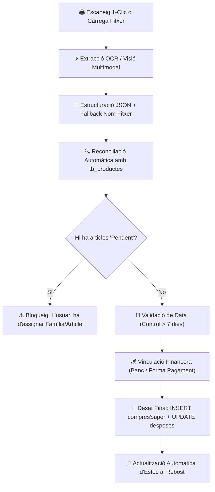

# Documentació del Projecte: Dashboard Despeses i Gestió de la Llar - XiquiHouse
> **Versió Generalitzada i Modular**  
> *Data d'actualització: 25 d'octubre de 2026*  
> *Fitxer mestre de referència per a desenvolupament, noves sessions d'IA i desplegament del sistema.*

---

## Taula de Continguts
1. [Instruccions per a IA i Directrius Crítiques (Prioritat 1)](#1-instruccions-per-a-ia-i-directrius-crítiques-prioritat-1)
2. [Arquitectura del Sistema, Sincronització i Rendiment (Prioritat 1)](#2-arquitectura-del-sistema-sincronització-i-rendiment-prioritat-1)
3. [Estructura del Projecte i Mapa de Fitxers](#3-estructura-del-projecte-i-mapa-de-fitxers)
4. [Mòduls de Prioritat 2: Gestió Econòmica i Compres](#4-mòduls-de-prioritat-2-gestió-econòmica-i-compres)
   - [4.1 Compres Super i Stock (`modules/compres.py`)](#41-compres-super-i-stock-modulescomprespy)
   - [4.2 Mòdul Econòmic i Dashboard (`modules/economic.py`, `modules/dashboard.py`)](#42-mòdul-econòmic-i-dashboard-moduleseconomicpy-modulesdashboardpy)
5. [Mòduls de Prioritat 3: Subministraments i Manteniment de la Llar](#5-mòduls-de-prioritat-3-subministraments-i-manteniment-de-la-llar)
   - [5.1 Llum i Aigua (`modules/llum_aigua.py`)](#51-llum-i-aigua-modulesllum_aiguapy)
   - [5.2 Manteniment de la Llar (`modules/manteniment.py`)](#52-manteniment-de-la-llar-modulesmantenimentpy)
   - [5.3 Cotxe i Mobilitat (`modules/cotxe.py`)](#53-cotxe-i-mobilitat-modulescotxepy)
6. [Mòduls de Prioritat 4: Família, Nutrició i Benestar](#6-mòduls-de-prioritat-4-família-nutrició-i-benestar)
   - [6.1 Menús i Cuina (`modules/menjar.py`)](#61-menús-i-cuina-modulesmenjarpy)
   - [6.2 Agenda i Calendari Familiar (`modules/calendari.py`)](#62-agenda-i-calendari-familiar-modulescalendaripy)
   - [6.3 Control de Medicació (`modules/medicacio.py`)](#63-control-de-medicació-modulesmedicaciopy)
   - [6.4 Seguretat i Domòtica (`modules/seguretat.py`, `modules/domotica.py`)](#64-seguretat-i-domòtica-modulesseguretatpy-modulesdomoticapy)
7. [Mòduls de Prioritat 5: Administració, Nucli i Serveis Transversals](#7-mòduls-de-prioritat-5-administració-nucli-i-serveis-transversals)
   - [7.1 Configuració Global (`modules/admin.py`, `core/config_manager.py`)](#71-configuració-global-modulesadminpy-coreconfig_managerpy)
   - [7.2 Laboratori IA - Harness (`core/harness.py`)](#72-laboratori-ia---harness-coreharnesspy)
   - [7.3 Gestió de Bases de Dades i Sincronització Offline (`modules/bases_dades.py`, `modules/sincronitzacio.py`)](#73-gestió-de-bases-de-dades-i-sincronització-offline-modulesbases_dadespy-modulessincronitzaciopy)
   - [7.4 Sistema Global d'Alertes (`core/alerts.py`)](#74-sistema-global-dalertes-corealertspy)
   - [7.5 Impressora de Tiquets (`modules/impressora.py`)](#75-impressora-de-tiquets-modulesimpressorapy)
8. [Annex: Historial de Canvis Recents Consolidat](#8-annex-historial-de-canvis-recents-consolidat)

---

## 1. Instruccions per a IA i Directrius Crítiques (Prioritat 1)

> [!IMPORTANT]
> **Instrucció d'Arrencada per a Noves Sessions d'IA**  
> Si inicies una conversa nova amb un assistent d'IA, cal indicar-li:  
> **"Llegeix `DOCUMENTACIO_GENERALITZADA.md` per entendre l'arquitectura modular, les prioritats i el funcionament de l'aplicació abans de tocar cap codi."**

### 1.1 Directriu Obligatòria de Desplegament a GitHub (`git push`)
- L'aplicació s'executa tant en entorn local com des del núvol (**Streamlit Community Cloud** sincronitzat amb el repositori GitHub del projecte).
- **REGLE INVIOLABLE**: Un cop realitzat i provat qualsevol canvi en local, l'assistent d'IA **TÉ L'OBLIGACIÓ STRICTA DE DESAR I PUJAR SEMPRE ELS CANVIS A GITHUB** (`git add`, `git commit -m "..."`, `git push origin main`).
- Mai es dóna una tasca per finalitzada sense haver sincronitzat els canvis al repositori remot, garantint que la versió web estigui sempre actualitzada.

### 1.2 Llengua de Comunicació
- La llengua vehicular del projecte i de totes les comunicacions amb l'usuari és el **Català** per defecte, però es pot triar altres idiomes.

---

## 2. Arquitectura del Sistema, Sincronització i Rendiment (Prioritat 1)

### 2.1 Model Dual Híbrid (Cloud-First + Fallback Offline)
1. **Entorn Núvol (Streamlit Cloud)**: Accés multi-dispositiu permanent per a mòbils, tauletes i ordinadors.
2. **Arrencador d'Escriptori (`StartDashboard.py`)**:
   - En sistemes d'escriptori, obre automàticament la versió del núvol al navegador predeterminat (Google Chrome) en arrencar l'equip si hi ha connexió a Internet.
   - Paral·lelament, un procés silenciós en segon pla (`scripts/update_csvs_background.py`) sincronitza les dades remotes de PostgreSQL directament amb els fitxers CSV locals, assegurant una font de veritat íntegra a disc sense límits de paginació.
3. **Emergency Offline Mode**: Si no hi ha internet (o si es desconnecta manualment la xarxa abans d'iniciar l'aplicació), s'arrenca l'entorn local Streamlit de forma instantània llegint exclusivament dels CSV locals mitjançant *Lazy Loading*. Totes les mutacions locals (altes, edicions, esborrats) es retenen en una cua local (`sync_queue.json`) i es consoliden a la base de dades remota en recuperar la connexió.

### 2.2 Estratègia d'Optimització de Rendiment (Finestra Activa de 30 Dies)
Per mantenir la màxima fluïdesa fins i tot amb taules històriques massives de milers de registres (`despeses` i `compresSuper`):
- **Finestra Activa de 30 dies**: Es consulta a Supabase mitjançant una sola petició HTTP ultra-ràpida (`~0,15 s`) per obtenir els registres del mes en curs i els tiquets pendents de desglossar.
- **Arxiu Històric (Mesos vençuts)**: Carregat en memòria cau persistent de 24 hores (`@st.cache_data(ttl=86400)`) des del CSV local (`~0,04 s`).
- **Fusió Transparent**: L'aplicació unifica els registres recents amb l'històric sense duplicats, garantint càlculs i saldos exactes.
- **Mutacions Locals amb Zero Latència**: Les operacions `insert_db_row`, `update_db_row` i `delete_db_row` actualitzen directament el DataFrame a `st.session_state` i buiden quirúrgicament la finestra recent, **sense invalidar mai la memòria cau completa** (evitant bloquejos de 15 a 20 segons).
- **Càrrega Selectiva (*Lazy Loading*) per Mòdul**: Cada mòdul només demana les taules que utilitza estrictament.
- **Interfícies Adaptades amb Navegació Dinàmica**: L'ús de selectors de navegació horitzontal o menús redueix la càrrega del DOM del navegador, renderitzant únicament el contingut de la vista activa.

### 2.3 Centralització de Configuracions a Supabase (`app_config`)
Per assegurar la persistència completa de les dades al núvol i evitar pèrdues en reiniciar les màquines virtuals de Streamlit Cloud, totes les configuracions del sistema s'emmagatzemen a Supabase:
| ID | Fitxer Equivalent Local | Descripció |
|:---|:---|:---|
| **1** | `categories_conceptes.json` | Categories i conceptes de despeses i ingressos |
| **2** | `core/config.json` | Perfil familiar, al·lèrgies, vetos, eines de cuina i admin |
| **3** | `data/events.json` | Esdeveniments del calendari familiar i estats fet/no fet |
| **4** | `data/feeds_cache.json` | Memòria cau dels feeds de calendaris personals |
| **5** | `data/medication_plans.json` | Plans i horaris de medicació familiar |
| **6** | `data/ofertes.json` | Registre d'ofertes setmanals i fulletons |
| **7** | `data/manteniment_docs.json` | Registre documental de Manuals i Garanties de la llar |
| **8** | `data/registre_manteniment.json` / `csv/manteniment.csv` | Registre de tasques, reparacions i periodicitats de la llar |
| **9** | `data/consum_llum.json` / `csv/consum_llum.csv` | Factures elèctriques, potències i consums per tram (històric) |
| **10** | `data/consum_aigua.json` / `csv/consum_aigua.csv` | Factures d'aigua, lectures de comptador i consums en m³ |

---

## 3. Estructura del Projecte i Mapa de Fitxers

```
Dashboard/
├── app.py                         # Router principal canònic, barra superior i Landing interactiva
├── app_v2.py                      # Bridge de compatibilitat transparent per a Streamlit Cloud
├── StartDashboard.py              # Llançador d'escriptori de Windows (Chrome + background sync)
├── auto_scan_ui.py                # Interfície ràpida d'escaneig de tiquets en 1 clic
├── scan_winrt.ps1                 # Pont natiu WinRT (Windows.Devices.Scanners) per a escàners USB
├── scanner.py                     # Controlador d'escaneig (WinRT prioritari + WIA fallback)
├── core/
│   ├── aigua_manager.py           # Gestor de factures i lectures d'aigua (Supabase ID 10)
│   ├── alerts.py                  # Motor centralitzat d'alertes i campaneta de notificacions
│   ├── auth.py                    # Autenticació, sessions i tokens
│   ├── calendar_manager.py        # Gestor de calendari, sincronització iCal i desduplicació
│   ├── config_manager.py          # Gestor de configuració JSON i perfil familiar
│   ├── db.py                      # Connexions CRUD a Supabase, gestió híbrida i offline
│   ├── harness.py                 # Motor de tests IA asíncron en segon pla i informes .txt
│   ├── llm.py / llm_ui.py         # Connectors d'intel·ligència artificial (Gemini, DeepSeek, etc.)
│   ├── llum_manager.py            # Preus PVPC directe, optimitzador d'acumuladors i estudi solar PVGIS
│   ├── manteniment_manager.py     # Gestor de manuals, garanties i tasques de manteniment periòdiques
│   └── ocr_rules.md               # Regles d'extracció de tiquets per supermercat
├── modules/
│   ├── admin.py                   # ⚙️ Configuració global i laboratori IA (Harness)
│   ├── bases_dades.py             # 🗄️ Gestor de taules Supabase en temps real
│   ├── calendari.py               # 📅 Agenda familiar (Graella, Dia, Fet/No fet, mòbil 1 línia)
│   ├── compres.py                 # 🛒 Compres Super (OCR, tiquets, desglossament, rebost, estalvi)
│   ├── cotxe.py                   # 🚗 Km, repostatge, consum i manteniment col·lapsable
│   ├── dashboard.py               # 📊 Dashboard general i KPIs financers
│   ├── domotica.py                # 📶 Integració amb Home Assistant
│   ├── economic.py                # 📈 Previsió despeses/ingressos, nou any, pagues extres, inversions
│   ├── impressora.py              # 🖨️ Controlador d'impressora de tiquets de compra
│   ├── llum_aigua.py              # 💡 Preus PVPC, acumuladors, factures PDF i simulador solar
│   ├── manteniment.py             # 🛠️ Tasques periòdiques, subtasques, manuals i garanties PDF
│   ├── medicacio.py               # 💊 Control de medicació, pautes i tutelats
│   ├── menjar.py                  # 🍽️ Receptari, recomanador IA, calories i mise en place
│   ├── seguretat.py               # 📹 Estat de càmeres, accessos i alarmes
│   └── sincronitzacio.py          # 🔄 Consolidació de dades offline retingudes
├── PDF/                           # Magatzem centralitzat de documents en PDF
│   ├── Factures_Aigua/	           # Dipòsit de factures d'aigua en PDF
│   ├── Factures_Llum/             # Dipòsit de factures elèctriques en PDF
│   ├── Factures_Gas/              # Dipòsit de factures de gas en PDF
│   ├── Garanties/                 # Factures i pòlisses de garantia de la llar
│   └── Manuals/                   # Manuals d'instruccions d'aparells de la llar
├── imatges/
│   ├── Disseny/                   # Logotips de la llar, fons i elements de disseny
│   ├── Eines/                     # Miniatures dels aparells i eines de cuina
│   ├── Productes/                 # Imatges d'articles de compra i rebost
│   └── Receptes/                  # Imatges gastronòmiques oficials 4:3
└── DOCUMENTACIO_GENERALITZADA.md  # Aquest document
```

---

## 4. Mòduls de Prioritat 2: Gestió Econòmica i Compres

### 4.1 Compres Super i Stock (`modules/compres.py`)
Mòdul central i neuràlgic per a la ingesta intel·ligent de tiquets de compra, control pressupostari d'alimentació, gestió d'estoc del rebost domèstic, generació dinàmica de llistes de compra, comparativa històrica de preus i seguiment d'ofertes.

#### A. Arquitectura del Mòdul i Fonts de Dades
El mòdul articula el flux complet dels queviures de la llar connectant les següents taules i fonts de configuració:
1. **Taules a Supabase (PostgreSQL)**:
   - `compresSuper`: Registre atòmic línia per línia de cada article comprat (`IdCompra`, `data`, `mes`, `any`, `super`, `familia`, `article`, `pes`, `quantitat`, `preuUnit`, `prom`, `totLinea`, `IdDespesa`, `descompte`, `rebost`).
   - `despeses`: Moviments comptables i bancaris. Els moviments de supermercat pendents de desglossar tenen `ticketPendent = True`. En finalitzar la compra, s'enllacen automàticament via `IdDespesa` i el flag s'actualitza a `False`.
   - `tb_productes`: Catàleg mestre d'articles normalitzats amb la seva família canònica (`lactics`, `fruita`, `verdura`, `carn`, etc.) i equivalències de text segons cada supermercat.
   - `tb_supers`: Llista de comerços homologats (`Dia`, `bonArea`, `Mercadona`, `Consum`, `Esclat`, `Novavenda`, `Lidl`, `Aldi`, etc.).
2. **Fitxers de Configuració Centralitzats**:
   - `categories_conceptes.json` (ID 1): Defineix les famílies permeses i el catàleg de supermercats actius.
   - `data/ofertes.json` (ID 6): Registre d'ofertes de fulletons i descomptes setmanals.
   - `core/ocr_rules.md`: Regles manuals d'extracció que s'injecten al prompt d'IA per resoldre particularitats d'estil de tiquets segons la cadena comercial.
3. **Perifèrics Integrats**:
   - **Escàner USB (WinRT / WIA)**: Captura física de tiquets a 300 DPI mitjançant `scanner.py` i `auto_scan_ui.py`.
   - **Impressora Tèrmica ESC/POS**: Impressió física directa de la llista de la compra a través de `modules/impressora.py`.

---

#### B. Cicle de Vida i Flux Pas a Pas d'un Tiquet



- **Pas 1: Ingesta del document**:
  - *Opció 1-Clic Escàner*: En prémer `🖨️ Obrir Escàner`, s'obre la finestra d'escriptori [`auto_scan_ui.py`](file:///e:/Dashboard/auto_scan_ui.py) que adquireix la imatge del vidre a 300 DPI i la desa a `tickets/ticket_<super>_<data>.jpg`. En tornar a Streamlit, el botó verd destacat `📥 Carregar últim tiquet escanejat` l'ingereix instantàniament al motor d'OCR sense obrir cap diàleg de carpetes de Windows mitjançant [`LocalFileWrapper`](file:///e:/Dashboard/modules/compres.py).
  - *Opció Càrrega Manual*: Admet imatges (`png`, `jpg`, `jpeg`, `webp`, `bmp`), documents digitals de supermercat (`pdf` amb extracció de text per `pypdf`) i tiquets de text (`txt`).
- **Pas 2: Extracció intel·ligent per IA**:
  - *Mode Híbrid*: Tesseract OCR llegeix el text i el model de llenguatge (Gemini 2.5 Flash) el parseja a JSON net.
  - *Mode Visió Pura*: Envia la imatge directament al model multimodal.
  - *Fallback intel·ligent*: Si la capçalera està borrosa, el sistema extreu el súper i la data directament del nom del fitxer (`ticket_<super>_<data>.jpg`).
- **Pas 3: Reconciliació amb el catàleg i descomptes**:
  - Cada línia s'emparella amb `tb_productes` mitjançant cerca difusa (`difflib`).
  - **Fórmula d'Enginyeria Inversa de Descomptes**: El preu final pagat ($PF$) roman invariable i el sistema dedueix la base teòrica ($B$):
    $$PF = B \times (1 - d) \implies B = \frac{PF}{1 - d}$$
- **Pas 4: Validació de data i bloqueig de seguretat**:
  - Data mai superior a avui (`> date.today()`).
  - Si té més de 7 dies, s'obre el modal interactiu `@st.dialog` de confirmació de data.
  - Els articles desconeguts (`Pendent`) bloquegen el desat per evitar embrutar el catàleg.
- **Pas 5: Desat i consolidació econòmica**:
  - Es genera la despesa a `despeses` o es desglossa el tiquet bancari existent (`ticketPendent = False`).
  - S'insereixen els articles a `compresSuper` de forma atòmica.
- **Pas 6: Sincronització amb el Rebost**:
  - Els articles marcats incrementen automàticament l'estoc al rebost domèstic.

---

#### C. Detall de les 6 Pestanyes de la Interfície Gràfica

El mòdul s'estructura en 6 vistes especialitzades mitjançant `st.tabs` amb suport per a paràmetres URL (`?tab=...`):

1. **`🛒 Compres Super` (Entrada i Desglossament)**:
   - Capçalera dividida en 2 columnes: informació del tiquet bancari pendent a l'esquerra i zona d'escàner/càrrega a la dreta.
   - Taula editable d'articles amb selectors de família, article, unitats, pes, preu i descompte.
   - Panell d'assignació financera (Banc i Forma de Pagament) i botons d'acció ràpida.
2. **`📝 Llista de la Compra`**:
   - Generació automàtica basada en els productes que han quedat per sota de l'estoc mínim al rebost.
   - Checklist interactiva per marcar articles al telèfon mòbil mentre s'és al supermercat.
   - Botó directe per imprimir la llista física a la impressora tèrmica de tiquets ESC/POS (`modules/impressora.py`).
3. **`🥫 Rebost` (Gestió d'Estoc)**:
   - Inventari complet de queviures classificat per famílies d'aliments.
   - Semàfor visual d'estoc: 🟢 Suficient, 🟡 Sota mínims, 🔴 Esgotat.
   - Control de dates de caducitat amb alertes de consum preferent i botons ràpids d'increment/decrement en 1 clic.
4. **`📊 Estadístiques` (Anàlisi i Gràfics)**:
   - KPIs de despesa mensual, estalvi aconseguit en euros i percentatge de descompte mitjà.
   - **Gràfic de Donut interactiu (Plotly)**: Comparativa visual de *Preu Net Pagat vs Promoció/Estalvi*.
   - Històric mensual de despesa per supermercat i distribució de despesa per famílies d'aliments.
5. **`🔍 Comparador de Preus`**:
   - Motor de cerca que creua els preus històrics d'un mateix producte entre diferents cadenes comercials.
   - Taula comparativa de preu unitari mitjà (€/kg o €/u) per identificar on surt més a compte comprar cada article.
6. **`📰 Fulletons`**:
   - Panell per consultar ofertes setmanals i fulletons comercials en PDF o imatge.
   - Registre d'ofertes destacades sincronitzat amb `data/ofertes.json`.

---

#### D. Navegació Dinàmica i Enllaços amb Altres Mòduls
- **Navegació per Paràmetres URL (`st.query_params`)**:
  - Permet crear enllaços directes des de notificacions o altres mòduls: `?tab=rebost`, `?tab=llista_compra`, `?tab=compres_super`.
  - Commutació de pestanyes automàtica mitjançant JavaScript injectat al document pare sense recàrregues completes.
- **Interconnexió amb el Sistema Global**:
  - **[`modules/economic.py`](file:///e:/Dashboard/modules/economic.py)**: Actualització directa dels saldos bancaris i del balanç mensual d'ingressos/despeses.
  - **[`modules/menjar.py`](file:///e:/Dashboard/modules/menjar.py)**: Els ingredients del rebost alimenten les receptes i el recomanador IA de menús setmanals.
  - **[`modules/impressora.py`](file:///e:/Dashboard/modules/impressora.py)**: Servei d'impressió en paper tèrmic per a la llista de la compra.
  - **Menú Superior `Editar`**: Accés directe a `✏️ Regles OCR` (`core/ocr_rules.md`) i `📂 Arxius JSON` (`categories_conceptes.json`) sense canviar de pàgina.

---

### 4.2 Mòdul Econòmic i Dashboard (`modules/economic.py`, `modules/dashboard.py`)

#### A. Dashboard General
- Targetes KPI dels saldos actualitzats dels comptes bancaris i caixes d'efectiu configurats al sistema.
- Gràfic comparatiu d'ingressos i despeses amb finestra temporal de 3 anys (`any-1`, `any`, `any+1`) i projeccions visuals per als mesos futurs.
- Taula de detalls del mes amb selecció interactiva de categories (`st.dataframe` amb `on_select="rerun"` i claus d'estat estables).

#### B. Previsió de Despeses i Ingressos
- Taules amb filtratge dinàmic per Any, Mes, Banc i Estat (Pagat/Pendent), amb configuració nativa de columnes (`st.column_config`).
- Modificació d'imports en bloc per a pagaments pendents futurs.

#### C. Generador de Nou Any Comptable i Pagues Extres (Modal Interactiu)
- Accessible des del menú superior: `Mòduls > Mòdul Econòmic > 📅 Afegir nou any comptable`.
- Permet revisar i editar els imports estimats de cada partida abans de generar els 12 mesos de l'any següent.
- **Pestanya Pagues Extres**: Permet programar pagues extres o ingressos extraordinaris recurrents (ex. juny i novembre) associats a les pensions o nòmines de la família, integrant-se a la xifra anual d'ingressos.

#### D. Ingrés / Despesa General i Traspassos entre Comptes
- Formulari ràpid de moviments reals (despeses, ingressos, gasolina i traspassos).
- **Traspassos entre comptes (`op_banc`)**: Incorpora el camp "Quantitat al banc de destí (€)" configurable amb càlcul visual de la diferència, per reflectir situacions on una part del traspàs es reté o es destina a una altra partida.
- Neteja del desglòs mitjançant el filtre `grup != op_banc` per no duplicar operacions tècniques a la cartera.

#### E. Inversions i Fons d'Estalvi
- Seguiment de posicions en carteres d'inversió (accions, fons indexats, etc.) amb filtres per Any, Mes i Concepte.
- Evolució dels fons d'estalvi programats amb gràfics interactius d'aportacions i rescats.

---

## 5. Mòduls de Prioritat 3: Subministraments i Manteniment de la Llar

### 5.1 Llum i Aigua (`modules/llum_aigua.py`)

#### A. Subministrament Elèctric (⚡ Consum Llum)
- **Preus PVPC / Tarifa Regulada en Directe**: *Scraper* automatitzat a proveïdors oficials amb canal de contingència (*fallback*) a l'API de Red Eléctrica de España (`apidatos.ree.es`). Mètriques de preu actual per tram tarifari (🟢 Vall, 🟡 Pla, 🔴 Punta), preu mitjà del dia, hora més barata i hora més cara.
- **Gràfic Horari de 24 Hores (Plotly)**: Visualització interactiva de la corba de preus amb barres acolorides per tram horari 2.0TD.
- **Optimitzador de Càrrega d'Acumuladors de Calor**:
  - Algoritme que calcula la millor finestra contínua de càrrega per a cada acumulador de la llar, aprofitant les potències contractades per a cada tram horari (Vall nocturn o vall solar diürn).
  - Selector d'hores necessàries independent per a cada zona, amb persistència a `data/acumuladors_config.json`.
- **Registre de Factures Elèctriques i Ingesta PDF Automàtica**:
  - Botó ràpid `📄 Nova factura llum` amb càrrega de PDF i extracció OCR/Regex automàtica de número, període, import i consum per tram (P1, P2, P3).
  - Dipòsit de factures elèctriques en PDF a `PDF/Factures_Llum/` amb consolidació de consums i imports a Supabase ID 9.
  - Visor interactiu de PDF basat en PDF.js (HTML5 Canvas).
  - Gràfic mensual de barres apilades amb els preus totals situats netament sobre les barres.

#### B. Subministrament Hídric (💧 Consum Aigua)
- Registre de factures d'aigua, lectures de comptador i consums en m³.
- Dipòsit de factures a `PDF/Factures_Aigua/` amb visor integrat PDF.js i sincronització a Supabase ID 10.
- Gràfics d'evolució de consum en m³ i cost per factura.

#### C. Simulador Estudi Solar PVGIS (☀️ Estudi Solar)
- Model de radiació solar personalitzat amb dades oficials de PVGIS segons la ubicació geogràfica de l'habitatge (aplicant les Hores de Sol Pic mensuals reals).
- Simulador interactiu amb paràmetres dinàmics:
  - Nombre de plaques solars (mòduls fotovoltaics de potència configurable).
  - Orientació de la coberta segons la teulada de l'habitatge (Est-Oest, Sud òptim, etc.).
  - Emmagatzematge en bateries de liti (0 a 15 kWh).
  - Derivació d'excedents als acumuladors tèrmics de la llar.
- Contrast en temps real contra el consum elèctric anual real extret de l'històric de factures registrades.
- **Anàlisi jurídica i econòmica de compensació d'excedents**: Contrast de la factura elèctrica amb la normativa vigent (RD 244/2019, on els excedents només compensen fins al valor del terme d'energia, sense reduir el terme de potència).
- Comparativa d'inversió "Clau en mà" vs modalitat "Mixta / DIY" i guia de seguretat per a teulada de teules (fixació sense perforació directa).

---

### 5.2 Manteniment de la Llar (`modules/manteniment.py`)

#### A. Registre de Manteniment i Tasques Periòdiques
- **Camps normalitzats**: `idManteniment`, `dataManteniment`, `feina` (feina concreta), `tipus` (`Reparació`, `Manteniment`, `Feina casa`, `Altres`), `alertaA` (multiselecció de membres o "Tothom"), `diesAvis` (antelació configurable per a l'avís a la campaneta), `acompliment` (`Sí`/`No`) i `observacions`.
- **Selector de Periodicitat**:
  - Opcions: Puntual, Diària, Setmanal, Quinzenal, Mensual, Bimestral, Trimestral, Semestral, Anual o Personalitzada.
  - Límit de generació configurable: Per nombre de vegades o `"Fins a final d'any (31/12)"`.
  - Generació en sèrie (`serie_id`) amb etiqueta descriptiva `🔁 Periodicitat (X/N)`.
  - En editar una tasca, opció per actualitzar i regenerar les properes tasques pendents de la sèrie respectant les ja realitzades.
- **Subtasques amb Cadència Pròpia (`subtasques_template`)**:
  - Permet afegir subtasques amb ritme propi dins d'una tasca periòdica *(Exemple d'ús: revisar un filtre cada 6 mesos dins d'una tasca de neteja quinzenal)*.
  - Checklist interactiu a les targetes amb recompte de progrés (`📋 Subtasques (1/2)`).
  - Sincronització automàtica: en completar la tasca principal es completen les subtasques, i en completar totes les subtasques es marca la tasca principal.
- **Generador de Tasques del Proper Any (Modal Interactiu)**:
  - Accessible des del menú superior: `Mòduls > Manteniment de la llar > 📅 Generar tasques proper any`.
  - Proposa automàticament el proper any i genera en bloc les tasques recurrents de la llar sincronitzant-les amb el calendari familiar.
- **Neteja del formulari**: Reinicialització automàtica de camps després de desar i desacoblament de la tecla `Enter` als diàlegs modals per evitar tancaments accidentals.

#### B. Gestió Documental de la Llar: Manuals i Garanties
- Subcarpetes físiques dedicades: `PDF/Manuals/` i `PDF/Garanties/`.
- Registre JSON centralitzat (`data/manteniment_docs.json`) sincronitzat a Supabase ID 7.
- **Visor interactiu basat en PDF.js (HTML5 Canvas)**: Renderització neta sense bloquejos d'iframe, amb controls de zoom, pàgines i descàrrega.
- **Seguiment semafòric de garanties**: Càlcul de dies de cobertura restants (🟢 Vigents, ⚠️ Venciment en menys de 60 dies, 🔴 Caducades).
- **Auto-detecció de fitxers**: Si s'afegeix un PDF directament a les carpetes del disc, el motor l'adhereix automàticament al registre JSON sense sobreescriure les dades existents.

---

### 5.3 Cotxe i Mobilitat (`modules/cotxe.py`)

#### A. Registre de Km, Repostatge i Consum
- `🛣️ Registre Km i Rutes`: Càlcul automàtic de quilometratge per lectura d'odòmetre amb plantilles de rutes habituals.
- `⛽ Repostatge`: Taula de proveïments de combustible amb seguiment de preus i estacions.
- `📊 Consum`: Gràfic de consum mitjà (L/100km).

#### B. Manteniment Integral Col·lapsable
Totes les seccions estan organitzades en blocs desplegables independents (`st.expander`) per mantenir la interfície compacta, amb interruptor superior *"Desplegar totes les seccions"* i badges informatius en temps real als encapçalaments:
1. **`🛢️ Canvi d'Oli`**: Km actuals, límit de canvi, km restants i barra de desgast.
2. **`🛞 Canvi de Rodes`**: Substitució de cobertes davanteres, posteriors o completes amb alertes per quilometratge.
3. **`💨 Inflat de Rodes`**: Pressió en bar, dates de revisió periòdica i vinculació a viatges llargs.
4. **`🧪 Control de Nivells`**: Secció independent per al seguiment dels líquids del vehicle (oli de motor, refrigerant, frens, eixugaparabrises) amb planificacions per km i per dies.
5. **`🛠️ Taller i Avaries`**: Entrades per manteniment, ITV, avaries o reparacions amb control d'estat (Resolt, Pendent, En taller).
6. **`📋 Històric de Manteniment i Taller`**: Taula interactiva amb filtratge per tipus, càlcul de despesa total acumulada (€) i eines d'edició.

---

## 6. Mòduls de Prioritat 4: Família, Nutrició i Benestar

### 6.1 Menús i Cuina (`modules/menjar.py`)

#### A. Base de Dades del Receptari (`tb_receptes_pro`)
- Catàleg de receptes estructurades amb ingredients, instruccions pas a pas i *mise en place*.
- **Racions de referència**: Totes les quantitats de la base de dades es defineixen per a un nombre de comensals base per defecte (configurable segons el nucli familiar).

#### B. Motor d'Escalat Dinàmic de Comensals (`scale_ingredients`)
- Algoritme Regex que processa quantitats, unitats i fraccions (`250g`, `4 ous`, `1/2 cullerada`, `1.5 kg`) aplicant el recàlcul proporcional:
  $$\text{Quantitat Recalculada} = \text{Quantitat Base} \times \frac{\text{Comensals}}{\text{Racions Base}}$$
- Els ingredients no quantificables linealment (*sal i pebre al gust*, *herbes*) es mantenen invariables.
- Selector interactiu a la fitxa de la recepta que permet simular quantitats a temps real d'1 a 30 persones.

#### C. Pautes Estètiques de Fotografia Gastronòmica
- Angle elevat a 45° en primer pla (Close-up) en proporció **4:3**. Ambientació neta amb llum natural càlida i fidelitat absoluta als ingredients reals de la recepta.

#### D. Perfils Familiars, Al·lèrgies Mèdiques vs Vetos Personals
- **Al·lèrgia mèdica**: Bloqueig estricte de la recepta per a tota la família.
- **Veto personal**: Quan un membre no consumeix un aliment determinat *(Exemple: bledes o casqueria)* però la resta de la família sí, el planificador no bloqueja el plat i assigna automàticament un **plat alternatiu ràpid comodí** *(Exemple: truita o carn a la planxa)* per a aquell membre, compartint la mateixa guarnició.

#### E. Recomanador de Menús Intel·ligent amb IA
- Generació setmanal considerant membres actius, eines disponibles a la cuina, regles de salut (carns vermelles, freqüència de peix i llegums) i no-repetició d'hidrats consecutius.
- **Control dietètic de calories**: Fixació de límit calòric separat per a dinars i sopars, prioritzant receptes saludables i balancejant macronutrients amb etiquetes nutricionals.
- **Anti-repetició estricta**: Llegeix `tb_historial_menjars` i prohibeix repetir plats consumits en els darrers X dies (configurable per l'usuari).
- **Priorització per valoració**: Afavoreix les receptes amb 4 i 5 estrelles.
- **Bústia de Peticions (`tb_peticions_menjar`)**: Permet als membres demanar plats desitjats que, un cop aprovats, s'incorporen automàticament al proper menú.

#### F. Mise en Place de Diumenge (Batch Cooking) i Connexió amb l'Stock
- Derivació automàtica de preparacions base (caldos, sofregits, verdures rostides).
- Si hi ha brous o sofregit congelats a l'estoc, es descompten de la preparació de diumenge i de la llista de la compra:
  $$\text{Compra} = \max(0, \text{Necessari} - \text{Stock})$$

---

### 6.2 Agenda i Calendari Familiar (`modules/calendari.py`, `core/calendar_manager.py`)

#### A. Vistes del Calendari
- **Vista Graella Mensual (Estil Google Calendar)**: Graella interactiva responsive amb colors per membre familiar i categoria, comptadors diaris i navegació fluida.
- **Vista Llista / Agenda**: Llistat cronològic estricte del període seleccionat.
- **Consulta i Gestió del Dia**: En fer clic a qualsevol dia de la graella, es mostren a sota tots els esdeveniments d'aquell dia amb accions completes i formulari directe per afegir noves tasques.

#### B. Control d'Acompliment (Fet / No Fet)
- Cada esdeveniment disposa de dos botons interactius:
  - **Check verd (`✅`)**: Marca com a feta la tasca (il·luminació verda maragda `#10b981`, prefix `✅ ` al títol i insígnia `FET`).
  - **Creu vermella (`❌`)**: Marca com a no feta o cancel·lada (il·luminació vermella `#ef4444`, prefix `❌ ` i text ratllat).
- Persistència a Supabase `app_config` ID 3 amb clau triple (ID esdeveniment, UID iCal i títol normalitzat).

#### C. Sincronització iCal Bidireccional i Desduplicació
- Connexió amb feeds de Google Calendar personals.
- Algoritme `deduplicate_events` per evitar duplicats per concurrència i gestió canònica d'excepcions de recurrències (`RECURRENCE-ID`).

#### D. Disseny Compacte en 1 Sola Línia Horitzontal per a Mòbils
- Regles CSS flexbox amb `:has(.cal-action-btn)` que mantenen els 5 botons d'acció (`✔️`/`✅`, `✖️`/`❌`, `✏️`, `🗑️`, `📅 GCal`) en una sola fila horitzontal, eliminant l'apilament vertical en telèfons intel·ligents.

---

### 6.3 Control de Medicació (`modules/medicacio.py`)
- Pautes mèdiques de cada membre familiar i tutelats.
- Vista de preses d'avui i supervisió d'horaris.
- Gestió de la farmaciola de la llar amb sincronització a Supabase `app_config` ID 5.

---

### 6.4 Seguretat i Domòtica (`modules/seguretat.py`, `modules/domotica.py`)
- `modules/seguretat.py`: Estat de càmeres, accessos i alarmes de la llar.
- `modules/domotica.py`: Integració amb instàncies locals de Home Assistant, llums i sensors.

---

## 7. Mòduls de Prioritat 5: Administració, Nucli i Serveis Transversals

### 7.1 Configuració Global (`modules/admin.py`, `core/config_manager.py`)
- `👤 Administrador`: Dades de contacte, avatar i PIN mestre.
- `🏷️ Títol de la casa`: Personalització de text, colors i mida de la capçalera d'inici.
- `👨‍👩‍👧‍👦 Família`: Membres de la llar amb data de naixement europea (`DD/MM/AAAA`), edat automàtica, telèfon mòbil, al·lèrgies mèdiques, vetos personals, plats comodí favorits i commutador de presència (`🟢 Present` vs `⚪ Fora`). Neteja d'estat de sessió (`f_`) en desar per forçar la lectura neta des de `core/config.json`.
- `🍳 Aparells i Eines de Cuina`: Selector visual del catàleg d'estris de cuina de la llar amb miniatures homogènies i ampliació modal interactiva.
- `🤝 Tutelats`, `🏦 Bancs`, `🎨 Aspecte i Tema`, `🔘 Icones d'inici`, `🌐 Idiomes`.

---

### 7.2 Laboratori IA - Harness (`core/harness.py`)
- **Dataset mestre**: Bateria de casos de prova exhaustius a `data/harness_menu_cases.json` per avaluar l'adherència del model d'IA a les regles de la llar.
- **Execució Asíncrona en Segon Pla**: Llançament de proves sense bloquejar la interfície d'usuari, monitorant el progrés a `data/harness_status.json`.
- **Avaluadors deterministes**: Tolerància 0 a al·lèrgens (amb filtre previ de termes segurs com `sense lactosa` o `apte per a celíacs` per evitar falsos positius), verificació de plats alternatius per vetos, control d'hidrats consecutius i compliment d'aparells disponibles.
- **Exportació d'informes en format Text (.txt)**.
- **Models recomanats**: `gemini-2.5-flash`, `gemini-3.8-flash`.

---

### 7.3 Gestió de Bases de Dades i Sincronització Offline (`modules/bases_dades.py`, `modules/sincronitzacio.py`)
- **Gestor de Bases de Dades (`modules/bases_dades.py`)**: Accessible des del menú superior, permet visualitzar i editar en temps real (inserir, modificar i esborrar) totes les taules de Supabase mitjançant `st.data_editor`, amb ordenació cronològica real per data i clau primària.
- **Consolidar Dades Offline (`modules/sincronitzacio.py`)**: Visualitza i sincronitza en bloc a Supabase les mutacions retingudes a la cua `sync_queue.json` durant caigudes d'internet.

---

### 7.4 Sistema Global d'Alertes (`core/alerts.py`)
- **Campaneta de Notificacions Global (`🔔`)**: Ubicada permanentment a la barra superior desplegable i a la pantalla d'inici amb recompte en temps real.
- **Alertes monitorades**:
  - Tiquets de compra pendents de desglossar (`ticketPendent = True`).
  - Tasques de manteniment de la llar pendents o vençudes amb `diesAvis` configurables i assignació a membres.
  - Canvis d'oli, revisió de rodes, nivells de líquids i ITV del vehicle.
  - Venciment de garanties de productes de la llar (avís previ a 60 dies).
  - Avisos familiars i administratius.
- **Optimització**: Memòria cau temporal de 60 segons a `app.py` i reutilització directa dels DataFrames actius de la sessió.

---

### 7.5 Impressora de Tiquets (`modules/impressora.py`)
- Suport per a impressores de tiquets de compra (rotlles de 76mm o 80mm).
- Suport dual d'impressió:
  - **RAW ESC/POS en local**: Impressió directa amb comandament de tall automàtic de paper (`\x1dV\x00`) i salts de línia de marge de seguretat entre el capçal i la guillotina.
  - **Impressió web neta**: Compatible amb Streamlit Cloud mitjançant `window.print()` estilitzat.
- Integració directa al desplegable de cada supermercat a la Llista de la Compra.

---

## 8. Annex: Historial de Canvis Recents Consolidat

| Data | Mòdul Afectat | Descripció del Canvi Consolidat |
|:---|:---|:---|
| **27/10/2026** | **Cotxe / Km i Rutes** | **Control Estricte d'Odòmetre**: Bloqueig i validació perquè els kilòmetres entrats a una nova ruta mai puguin ser iguals o inferiors a l'última lectura registrada de l'odòmetre (`contador_val > last_km`), amb avís dinàmic en vermell, indicador de trajecte invàlid i protecció tant a l'entrada manual com a l'escaneig per foto OCR. |
| **26/10/2026** | **Llum i Aigua / Preus** | **Registre Persistent de Preus Horaris PVPC i Auditoria Factura**: Creat el registre diari `data/preus_llum_diaris.json` (accessible des del menú superior *Editar > 📂 Arxius JSON* sense afegir noves pestanyes), gravació automàtica continuada de les 24h de cada dia, funció de contrast de consums i auditoria completa de la factura 10-2026 (66,59 €, 449,572 kWh amb 25h de preus negatius). |
| **28/10/2026** | **Compres / Escàner** | **Integració 1-Clic d'Escaneig a Compres**: Afegits botons `🖨️ Obrir Escàner` i `📥 Carregar últim tiquet` a `modules/compres.py`, encapsulament `LocalFileWrapper` i fallback automàtic de supermercat i data des del nom de fitxer (`tickets/ticket_<super>_<date>.jpg`). |
| **28/10/2026** | **Cotxe / Odòmetre** | **Validació Estricta de Km**: Bloqueig d'entrades de quilòmetres inferiors o iguals al darrer registre a `modules/cotxe.py` amb alerta visual vermella en temps real. |
| **28/10/2026** | **Llum / PVPC** | **Registre Diari de Preus PVPC**: Implementació de registre horari persistent a `data/preus_llum_diaris.json` i funcions de contrast de consum a `core/llum_manager.py`. |
| **25/10/2026** | **Escaneig Tiquets** | **Restauració escaneig directe 1-clic**: Nou motor natiu WinRT ([`scan_winrt.ps1`](file:///e:/Dashboard/scan_winrt.ps1)), superant l'antiga fallada de bloqueig temporal WIA (`ERROR_SHARING_VIOLATION` / `0x80030070`). Eliminats botons secundaris a [`auto_scan_ui.py`](file:///e:/Dashboard/auto_scan_ui.py) deixant només `🖨️ Escanejar Tiquet`. |
| **25/10/2026** | **Cotxe / Manteniment** | **Seccions Col·lapsables**: Totes les seccions de la pestanya *Manteniment* transformades en blocs plegables independents (`st.expander`) amb badges informatius en temps real als encapçalaments i control de desplegament global. |
| **24/10/2026** | **Rendiment Core** | **Pla d'optimització de 30 dies**: Finestra activa de 30 dies a Supabase + arxiu històric en CSV amb memòria cau de 24h per a taules massives. Eliminats els buidats massius de cau, passant de bloquejos de 20s a càrregues en menys d'1s. |
| **24/10/2026** | **Compres Super** | **Model Matemàtic de Preu Final Fix ($PF = B \times (1 - d)$)**: Enginyeria inversa de promocions a la càrrega manual de línies, mantenint el Total Línia invariable i fidel al tiquet de caixa. |
| **24/10/2026** | **Llum i Aigua** | **Estudi Solar PVGIS i Acumuladors**: Integrat simulador fotovoltaic amb dades oficials de radiació solar, desdoblament d'acumuladors tèrmics amb persistència a `data/acumuladors_config.json`, i ingesta històrica de factures elèctriques en PDF. |
| **23/10/2026** | **Llum i Aigua** | **Creació del Mòdul '💡 Llum i Aigua'**: Preus PVPC horaris en directe, gestió de factures elèctriques i d'aigua amb visor natiu PDF.js i sincronització a Supabase IDs 9 i 10. |
| **22/10/2026** | **Cotxe** | **Control de Nivells**: Secció independent per a la revisió de líquids del vehicle (oli, refrigerant, frens, eixugaparabrises) amb planificacions i alertes per km i temps. |
| **22/10/2026** | **Agenda** | **Control Fet/No Fet i Mòbil 1 Línia**: Botons interactius `✅`/`❌` amb colors sòlids vibrants i regles CSS `:has(.cal-action-btn)` per mantenir les 5 accions en una sola fila horitzontal a telèfons mòbils. |
| **21/10/2026** | **Manteniment Llar** | **Tasques Periòdiques i Subtasques**: Generació en sèrie de tasques recurrents, subtasques amb cadència pròpia i generador interactiu de tasques per al proper any al menú superior. |
| **19/10/2026** | **Manteniment Llar** | **Gestió Documental (Manuals i Garanties)**: Dipòsit de documents PDF amb visor interactiu HTML5 Canvas (PDF.js) i semàfor de venciment de garanties. |
| **18/10/2026** | **Econòmic / Compres** | **Navegació Nativa per Pestanyes**: Ús del paràmetre natiu `default` a `st.tabs`, creació de botons túnel bidireccionals i quantitat editable a destí per a traspassos de comptes. |
| **17/10/2026** | **Compres Super** | **Blindatge de Dates i Suport PDF**: Sanejament de dates contra errors matricials d'OCR, bloqueig de dates futures, extracció nativa de PDFs de supermercat amb `pypdf` i nous models Gemini. |
| **16/10/2026** | **Econòmic** | **Pagues Extres i Nou Any Comptable**: Incorporació de pagues extres i selector d'anys a 3 bandes ([any-1, any, any+1]) amb projeccions visuals. |
| **16/10/2026** | **Impressora** | **Impressora de Tiquets**: Integració d'impressió RAW ESC/POS de llistes de compra amb tall de paper i vista d'impressió web. |
| **18/09/2026** | **Nucli / BBDD** | **Arquitectura Offline**: Mode desconnectat amb cua local `sync_queue.json` i mòdul de consolidació de dades. |
| **13/09/2026** | **BBDD / Interfície** | **Gestor de Bases de Dades**: Creació de `modules/bases_dades.py` i barra de navegació superior d'escriptori amb 4 menús clàssics. |
