# Documentació del Projecte: Dashboard Despeses i Gestió de la Llar - XiquiHouse
> **Versió Generalitzada i Modular**  
> *Data d'actualització: 25 d'octubre de 2026*  
> *Fitxer mestre de referència per a desenvolupament, noves sessions d'IA i desplegament del sistema.*

---

## Taula de Continguts
1. [Instruccions per a IA i Directrius Crítiques (Prioritat 1)](#1-instruccions-per-a-ia-i-directrius-crítiques-prioritat-1)
2. [Arquitectura del Sistema, Sincronització i Rendiment (Prioritat 1)](#2-arquitectura-del-sistema-sincronització-i-rendiment-prioritat-1)
3. [Estructura del Projecte i Mapa de Fitxers](#3-estructura-del-projecte-i-mapa-de-fitxers)
4. [Mòduls de Prioritat 2: Gestió Econòmica i Compres](#4-mòduls-de-prioritat-2-gestió-econòmica-i-compres)
   - [4.1 Compres Super i Stock (`modules/compres.py`)](#41-compres-super-i-stock-modulescomprespy)
   - [4.2 Mòdul Econòmic i Dashboard (`modules/economic.py`, `modules/dashboard.py`)](#42-mòdul-econòmic-i-dashboard-moduleseconomicpy-modulesdashboardpy)
5. [Mòduls de Prioritat 3: Subministraments i Manteniment de la Llar](#5-mòduls-de-prioritat-3-subministraments-i-manteniment-de-la-llar)
   - [5.1 Llum i Aigua (`modules/llum_aigua.py`)](#51-llum-i-aigua-modulesllum_aiguapy)
   - [5.2 Manteniment de la Llar (`modules/manteniment.py`)](#52-manteniment-de-la-llar-modulesmantenimentpy)
   - [5.3 Cotxe i Mobilitat (`modules/cotxe.py`)](#53-cotxe-i-mobilitat-modulescotxepy)
6. [Mòduls de Prioritat 4: Família, Nutrició i Benestar](#6-mòduls-de-prioritat-4-família-nutrició-i-benestar)
   - [6.1 Menús i Cuina (`modules/menjar.py`)](#61-menús-i-cuina-modulesmenjarpy)
   - [6.2 Agenda i Calendari Familiar (`modules/calendari.py`)](#62-agenda-i-calendari-familiar-modulescalendaripy)
   - [6.3 Control de Medicació (`modules/medicacio.py`)](#63-control-de-medicació-modulesmedicaciopy)
   - [6.4 Seguretat i Domòtica (`modules/seguretat.py`, `modules/domotica.py`)](#64-seguretat-i-domòtica-modulesseguretatpy-modulesdomoticapy)
7. [Mòduls de Prioritat 5: Administració, Nucli i Serveis Transversals](#7-mòduls-de-prioritat-5-administració-nucli-i-serveis-transversals)
   - [7.1 Configuració Global (`modules/admin.py`, `core/config_manager.py`)](#71-configuració-global-modulesadminpy-coreconfig_managerpy)
   - [7.2 Laboratori IA - Harness (`core/harness.py`)](#72-laboratori-ia---harness-coreharnesspy)
   - [7.3 Gestió de Bases de Dades i Sincronització Offline (`modules/bases_dades.py`, `modules/sincronitzacio.py`)](#73-gestió-de-bases-de-dades-i-sincronització-offline-modulesbases_dadespy-modulessincronitzaciopy)
   - [7.4 Sistema Global d'Alertes (`core/alerts.py`)](#74-sistema-global-dalertes-corealertspy)
   - [7.5 Impressora de Tiquets (`modules/impressora.py`)](#75-impressora-de-tiquets-modulesimpressorapy)
8. [Annex: Historial de Canvis Recents Consolidat](#8-annex-historial-de-canvis-recents-consolidat)

---

## 1. Instruccions per a IA i Directrius Crítiques (Prioritat 1)

> [!IMPORTANT]
> **Instrucció d'Arrencada per a Noves Sessions d'IA**  
> Si inicies una conversa nova amb un assistent d'IA, cal indicar-li:  
> **"Llegeix `DOCUMENTACIO_GENERALITZADA.md` per entendre l'arquitectura modular, les prioritats i el funcionament de l'aplicació abans de tocar cap codi."**

### 1.1 Directriu Obligatòria de Desplegament a GitHub (`git push`)
- L'aplicació s'executa tant en entorn local com des del núvol (**Streamlit Community Cloud** sincronitzat amb el repositori GitHub del projecte).
- **REGLE INVIOLABLE**: Un cop realitzat i provat qualsevol canvi en local, l'assistent d'IA **TÉ L'OBLIGACIÓ STRICTA DE DESAR I PUJAR SEMPRE ELS CANVIS A GITHUB** (`git add`, `git commit -m "..."`, `git push origin main`).
- Mai es dóna una tasca per finalitzada sense haver sincronitzat els canvis al repositori remot, garantint que la versió web estigui sempre actualitzada.

### 1.2 Llengua de Comunicació
- La llengua vehicular del projecte i de totes les comunicacions amb l'usuari és el **Català** per defecte, però es pot triar altres idiomes.

---

## 2. Arquitectura del Sistema, Sincronització i Rendiment (Prioritat 1)

### 2.1 Model Dual Híbrid (Cloud-First + Fallback Offline)
1. **Entorn Núvol (Streamlit Cloud)**: Accés multi-dispositiu permanent per a mòbils, tauletes i ordinadors.
2. **Arrencador d'Escriptori (`StartDashboard.py`)**:
   - En sistemes d'escriptori, obre automàticament la versió del núvol al navegador predeterminat (Google Chrome) en arrencar l'equip si hi ha connexió a Internet.
   - Paral·lelament, un procés silenciós en segon pla (`scripts/update_csvs_background.py`) sincronitza les dades remotes de PostgreSQL directament amb els fitxers CSV locals, assegurant una font de veritat íntegra a disc sense límits de paginació.
3. **Emergency Offline Mode**: Si no hi ha internet (o si es desconnecta manualment la xarxa abans d'iniciar l'aplicació), s'arrenca l'entorn local Streamlit de forma instantània llegint exclusivament dels CSV locals mitjançant *Lazy Loading*. Totes les mutacions locals (altes, edicions, esborrats) es retenen en una cua local (`sync_queue.json`) i es consoliden a la base de dades remota en recuperar la connexió.

### 2.2 Estratègia d'Optimització de Rendiment (Finestra Activa de 30 Dies)
Per mantenir la màxima fluïdesa fins i tot amb taules històriques massives de milers de registres (`despeses` i `compresSuper`):
- **Finestra Activa de 30 dies**: Es consulta a Supabase mitjançant una sola petició HTTP ultra-ràpida (`~0,15 s`) per obtenir els registres del mes en curs i els tiquets pendents de desglossar.
- **Arxiu Històric (Mesos vençuts)**: Carregat en memòria cau persistent de 24 hores (`@st.cache_data(ttl=86400)`) des del CSV local (`~0,04 s`).
- **Fusió Transparent**: L'aplicació unifica els registres recents amb l'històric sense duplicats, garantint càlculs i saldos exactes.
- **Mutacions Locals amb Zero Latència**: Les operacions `insert_db_row`, `update_db_row` i `delete_db_row` actualitzen directament el DataFrame a `st.session_state` i buiden quirúrgicament la finestra recent, **sense invalidar mai la memòria cau completa** (evitant bloquejos de 15 a 20 segons).
- **Càrrega Selectiva (*Lazy Loading*) per Mòdul**: Cada mòdul només demana les taules que utilitza estrictament.
- **Interfícies Adaptades amb Navegació Dinàmica**: L'ús de selectors de navegació horitzontal o menús redueix la càrrega del DOM del navegador, renderitzant únicament el contingut de la vista activa.

### 2.3 Centralització de Configuracions a Supabase (`app_config`)
Per assegurar la persistència completa de les dades al núvol i evitar pèrdues en reiniciar les màquines virtuals de Streamlit Cloud, totes les configuracions del sistema s'emmagatzemen a Supabase:
| ID | Fitxer Equivalent Local | Descripció |
|:---|:---|:---|
| **1** | `categories_conceptes.json` | Categories i conceptes de despeses i ingressos |
| **2** | `core/config.json` | Perfil familiar, al·lèrgies, vetos, eines de cuina i admin |
| **3** | `data/events.json` | Esdeveniments del calendari familiar i estats fet/no fet |
| **4** | `data/feeds_cache.json` | Memòria cau dels feeds de calendaris personals |
| **5** | `data/medication_plans.json` | Plans i horaris de medicació familiar |
| **6** | `data/ofertes.json` | Registre d'ofertes setmanals i fulletons |
| **7** | `data/manteniment_docs.json` | Registre documental de Manuals i Garanties de la llar |
| **8** | `data/registre_manteniment.json` / `csv/manteniment.csv` | Registre de tasques, reparacions i periodicitats de la llar |
| **9** | `data/consum_llum.json` / `csv/consum_llum.csv` | Factures elèctriques, potències i consums per tram (històric) |
| **10** | `data/consum_aigua.json` / `csv/consum_aigua.csv` | Factures d'aigua, lectures de comptador i consums en m³ |

---

## 3. Estructura del Projecte i Mapa de Fitxers

```
Dashboard/
├── app.py                         # Router principal canònic, barra superior i Landing interactiva
├── app_v2.py                      # Bridge de compatibilitat transparent per a Streamlit Cloud
├── StartDashboard.py              # Llançador d'escriptori de Windows (Chrome + background sync)
├── auto_scan_ui.py                # Interfície ràpida d'escaneig de tiquets en 1 clic
├── scan_winrt.ps1                 # Pont natiu WinRT (Windows.Devices.Scanners) per a escàners USB
├── scanner.py                     # Controlador d'escaneig (WinRT prioritari + WIA fallback)
├── core/
│   ├── aigua_manager.py           # Gestor de factures i lectures d'aigua (Supabase ID 10)
│   ├── alerts.py                  # Motor centralitzat d'alertes i campaneta de notificacions
│   ├── auth.py                    # Autenticació, sessions i tokens
│   ├── calendar_manager.py        # Gestor de calendari, sincronització iCal i desduplicació
│   ├── config_manager.py          # Gestor de configuració JSON i perfil familiar
│   ├── db.py                      # Connexions CRUD a Supabase, gestió híbrida i offline
│   ├── harness.py                 # Motor de tests IA asíncron en segon pla i informes .txt
│   ├── llm.py / llm_ui.py         # Connectors d'intel·ligència artificial (Gemini, DeepSeek, etc.)
│   ├── llum_manager.py            # Preus PVPC directe, optimitzador d'acumuladors i estudi solar PVGIS
│   ├── manteniment_manager.py     # Gestor de manuals, garanties i tasques de manteniment periòdiques
│   └── ocr_rules.md               # Regles d'extracció de tiquets per supermercat
├── modules/
│   ├── admin.py                   # ⚙️ Configuració global i laboratori IA (Harness)
│   ├── bases_dades.py             # 🗄️ Gestor de taules Supabase en temps real
│   ├── calendari.py               # 📅 Agenda familiar (Graella, Dia, Fet/No fet, mòbil 1 línia)
│   ├── compres.py                 # 🛒 Compres Super (OCR, tiquets, desglossament, rebost, estalvi)
│   ├── cotxe.py                   # 🚗 Km, repostatge, consum i manteniment col·lapsable
│   ├── dashboard.py               # 📊 Dashboard general i KPIs financers
│   ├── domotica.py                # 📶 Integració amb Home Assistant
│   ├── economic.py                # 📈 Previsió despeses/ingressos, nou any, pagues extres, inversions
│   ├── impressora.py              # 🖨️ Controlador d'impressora de tiquets de compra
│   ├── llum_aigua.py              # 💡 Preus PVPC, acumuladors, factures PDF i simulador solar
│   ├── manteniment.py             # 🛠️ Tasques periòdiques, subtasques, manuals i garanties PDF
│   ├── medicacio.py               # 💊 Control de medicació, pautes i tutelats
│   ├── menjar.py                  # 🍽️ Receptari, recomanador IA, calories i mise en place
│   ├── seguretat.py               # 📹 Estat de càmeres, accessos i alarmes
│   └── sincronitzacio.py          # 🔄 Consolidació de dades offline retingudes
├── PDF/                           # Magatzem centralitzat de documents en PDF
│   ├── Factures_Aigua/	           # Dipòsit de factures d'aigua en PDF
│   ├── Factures_Llum/             # Dipòsit de factures elèctriques en PDF
│   ├── Factures_Gas/              # Dipòsit de factures de gas en PDF
│   ├── Garanties/                 # Factures i pòlisses de garantia de la llar
│   └── Manuals/                   # Manuals d'instruccions d'aparells de la llar
├── imatges/
│   ├── Disseny/                   # Logotips de la llar, fons i elements de disseny
│   ├── Eines/                     # Miniatures dels aparells i eines de cuina
│   ├── Productes/                 # Imatges d'articles de compra i rebost
│   └── Receptes/                  # Imatges gastronòmiques oficials 4:3
└── DOCUMENTACIO_GENERALITZADA.md  # Aquest document
```

---

## 4. Mòduls de Prioritat 2: Gestió Econòmica i Compres

### 4.1 Compres Super i Stock (`modules/compres.py`)
Mòdul central i neuràlgic per a la ingesta intel·ligent de tiquets de compra, control pressupostari d'alimentació, gestió d'estoc del rebost domèstic, generació dinàmica de llistes de compra, comparativa històrica de preus i seguiment d'ofertes.

#### A. Arquitectura del Mòdul i Fonts de Dades
El mòdul articula el flux complet dels queviures de la llar connectant les següents taules i fonts de configuració:
1. **Taules a Supabase (PostgreSQL)**:
   - `compresSuper`: Registre atòmic línia per línia de cada article comprat (`IdCompra`, `data`, `mes`, `any`, `super`, `familia`, `article`, `pes`, `quantitat`, `preuUnit`, `prom`, `totLinea`, `IdDespesa`, `descompte`, `rebost`).
   - `despeses`: Moviments comptables i bancaris. Els moviments de supermercat pendents de desglossar tenen `ticketPendent = True`. En finalitzar la compra, s'enllacen automàticament via `IdDespesa` i el flag s'actualitza a `False`.
   - `tb_productes`: Catàleg mestre d'articles normalitzats amb la seva família canònica (`lactics`, `fruita`, `verdura`, `carn`, etc.) i equivalències de text segons cada supermercat.
   - `tb_supers`: Llista de comerços homologats (`Dia`, `bonArea`, `Mercadona`, `Consum`, `Esclat`, `Novavenda`, `Lidl`, `Aldi`, etc.).
2. **Fitxers de Configuració Centralitzats**:
   - `categories_conceptes.json` (ID 1): Defineix les famílies permeses i el catàleg de supermercats actius.
   - `data/ofertes.json` (ID 6): Registre d'ofertes de fulletons i descomptes setmanals.
   - `core/ocr_rules.md`: Regles manuals d'extracció que s'injecten al prompt d'IA per resoldre particularitats d'estil de tiquets segons la cadena comercial.
3. **Perifèrics Integrats**:
   - **Escàner USB (WinRT / WIA)**: Captura física de tiquets a 300 DPI mitjançant `scanner.py` i `auto_scan_ui.py`.
   - **Impressora Tèrmica ESC/POS**: Impressió física directa de la llista de la compra a través de `modules/impressora.py`.

---

#### B. Cicle de Vida i Flux Pas a Pas d'un Tiquet

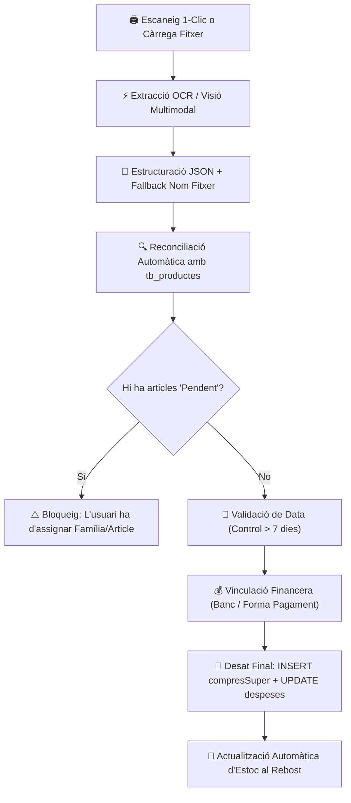

- **Pas 1: Ingesta del document**:
  - *Opció 1-Clic Escàner*: En prémer `🖨️ Obrir Escàner`, s'obre la finestra d'escriptori [`auto_scan_ui.py`](file:///e:/Dashboard/auto_scan_ui.py) que adquireix la imatge del vidre a 300 DPI i la desa a `tickets/ticket_<super>_<data>.jpg`. En tornar a Streamlit, el botó verd destacat `📥 Carregar últim tiquet escanejat` l'ingereix instantàniament al motor d'OCR sense obrir cap diàleg de carpetes de Windows mitjançant [`LocalFileWrapper`](file:///e:/Dashboard/modules/compres.py).
  - *Opció Càrrega Manual*: Admet imatges (`png`, `jpg`, `jpeg`, `webp`, `bmp`), documents digitals de supermercat (`pdf` amb extracció de text per `pypdf`) i tiquets de text (`txt`).
- **Pas 2: Extracció intel·ligent per IA**:
  - *Mode Híbrid*: Tesseract OCR llegeix el text i el model de llenguatge (Gemini 2.5 Flash) el parseja a JSON net.
  - *Mode Visió Pura*: Envia la imatge directament al model multimodal.
  - *Fallback intel·ligent*: Si la capçalera està borrosa, el sistema extreu el súper i la data directament del nom del fitxer (`ticket_<super>_<data>.jpg`).
- **Pas 3: Reconciliació amb el catàleg i descomptes**:
  - Cada línia s'emparella amb `tb_productes` mitjançant cerca difusa (`difflib`).
  - **Fórmula d'Enginyeria Inversa de Descomptes**: El preu final pagat ($PF$) roman invariable i el sistema dedueix la base teòrica ($B$):
    $$PF = B \times (1 - d) \implies B = \frac{PF}{1 - d}$$
- **Pas 4: Validació de data i bloqueig de seguretat**:
  - Data mai superior a avui (`> date.today()`).
  - Si té més de 7 dies, s'obre el modal interactiu `@st.dialog` de confirmació de data.
  - Els articles desconeguts (`Pendent`) bloquegen el desat per evitar embrutar el catàleg.
- **Pas 5: Desat i consolidació econòmica**:
  - Es genera la despesa a `despeses` o es desglossa el tiquet bancari existent (`ticketPendent = False`).
  - S'insereixen els articles a `compresSuper` de forma atòmica.
- **Pas 6: Sincronització amb el Rebost**:
  - Els articles marcats incrementen automàticament l'estoc al rebost domèstic.

---

#### C. Detall Exhaustiu de les 6 Pestanyes de la Interfície Gràfica

El mòdul s'estructura en 6 vistes especialitzades mitjançant `st.tabs` amb suport natiu per a commutació dinàmica i paràmetres URL (`?tab=...`):

---

##### 4.1.1 Pestanya 1: `🛒 Compres Super` (Entrada de Tiquets i Desglossament)
La interfície d'adquisició, estructuració per IA, auditoria i consolidació comptable.

1. **Capçalera Superior Esquerra (Reconciliació de Tiquets Bancaris Pendents)**:
   - **Informació de Tiquet Pendent**: Mostra la referència del moviment bancari carregat pel banc que encara no s'ha desglossat *(Exemple: `🛒 Desglossant: Nº 8207 — Plaça (24/10/2026) — 43.65 €`)*.
   - **Botó `🛒 Desglossar Nº X`**: Si hi ha tiquets pendents a `despeses`, cada línia compta amb aquest botó verd destacat que precarrega automàticament el súper, la data i el banc a la sessió actual.
   - **Botó `❌ Desvincular`**: Allibera el tiquet pendent actiu per permetre a l'usuari entrar una compra independent des de zero.
   - **Botó Túnel `⚡ Mòdul Econòmic`**: Redirigeix a la pestanya econòmica per revisar els detalls del moviment original.
   - **Control de Coincidència de Total (Mismatch)**: Si la suma dels articles desglossats difereix del total del càrrec bancari, apareix una alerta taronja amb la diferència en euros i un botó interactiu **`Forçar correcció del banc a X.XX €`** per ajustar el moviment financer sense errors manuals.

2. **Capçalera Superior Dreta (Escaneig i Gestió d'Imatge)**:
   - **Botó `🖨️ Obrir Escàner`**: Executa en segon pla l'aplicació nativa WinRT [`auto_scan_ui.py`](file:///e:/Dashboard/auto_scan_ui.py), obrint la interfície ràpida d'escaneig de sobretaula directament a la pantalla de l'usuari.
   - **Botó `📥 Carregar últim (tiquet)`**: Detecta automàticament el darrer fitxer generat a `tickets/` (ex. `ticket_BonPreu_281026.jpg`). Si s'ha escanejat fa menys d'una hora, es ressalta en color verd (`type="primary"`) i amb un sol clic l'ingereix a l'OCR encapsulant-lo amb [`LocalFileWrapper`](file:///e:/Dashboard/modules/compres.py) sense obrir cap diàleg de fitxers de Windows.
   - **Expander `📂 Historial de tiquets escanejats`**: Desplegable per seleccionar qualsevol dels 8 darrers tiquets escanejats amb data i hora de captura.
   - **Selector Manual `📷 Llegir ticket` (`st.file_uploader`)**: Admet fitxers en formats d'imatge (`jpg`, `png`, `webp`, `bmp`), documents `pdf` de supermercat (processats mitjançant `pypdf`) i fitxers `txt`.
   - **Badge d'Arxiu Actiu**: Mostra el nom del fitxer i la mida en KB.
   - **Botó `🔄` (Reintentar)**: Permet canviar de model d'IA i forçar una reavaluació de la mateixa imatge si la primera lectura no ha estat òptima.
   - **Botó `❌` (Descartar)**: Neteja la imatge de la memòria cau i reinicia el selector per carregar-ne un de nou.

3. **Configuració Financera i Models d'IA**:
   - **Casella `Enviar a despeses`**: Marca si el tiquet ha de crear automàticament un apunt comptable a la taula `despeses` (si no prové d'un tiquet bancari pendent).
   - **Desplegables `Banc` i `Forma de Pagament`**: Selecció del compte financer (BBVA, LaCaixa, Efectiu, etc.) i el mitjà (Targeta, Transferència, Efectiu). Bloqueja el desat si no s'ha triat banc.
   - **Selector Ràdio `Mètode d'Escaneig`**: Permet alternar entre **⚡ Híbrid (Tesseract+IA, recomanat)** (extracció de text local per OCR i estructuració per IA) o **👁️ Visió Pura (Directa)** (enviament directe de la imatge al model multimodal).
   - **Selector de Models d'Intel·ligència Artificial (`render_ai_selector`)**: Desplegable dinàmic per triar el proveïdor (Gemini, Groq, DeepSeek) i el model concret (Gemini 2.5 Flash, Gemini 3.8 Flash, etc.), adaptant-se automàticament si el model suporta visió directa o requereix Tesseract previ.

4. **Metadades del Tiquet (Data i Supermercat)**:
   - **Selector `Data` (`st.date_input`)**: Data del tiquet amb bloqueig absolut de dates futures. Si té més de 7 dies d'antiguitat, s'activa un avís informatiu.
   - **Botó `Avui`**: Assigna instantàniament la data actual al selector amb un sol clic.
   - **Desplegable `Supermercat`**: Llista de cadenes comercials homologades.
   - **Botó `Nou` / Panell d'Alta de Súper**: Obre un camp de text que permet enregistrar un nou supermercat tant a Supabase (`tb_supers`) com al fitxer de configuració local (`categories_conceptes.json`) sense sortir de la pàgina.

5. **Panell d'Entrada i Correcció Manual d'Articles**:
   - **Camps en Cascada `FAMILIA` i `ARTICLE`**: Desplegables interconnectats per seleccionar la família (ex: `lactics`, `fruita`, `carn`) i l'article normalitzat de la base de dades.
   - **Botó `✚` (Afegir Nou Article al Catàleg)**: Obre el diàleg modal `@st.dialog("➕ Afegir nou article")` per enregistrar un producte desconegut a `tb_productes` al vol, assignant-li nom canònic, família i equivalència de supermercat.
   - **Camp `PES`**: Camp per indicar el pes en grams o quilos (si és un article a granel).
   - **Camp Numèric `QUANTITAT`**: Unitats de l'article (normalitzat a 1 en productes a pes).
   - **Camp Numèric `PREU UNIT.`**: Preu per unitat en euros.
   - **Camps de Descompte (`%` i `PROMOCIÓ`)**: Permeten aplicar la fórmula d'enginyeria inversa de promocions. En modificar qualsevol dels dos valors, el sistema recalcula la base teòrica mantenint fix el preu real pagat.
   - **Camp `TOTAL LÍNIA`**: Mostra l'import líquid total de la línia calculat automàticament (deshabilitat per protegir la integritat matemàtica).
   - **Casella `Reb.`**: Casella per indicar si aquest producte ha d'incrementar les existències del rebost domèstic en finalitzar el tiquet.
   - **Botó `Intro línia`**: Afegeix l'article a la taula provisional de compra.

6. **Taula Interactiva d'Articles i Accions Finals**:
   - **Llistat de Línies**: Graella amb tots els productes extrets per la IA o afegits manualment.
   - **Botó `✏️` (Modificar línia)**: Carrega les dades de la línia seleccionada als camps superiors per editar-ne la família, article, preu o promoció.
   - **Botó `🗑️` (Eliminar línia)**: Elimina l'article del tiquet provisional.
   - **Camp `Descompte global del Tiquet (€)`**: Permet introduir descomptes globals de caixa (ex: vals de 5 € de fidelitat) que es reparteixen de forma ponderada.
   - **Botó `💾 Fi Tiquet` (`type="primary"`)**: Porta a terme la validació integral:
     - Bloqueja l'acció si hi ha articles pendents de categoritzar (`familia == 'Pendent'`).
     - Si la data supera els 7 dies, activa el modal de confirmació expressa `@st.dialog`.
     - Executa la inserció massiva a `compresSuper`, actualitza `despeses` (`ticketPendent = False`), refresca el rebost i neteja els formularis.
   - **Botó `Netejar Tiquet`**: Restableix la sessió buidant la taula temporal sense modificar la base de dades.

---

##### 4.1.2 Pestanya 2: `📝 Llista de la Compra` (Planificació i Checklist)
Eina àgil per preparar la compra des de casa i marcar els productes al mòbil o imprimir-los en paper físic.

1. **Generador Automàtic d'Estocs Mínims**:
   - Analitza el rebost en temps real: qualsevol article amb `stock < stock_minim` s'incorpora automàticament a la llista de compra proposada, calculant la quantitat exacta que cal reposar.
   - Agrupació intel·ligent per establiment comercial habitual (BonPreu, Dia, Mercadona, etc.) o sota la secció `Sense súper assignat`.

2. **Panell d'Alta de Peticions Puntuals**:
   - **Botó `➕ Afegir petició puntual`**: Desplega un formulari per afegir articles que no formen part de l'inventari regular (ex: bateries, eines, articles especials).
   - **Desplegable `Supermercat`**: Assigna a quina botiga s'ha d'anar a comprar l'article.
   - **Camp `Nom lliure (nou)`** o **`O tria del catàleg`**: Permet escriure qualsevol text lliure o cercar un producte ja existent a la base de dades.
   - **Camp `Quantitat`**: Nombre d'unitats requerides.

3. **Interfície de Checklist per a Supermercat**:
   - **Acordions per Supermercat (`st.expander`)**: Cada botiga es presenta en un acordió independent que mostra el nombre total d'articles pendents i la suma estimada de diners.
   - **Caselles de Verificació Interactives (`st.checkbox`)**: Dissenyades per utilitzar-se des del navegador del telèfon mòbil mentre s'és al passadís del súper. En marcar un producte, queda ratllat visualment.
   - **Botó `🧹 Netejar peticions lliures`**: Elimina de cop les peticions puntuals que ja s'han adquirit.
   - **Selector de Canvi de Destí**: Permet moure un article pendent d'un supermercat a un altre amb un sol clic si es decideix comprar-lo en una altra botiga.

4. **Integració amb Impressora Tèrmica ESC/POS**:
   - Botó directe per transmetre la llista completa o d'un sol supermercat a la impressora física de tiquets mitjançant [`modules/impressora.py`](file:///e:/Dashboard/modules/impressora.py), amb tall automàtic de paper per portar la llista impresa a la butxaca.

---

##### 4.1.3 Pestanya 3: `🥫 Rebost` (Gestió d'Inventari Domèstic)
Control físic dels queviures emmagatzemats a la cuina, armaris i congelador.

1. **Inventari General de Queviures**:
   - Graella completa d'articles agrupats per categories (`Conserves`, `Làctics`, `Begudes`, `Neteja`, etc.).
   - Mostra en columnes: Article, Família, Estoc Actual, Estoc Mínim de Seguretat i Data de Darrera Entrada.

2. **Semàfor Visual d'Estoc**:
   - 🟢 **Verd (Suficient)**: Quantitat per sobre de l'estoc mínim.
   - 🟡 **Groc (Sota mínims)**: Quantitat igual o per sota del llindar de seguretat (alerta groga d'atenció).
   - 🔴 **Vermell (Esgotat)**: Estoc a zero (provoca l'alta automàtica a la *Llista de la Compra*).

3. **Controls d'Ajust Ràpid en 1 Clic**:
   - **Botó `➕ Afegir 1`**: Incrementa l'estoc manualment quan es porta un article a casa sense tiquet.
   - **Botó `➖ Gastar 1`**: Descompta una unitat quan s'obre o consumeix un paquet a la cuina.
   - Sincronització immediata amb Supabase sense requerir recàrregues completes de pàgina.

4. **Control de Caducitats i Consum Preferent**:
   - Registre de dates de venciment per a productes peribles.
   - Avisos visuals i notificacions a la campaneta d'alertes superior (`🔔`) quan un producte està a punt de caducar.

5. **Vinculació de Codis de Barres (Lectura Làser)**:
   - Desplegable de productes i botó **`🔗 Enllaçar Codi i Producte`**: Permet assignar el codi EAN d'un codi de barres llegit per pistola làser a un article del catàleg per a futures lectures instantànies.

---

##### 4.1.4 Pestanya 4: `📊 Estadístiques` (Mètriques Financeres i Gràfics Interactius)
Panell analític per auditar el cost dels aliments, l'estalvi aconseguit i els patrons de consum familiar.

1. **Filtres de Segmentació Temporal**:
   - **Selector `Any`**: Filtra l'històric d'anys disponibles (ex: 2024, 2025, 2026).
   - **Selector `Mes`**: Permet avaluar tot l'any conjuntament (`Tots`) o centrar-se en un mes específic.

2. **Targetes KPI Resum**:
   - **`Total Compra Pagada`**: Despesa neta real en euros efectuada en queviures durant el període.
   - **`Total Estalvi Generat`**: Suma de tots els descomptes i promocions assolits, amb un indicador delta verd que reflecteix el percentatge d'estalvi aconseguit sobre el total teòric.
   - **`Preu Sense Ofertes`**: Import teòric brut que s'hauria abonat si els productes s'haguessin comprat sense cap rebaixa o promoció.
   - **`Nº Línies / Articles`**: Volum total d'articles físics adquirits.

3. **Gràfics Interactius de Plotly**:
   - **Gràfic de Donut (*Pagat vs Estalvi*)**: Mostra visualment la proporció entre els diners realment pagats i els diners que s'han estalviat gràcies a ofertes i vals.
   - **Gràfic de Pastís per Famílies d'Aliments**: Distribució percentual de la despesa en funció del tipus d'aliment (Carnisseria, Fruita/Verdura, Làctics, Neteja, etc.).
   - **Gràfic de Barres per Supermercat**: Rànquing visual del volum de despesa acumulat a cada comerç per conèixer a quina cadena es destina el pressupost d'alimentació.

---

##### 4.1.5 Pestanya 5: `🔍 Comparador de Preus` (Intel·ligència de Compra)
Cercador creuat per identificar diferències de preu entre cadenes i contrarestar la inflació.

1. **Filtres de Cerca de Mercat**:
   - **Selector Ràdio `👀 Filtrar productes per`**: Permet triar entre visualitzar només els articles que falten a la llista de compra actual (`🛒 A la llista de compra`) o explorar tot l'històric de la base de dades (`📦 Tot el catàleg`).
   - **Camp `🔍 Buscar producte...`**: Cerca en temps real per nom o paraula clau.

2. **Graella Comparativa de Comerços**:
   - Taula comparativa que creua els productes amb els diferents supermercats, mostrant el darrer preu registrat i el preu unitari normalitzat (€/kg o €/u).
   - Identificació visual del comerç que ofereix el millor preu per a cada producte.

3. **Històric d'Evolució Temporal per Article**:
   - **Desplegable `🔍 Selecciona un producte`**: Mostra la cronologia completa de compres d'aquell article al llarg dels mesos.
   - Taula d'evolució amb data, supermercat, preu unitari pagat i variació percentual per detectar pujades o baixades de preu entre cadenes.

4. **Panell d'Anotació d'Ofertes de Mercat**:
   - Formulari per registrar ofertes externes detectades: selectors de producte, súper, tipus de promoció (`Preu rebaixat`, `3x2`, `2a unitat %`) i preu final ofertat.

---

##### 4.1.6 Pestanya 6: `📰 Fulletons` (Catàlegs i Promocions Setmanals)
Espai dedicat a consultar i arxivar catàlegs promocionals i descomptes especials.

1. **Visualitzador de Fulletons Comercials**:
   - Galeria d'imatges i documents PDF dels fulletons en curs de les cadenes habituals (Lidl, Dia, BonPreu, etc.).
   - Consulta ràpida abans de planificar els menús de la setmana o fer la llista de la compra.

2. **Cercador de Promocions Actives**:
   - Selector de producte que creua els descomptes vigents amb el catàleg per saber si algun article habitual té promoció activa.

3. **Persistència i Sincronització Núvol**:
   - Integrat directament amb la taula `data/ofertes.json` (Config ID 6 de Supabase), garantint que les ofertes desades es mantinguin disponibles a tots els dispositius mòbils i ordinadors.

---

#### D. Navegació Dinàmica i Enllaços amb Altres Mòduls
- **Navegació per Paràmetres URL (`st.query_params`)**:
  - Permet crear enllaços directes des de notificacions o altres mòduls: `?tab=rebost`, `?tab=llista_compra`, `?tab=compres_super`.
  - Commutació de pestanyes automàtica mitjançant JavaScript injectat al document pare sense recàrregues completes.
- **Interconnexió amb el Sistema Global**:
  - **[`modules/economic.py`](file:///e:/Dashboard/modules/economic.py)**: Actualització directa dels saldos bancaris i del balanç mensual d'ingressos/despeses.
  - **[`modules/menjar.py`](file:///e:/Dashboard/modules/menjar.py)**: Els ingredients del rebost alimenten les receptes i el recomanador IA de menús setmanals.
  - **[`modules/impressora.py`](file:///e:/Dashboard/modules/impressora.py)**: Servei d'impressió en paper tèrmic per a la llista de la compra.
  - **Menú Superior `Editar`**: Accés directe a `✏️ Regles OCR` (`core/ocr_rules.md`) i `📂 Arxius JSON` (`categories_conceptes.json`) sense canviar de pàgina.

---

### 4.2 Mòdul Econòmic i Dashboard (`modules/economic.py`, `modules/dashboard.py`)
Mòdul mestre de control pressupostari, tresoreria bancària, seguiment patrimonial, projecció financera plurianual i comptabilitat familiar integral. Articula la dualitat entre la **Vista Executiva de Dashboard** ([`modules/dashboard.py`](file:///e:/Dashboard/modules/dashboard.py)) i la **Vista Operativa de Gestió Econòmica** ([`modules/economic.py`](file:///e:/Dashboard/modules/economic.py)).

#### A. Arquitectura Financera i Fonts de Dades
El mòdul opera sincronitzant les següents taules a Supabase (PostgreSQL) i fitxers de configuració:
1. **Taules Principals**:
   - `despeses`: Moviments reals de despesa (`ID_mov`, `Data`, `Banc`, `FormaPago`, `IdCategoria`, `Idconcepte`, `Import càrrec`, `ticketPendent`).
   - `ingressos`: Ingressos reals i cobraments (`ID_mov`, `Data`, `Banc`, `FormaPago`, `IdCategoria`, `Idconcepte`, `Import abonament`).
   - `pagaments`: Taula mestre de **previsió de despeses i quotes periòdiques** de tot l'any (`idPago`, `Banc`, `Formapago`, `Data`, `dia`, `mes`, `any`, `Categoria`, `Concepte`, `Import`, `pagat`, `banc_desti`, `import_desti`).
   - `inversions`: Seguiment de posicions financeres, accions i fons indexats (Trade Republic, NVIDIA, S&P 500, etc.).
   - `sync_queue.json`: Cua local de mutacions retingudes en cas de pèrdua de connectivitat.
2. **Configuració Centralitzada**:
   - `categories_conceptes.json` (Config ID 1): Arbre taxonòmic de categories de despesa/ingrés, conceptes associats, llista de comptes bancaris oficials (`BBVA`, `La Caixa`, `Trade Repub.`, `Casa`, `Tg.Moneder`, `CORTEINGLÉS`, `Pago VISA`) i formes de pagament.
3. **Mecanisme de Zero Latència**:
   - Totes les modificacions (`insert_db_row`, `update_db_row`, `delete_db_row`) alteren directament el DataFrame a `st.session_state` i buiden quirúrgicament la finestra recent, sense reiniciar la memòria cau massiva de 24 hores.

---

#### B. Cicle de Vida del Flux Financer

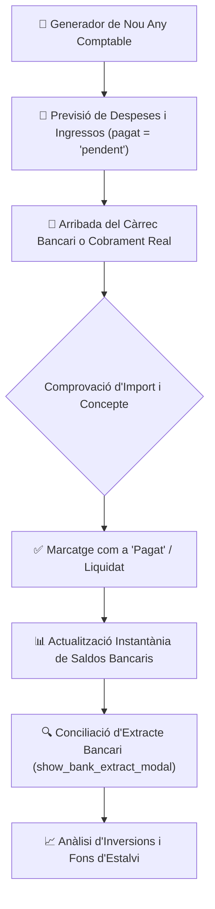

- **Pas 1: Planificació Anual**: A través del generador d'any comptable, es projecten totes les quotes fixes, subministraments, hipoteques, impostos i pagues extres dels 12 mesos com a `pendent`.
- **Pas 2: Execució Mensual**: A mesura que avança el mes, l'usuari o el banc van liquidant càrrecs. Des de la taula de previsió es pot marcar com a `Pagat` individualment o mitjançant liquidació massiva.
- **Pas 3: Conciliació i Extracte**: Fent clic a qualsevol targeta de compte bancari, s'obre l'extracte mensual per verificar que el saldo quadra amb el banc real.
- **Pas 4: Traspassos i Inversions**: Gestió de traspassos entre comptes amb control d'imports a destí i seguiment de les carteres d'inversió.

---

#### C. Detall Exhaustiu de les Vistes i Controls Interactius

##### 4.2.1 Vista Executiva: Dashboard General (`view_mode == "dashboard"`)
La pantalla d'inici i comandament financer del Dashboard ([`modules/dashboard.py`](file:///e:/Dashboard/modules/dashboard.py)).

1. **Targetes Interactives de Tresoreria i Comptes Bancaris (Top Container)**:
   - **Mètrica Principal de Saldo Global**: Mostra la suma consolidada de diners de tots els comptes actius: `💰 Saldo Comptes: X.XX €` en verd vibrant i tipografia destacada.
   - **Botons-Targeta de Comptes Bancaris**: Bloc horitzontal amb un botó estilitzat per a cada compte oficial en l'ordre estricte: `BBVA`, `La Caixa`, `TRADE REPUB.`, `Casa` (Efectiu), `Tg.Moneder`, `CORTEINGLÉS`, `Pago VISA`.
     - Tipografia condicional: Verd si el saldo és positiu (`> 0.05 €`), Vermell si és negatiu (`< -0.05 €`).
     - **Acció en 1 Clic**: En clicar sobre qualsevol targeta de banc, s'obre el modal **`show_bank_extract_modal(banc, any, mes)`**.
   - **Diàleg Modal d'Extracte Bancari (`show_bank_extract_modal`)**:
     - Mostra l'extracte complet d'aquell compte per al mes actiu: Saldo inicial a l'inici de mes, llistat cronològic de càrrecs i abonaments amb categoria i concepte, i saldo final resultant.

2. **Filtres Temporals i Límits de Despesa**:
   - **Títol Dinàmic**: `📅 Resum Mensual d'Ingressos i Despeses {Any}`.
   - **Botó Popover `🔍`**: Desplega el selector d'Any i la casella **`Veure límits despesa`** per mostrar les fites pressupostàries mensuals.

3. **Gràfica Temporal i Taula Resum de Categories**:
   - **Gràfic Comparatiu d'Ingressos vs Despeses (Plotly)**: Finestra temporal de 3 anys (`Any-1`, `Any`, `Any+1`) per comparar l'evolució del mes actual amb anys anteriors i projeccions futures.
   - **Taula Resum Ràpida (`generate_fast_summary_table_html`)**: Taula HTML optimitzada amb estils visuals i gradient cromàtic verd/vermell segons el saldo de cada categoria.
   - **Taula Interactiva de Detall del Mes (`st.dataframe` amb `on_select="rerun"`)**: Permet fer clic a qualsevol fila o categoria per filtrar automàticament els moviments individuals a la part inferior de la pantalla.

---

##### 4.2.2 Vista Operativa: Mòdul Econòmic (`view_mode == "economic"`)
La interfície de treball comptable estructurada en 6 pestanyes especialitzades ([`modules/economic.py`](file:///e:/Dashboard/modules/economic.py)):

---

##### 4.2.2.1 Pestanya 1: `📝 Ingrés / Despesa General`
Panell d'entrada de transaccions reals del dia a dia i moviments d'efectiu/bancaris que no provenen de tiquets de supermercat.

1. **Formulari Ràpid d'Apunt Contable**:
   - **Ràdio de Tipus**: `Despesa`, `Ingrés`, `Gasolina`, `Traspàs entre comptes`.
   - **Selectors en Cascada**: `Categoria` i `Concepte` amb càrrega dinàmica des de `categories_conceptes.json`.
   - **Selector de Compte i Mètode**: `Banc` (origen) i `Forma de Pagament`.
   - **Camps Numèrics**: `Import (€)` i `Data` de la transacció.
2. **Sub-formulari de Traspassos entre Comptes (`op_banc`)**:
   - En seleccionar un traspàs, apareixen els camps: `Banc d'Origen`, `Banc de Destí`, `Import a Origen` i el camp especial **`Quantitat al banc de destí (€)`**.
   - **Control de Retencions**: Permet reflectir situacions on una part del traspàs es reté en comissions o es desvia a una altra guardiola, calculant automàticament la diferència.
   - **Filtre de Neteja**: El sistema marca aquests moviments com a `op_banc` per no falsejar les estadístiques de consum familiar.
3. **Històric Recent de Moviments**:
   - Graella amb botons d'edició ràpida `✏️` i eliminació `🗑️` amb desplaçament automàtic cap a la paperera de reciclatge.

---

##### 4.2.2.2 Pestanya 2: `🔴 Prev. Despeses` (Pagaments Programats)
Gestió integral de totes les obligacions econòmiques futures i passades de l'exercici.

1. **Formulari Acordió `➕ Nova Previsió de Pagament`**:
   - Permet programar una nova despesa futura: Data/Dia, Concepte, Categoria, Import estimat, Banc assignat i periodicitat.
2. **Filtres i Cercadors de la Taula de Pagaments**:
   - Selectors de filtratge múltiple per: `Any`, `Mes`, `Banc` i `Estat` (Tots, Només Pagats, Només Pendents).
   - Cercador per text de conceptes (ex: `Ibi`, `Assegurança`, `Lloguer`).
3. **Taula Interactiva de Previsió (`st.dataframe`)**:
   - Configuració nativa de columnes (`st.column_config`): Data en format català, imports en euros alineats, i checkboxes interactives de `pagat`.
4. **Accions Massives i Confirmació d'Operacions amb Control de Dates**:
   - **Modificació d'Imports en Bloc**: Permet ajustar l'import previst de múltiples rebuts o ingressos abans de traspassar-los a la comptabilitat definitiva.
   - **Liquidació i Confirmació en Bloc (`dialog_confirmar_operacions`)**: Diàleg modal interactiu que permet revisar cada concepte, verificar el banc associat (o assignar-ne un si manca) i **modificar la data de l'apunt** mitjançant un selector de dates (`st.date_input`) en format `dd/mm/aaaa`.
   - **Control Estricte de Data del Mes**: El selector de dates està blindat visualment (`min_value` i `max_value`) i validat al servidor per garantir que la data de l'apunt estigui obligatòriament compresa entre el dia 1 i l'últim dia del mes consultat, impedint apunts erronis fora de període.

---

##### 4.2.2.3 Pestanya 3: `🟢 Prev. Ingressos` (Nòmines i Rendiments)
Seguiment de les fonts d'entrada monetària de la unitat familiar.

1. **Formulari `➕ Nova Previsió d'Ingrés`**:
   - Registre d'ingressos futurs programats: Nòmines mensuals, pensions, cobraments d'assegurances, lloguers o devolucions fiscals.
2. **Control d'Estat de Cobrament**:
   - Taula amb indicadors d'estat: `🟢 Pagat/Cobrat` vs `🟡 Pendent`.
   - Enllaç directe amb el banc receptor per comprovar la data exacta d'ingrés en compte.
3. **Mètriques Resum d'Ingressos**:
   - KPIs de total ingressat al mes, total pendent de cobrar i comparativa respecte a la previsió inicial.

---

##### 4.2.2.4 Pestanya 4: `📈 Inversions` (Patrimoni i Actius)
Control de carteres de valors, fons indexats i plataformes fintech.

1. **Integració de Posicions (Trade Republic, ETFs, Accions)**:
   - Monitorització de carteres amb detall de títols (ex: NVIDIA, S&P 500, fons monetaris).
   - Registre d'aportacions mensuals recurrents (ex: aportacions de 25 €/mes programades).
2. **Seguiment de Rendibilitat i Plusvàlues**:
   - Càlcul de capital invertit acumulat enfront del valor liquidatiu actual.
   - Gràfics d'evolució patrimonial i gràfic de barres d'aportacions netes.

---

##### 4.2.2.5 Pestanya 5: `💰 Estalvis` (Metes i Reserves)
Gestió de fons d'emergència i guardioles familiars.

1. **Compte i Caixes d'Estalvi**:
   - Separació comptable dels fons immobilitzats per a contingències (reparacions del vehicle, vacances, impostos anuals).
2. **Definició de Metes d'Estalvi**:
   - Barres de progrés interactives que mostren el percentatge assolit per a cada objectiu d'estalvi familiar.
   - Formulari per registrar aportacions o rescats de diners entre el compte corrent i la guardiola d'estalvis.

---

##### 4.2.2.6 Pestanya 6: `🤖 Xat IA` (Assistent Financer Intel·ligent)
Agent conversacional dotat de context sobre la situació econòmica real de la llar.

1. **Context Financer Connectat**:
   - L'assistent disposa de visibilitat sobre els saldos actuals dels comptes, les despeses del mes en curs i les previsions pendents.
2. **Consultes en Llenguatge Natural**:
   - Permet formular preguntes com: *"Puc afrontar una despesa extraordinària de 500 € aquest mes?"*, *"A quant puja la despesa de supermercat aquest trimestre?"* o *"Quin marge d'estalvi tenim fins a final d'any?"*.
3. **Respostes Estructurades**:
   - Proporciona recomanacions d'ajust pressupostari, càlculs de desviació i alertes de liquiditat.

---

#### D. Diàlegs Modals i Eines Globals del Mòdul

1. **`📅 Afegir Nou Any Comptable` (`show_afegir_any_comptable_dialog`)**:
   - Accessible des del menú superior: `Mòduls > Mòdul Econòmic > 📅 Afegir nou any comptable`.
   - Modal amb 3 pestanyes interactives:
     - **Pestanya 1 (Ingressos recurrents)**: Revisa imports de nòmines i pensions per projectar els 12 mesos de l'any següent.
     - **Pestanya 2 (Despeses recurrents)**: Permet editar l'estimació de quotes mensuals (lloguer, hipoteca, assegurances, llum, aigua, etc.) abans de generar-les.
     - **Pestanya 3 (Pagues Extres)**: Permet programar les pagues dobles d'estiu (juny) i Nadal (novembre/desembre), afegint-les automàticament a les previsions.
   - **Botó Generador**: Genera en bloc centenars de registres a `pagaments` amb `pagat = 'pendent'` sense bloquejar la base de dades.

2. **`🗑️ Paperera de Reciclatge` (`show_paperera_modal`)**:
   - Registre d'auditoria de moviments eliminats.
   - Permet restaurar un registre esborrat per error amb un sol clic (`Restaurar`).

3. **`📦 Modal d'Inventari` (`modal_inventari`)**:
   - Balanç patrimonial de béns materials i equipament de la llar.

---

#### E. Enllaços i Interconnexions amb Altres Mòduls
- **[`modules/compres.py`](file:///e:/Dashboard/modules/compres.py)**: Connexió bidireccional immediata. Cada desglossament de tiquet a compres tanca el pendent a `despeses` (`ticketPendent = False`), i el botó `⚡ Mòdul Econòmic` permet alternar entre ambdós mòduls sense perdre context.
- **[`modules/llum_aigua.py`](file:///e:/Dashboard/modules/llum_aigua.py)**: Les factures elèctriques i d'aigua confirmades es consoliden automàticament a les partides corresponents de despeses generals.
- **[`modules/cotxe.py`](file:///e:/Dashboard/modules/cotxe.py)**: Els repostatges de combustible i les factures de taller s'imputen com a despeses del vehicle a la categoria de mobilitat.

---

## 5. Mòduls de Prioritat 3: Subministraments i Manteniment de la Llar

### 5.1 Llum i Aigua (`modules/llum_aigua.py`)
Mòdul central per al seguiment, control analític i optimització energètica dels subministraments bàsics de la llar (electricitat i aigua potable), monitorització de tarifes regulades (PVPC), gestió d'acumuladors tèrmics de calor, ingesta digital de factures en PDF amb visor interactiu i estudi fotovoltaic d'autoconsum basat en dades satel·litàries oficials de la Unió Europea (PVGIS).

#### A. Arquitectura Energètica i Fonts de Dades
El mòdul integra de forma transparent múltiples fonts d'informació oficials, fitxers de configuració i bases de dades al núvol:
1. **Taules a Supabase (PostgreSQL)**:
   - `data/consum_llum.json` / `csv/consum_llum.csv` (Config ID 9): Registre històric complet de factures elèctriques (`idFactura`, `numFactura`, `dataInici`, `dataFi`, `diesFactura`, `importTotal`, `consumTotal`, `kWh_P1`, `kWh_P2`, `kWh_P3`, `potencia_P1`, `potencia_P2`, `pdf_filename`).
   - `data/consum_aigua.json` / `csv/consum_aigua.csv` (Config ID 10): Registre de factures d'aigua (`idFactura`, `numFactura`, `dataInici`, `dataFi`, `diesFactura`, `importTotal`, `consum_m3`, `lecturaAnterior`, `lecturaActual`, `pdf_filename`).
2. **Arxius de Registre Diari i Configuració Local**:
   - `data/preus_llum_diaris.json`: Registre continuat de les 24 hores dels preus PVPC de cada dia, permetent contrastar consums històrics hora a hora amb els preus reals de mercat. Accessible des del menú superior `Editar > 📂 Arxius JSON`.
   - `data/acumuladors_config.json`: Paràmetres tècnics dels acumuladors de calor de la llar (potències en kW i hores de càrrega necessàries per a cada estança).
   - Dipòsits de Documents PDF: `PDF/Factures_Llum/` i `PDF/Factures_Aigua/`.
3. **APIs Externes en Temps Real**:
   - **Red Eléctrica de España (REE / ESIOS - `apidatos.ree.es`)**: Connexió en viu per obtenir els preus horaris de la tarifa regulada 2.0TD (avui i demà a partir de les 20:15h).
   - **PVGIS (Comissió Europea - `re.jrc.ec.europa.eu`)**: API de radiació solar satel·litària per calcular el rendiment fotovoltaic segons les coordenades GPS exactes de l'habitatge.

---

#### B. Cicle de Vida i Flux Operatiu dels Subministraments

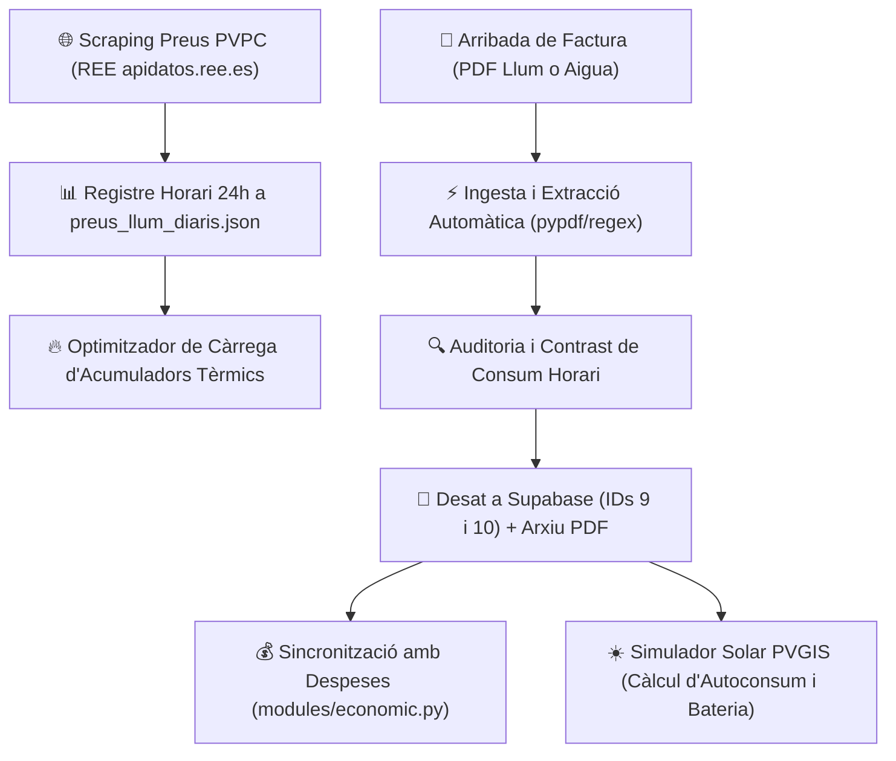

- **Pas 1: Captura i Gravació PVPC**: L'algoritme consulta la tarifa regulada d'avui i demà, identificant els trams (Vall, Pla, Punta) i gravant les 24 hores a `data/preus_llum_diaris.json`.
- **Pas 2: Optimització de Climatització**: Calcula la millor franja contínua per carregar els acumuladors de calor aprofitant les hores més econòmiques (vall nocturn o vall solar diürn).
- **Pas 3: Ingesta Digital de Factures**: En rebre una factura en PDF, l'usuari la carrega; el motor extreu automàticament imports, dates, consums per tram i potències contractades.
- **Pas 4: Auditoria de Facturació**: Es verifica si l'import facturat coincideix amb els consums per hora, desglossant termes d'energia, potència, lloguer de comptador i bonificacions (com el Bono Social).
- **Pas 5: Sincronització i Estudi Solar**: Les dades es consoliden a la comptabilitat i alimenten el simulador fotovoltaic PVGIS per calcular l'estalvi potencial amb plaques solars.

---

#### C. Detall Exhaustiu de les 3 Pestanyes de la Interfície Gràfica

El mòdul s'estructura en 3 grans àmbits mitjançant `st.tabs`:

---

##### 5.1.1 Pestanya 1: `⚡ Consum Llum` (Preus PVPC, Acumuladors i Factures Elèctriques)

Aquesta vista es divideix en 3 subpestanyes interactives superiors i un panell inferior de gestió documental de factures:

1. **Subpestanya 1.1: `📅 Preus d'Avui`**:
   - **Targetes KPI en Temps Real**:
     - `Preu Actual`: Preu en €/kWh de l'hora en curs amb etiqueta de color vibrant segons el tram (🟢 Vall, 🟡 Pla, 🔴 Punta).
     - `Preu Mitjà`: Mitjana ponderada de les 24 hores del dia.
     - `Hora Més Barata`: Franja horària amb el cost mínim (indicant si hi ha preus negatius o propers a 0 €).
     - `Hora Més Cara`: Franja horària amb el cost màxim a evitar.
   - **Gràfic Horari de 24 Hores (Plotly)**: Corba interactiva de barres verticals on cada barra correspon a una hora del dia (00h a 23h), acolorida segons la tarifa regulada 2.0TD (verd per a vall, groc per a pla, vermell per a punta). En passar el cursor, es visualitza el preu exacte en €/kWh i €/MWh.
   - **Secció d'Optimització d'Acumuladors de Calor**:
     - Llegeix les característiques tècniques de `data/acumuladors_config.json`.
     - **Selector d'Hores de Càrrega**: Permet escollir quantes hores de càrrega requereix cada acumulador segons la temperatura exterior.
     - **Càlcul de Finestra Òptima Contínua**: L'algoritme troba el període d'hores consecutives més econòmic per a la càrrega, maximitzant el rendiment tèrmic dels nuclis ceràmics sense disparar el cost elèctric.

2. **Subpestanya 1.2: `🔮 Preus de Demà`**:
   - Es publica automàticament cada dia a partir de les 20:15h (quan l'operador del mercat OMIE i REE publiquen la subhasta diària).
   - Ofereix el mateix conjunt de mètriques KPI i gràfic horari de 24 hores que la pestanya d'avui, facilitant la planificació anticipada d'electrodomèstics d'alt consum (rentadores, assecadores, rentavaixelles o recàrrega de vehicle).

3. **Subpestanya 1.3: `⚖️ Comparativa Avui vs Demà`**:
   - **Gràfic Combinat de Doble Línia (Plotly)**: Superposa la corba horària d'avui davant la de demà per comparar l'evolució del cost energètic hora a hora.
   - **KPIs de Variació**: Percentatge d'increment o descens del preu mitjà per saber si convé avançar o endarrerir consums intensius.

4. **Gestió de Factures Elèctriques (Històric i Ingesta PDF)**:
   - **Botó `📄 Nova factura llum`**: Desplega el panell de càrrega per arrossegar el document PDF emès per la comercialitzadora (Endesa, Iberdrola, Naturgy, PVPC, etc.).
   - **Extracció Automàtica Intel·ligent (`extract_data_from_pdf_bytes`)**:
     - Extreu via text digital i expressions regulars el número de factura, les dates d'inici i final, els dies facturats, l'import total en euros, els kWh consumits per tram (P1 Punta, P2 Pla, P3 Vall) i les potències contractades.
   - **Visor Natiu de Factures PDF (`view_pdf_dialog`)**: Obre un diàleg modal `@st.dialog` amb el document renderitzat sobre un llenç HTML5 (PDF.js Canvas), amb botons de canvi de pàgina, zoom i descàrrega.
   - **Format de Dates Unificat (`dd/mm/aaaa`) i Parser Resilient (`_parse_dmy_or_iso`)**:
     - Totes les dates de les factures elèctriques (`dataFactura`, `periodeInici`, `periodeFi`) s'emmagatzemen unificadament en format europeu `dd/mm/aaaa` tant al fitxer JSON persistent [`data/consum_llum.json`](file:///e:/Dashboard/data/consum_llum.json), com al fitxer [`csv/consum_llum.csv`](file:///e:/Dashboard/csv/consum_llum.csv) i al registre central de Supabase (Config ID 9).
     - La funció auxiliar `_parse_dmy_or_iso()` incorporada a [`modules/llum_aigua.py`](file:///e:/Dashboard/modules/llum_aigua.py) assegura que tant els formularis d'alta com els modals d'edició (`edit_factura_dialog`, `edit_factura_aigua_dialog`) puguin llegir i interpretar qualsevol format de data amb màxima tolerància a fallades, desant sempre la sortida normalitzada a `dd/mm/aaaa`.
   - **Taula d'Històric de Factures (`st.dataframe`)**: Mostra totes les factures registrades amb columnes configurades. Cada fila disposa de botons per:
     - `👁️`: Veure el document PDF original al visor.
     - `✏️`: Obrir el modal d'edició (`edit_factura_dialog`) per corregir qualsevol dada.
     - `🗑️`: Esborrar la factura i eliminar el fitxer físic de disc (`delete_factura_dialog`).
   - **Gràfic Mensual de Consum per Tram (Plotly Stacked Bar)**: Gràfic de barres apilades que reflecteix el consum en kWh de P1, P2 i P3 per a cada mes, coronat amb l'etiqueta flotant neta del preu total en euros sobre cada barra.

---

##### 5.1.2 Pestanya 2: `💧 Consum Aigua` (Lectures de Comptador i Factures Hídriques)

Control del subministrament d'aigua de xarxa de l'habitatge:

1. **Gestió i Ingesta de Factures d'Aigua**:
   - **Botó `📄 Nova factura aigua`**: Càrrega del PDF oficial de la companyia d'aigües (ex: Sorea, Agbar, Aigües municipals).
   - **Extracció Automàtica de Paràmetres**: Número de rebut, període de consum, import total, volum en metres cúbics ($m^3$), lectura anterior del comptador i lectura actual.
   - **Visor PDF Integrat**: Revisa visualment la factura en PDF mitjançant el visor `PDF.js`.

2. **Taula Històrica de Facturació Hídrica**:
   - Llistat cronològic de consums en $m^3$, dies de facturació, quota fixa de servei, cànon d'aigua i import total.
   - Accions d'edició ràpida (`edit_factura_aigua_dialog`) i eliminació segura (`delete_factura_aigua_dialog`).

3. **Gràfics d'Evolució Hídrica (Plotly)**:
   - **Evolució de Consum en $m^3$**: Barres mensuals de volum consumit amb línia de tendència de consum mitjà diari en litres per persona.
   - **Cost Mitjà del Metre Cúbic**: Ràtio entre import pagat i volum real ($€/m^3$) per vigilar increments de tarifes municipals o canvis de tram de consum.

---

##### 5.1.3 Pestanya 3: `☀️ Estudi Solar i Autoconsum (PVGIS)`

Eina de modelització i enginyeria financera per avaluar la instal·lació de panells solars fotovoltaics a l'habitatge:

1. **Paràmetres Dinàmics de la Instal·lació**:
   - **Selector de Potència per Panell**: Desplegable per escollir la potència dels mòduls (400W, 450W, 500W, 550W).
   - **Control de Nombre de Plaques**: Selector numèric de mòduls fotovoltaics a instal·lar.
   - **Orientació i Inclinació de Teulada**: Ajust segons la coberta real de la casa (Sud pur, Est-Oest, inclinació en graus).
   - **Capacitat d'Emmagatzematge en Bateria**: Selector de capacitat útil en kWh (de 0 a 15 kWh de bateries de liti LFP).
   - **Derivació a Acumuladors Tèrmics**: Opció per derivar automàticament els excedents solars cap a la calefacció d'acumuladors de calor abans d'abocar energia a la xarxa.

2. **Model de Radiació Solar PVGIS (Comissió Europea)**:
   - Aplica les dades oficials d'Hores de Sol Pic (HSP) mensuals basades en satèl·lits meteorològics per a les coordenades exactes de l'habitatge.
   - Contrast en temps real contra el consum elèctric real extret de l'històric de factures registrades a `consum_llum.json`.

3. **Simulació Econòmica i Normativa d'Autoconsum (RD 244/2019)**:
   - **Compensació d'Excedents Realista**: Simula fidelment la legislació vigent, on els excedents abocats només compensen fins al valor de l'energia consumida de la xarxa durant el període, sense reduir mai el terme de potència fix ni els peatges del sistema.
   - **Càlcul d'Autosuficiència Energètica (%)**: Percentatge de l'energia total de la llar que quedarà coberta directament pel sol.
   - **Comparativa Financera d'Inversió**: Balanç entre la modalitat "Clau en mà" (instal·lador comercial) i modalitat "Mixta / DIY" (adquisició directa de materials i suport d'electricista autoritzat per al butlletí CIE).

---

#### D. Navegació Dinàmica i Enllaços amb Altres Mòduls
- **Navegació per Paràmetres URL (`st.query_params`)**:
  - `?tab=llum`: Obre directament la secció elèctrica i tarifes PVPC.
  - `?tab=aigua`: Condueix a les factures d'aigua.
  - `?tab=solar`: Activa el simulador fotovoltaic PVGIS.
- **Interconnexions amb la Resta del Dashboard**:
  - **[`modules/economic.py`](file:///e:/Dashboard/modules/economic.py)**: Les factures elèctriques i d'aigua confirmades es consoliden automàticament a les línies de despesa de subministraments de la comptabilitat general.
  - **Menú Superior `Editar > 📂 Arxius JSON`**: Accés directe per consultar o editar `data/preus_llum_diaris.json` i `data/acumuladors_config.json`.
  - **Domòtica i Alertes**: Connexió futura amb sistemes domòtics (Home Assistant) per disparar relés de càrrega d'acumuladors en les hores vall calculades.

---

### 5.2 Manteniment de la Llar (`modules/manteniment.py`)
Mòdul integral de gestió operativa de la llar, planificació de tasques domèstiques recurrents i reparacions, coordinació familiar de responsabilitats, gestió documental centralitzada de manuals d'instruccions d'aparells i vigilància semafòrica de venciments de garanties i factures de compra.

#### A. Arquitectura del Mòdul i Fonts de Dades
El mòdul opera combinant registres JSON sincronitzats a Supabase, repositoris físics de documents PDF i el perfil familiar:
1. **Taules a Supabase (PostgreSQL)**:
   - `data/registre_manteniment.json` / `csv/manteniment.csv` (Config ID 8): Registre de tasques i manteniments (`idManteniment`, `dataManteniment`, `feina`, `tipus`, `alertaA`, `diesAvis`, `acompliment`, `observacions`, `serie_id`, `recurrencia`, `subtasques`, `subtasques_template`, `send_to_calendar`).
   - `data/manteniment_docs.json` (Config ID 7): Dipòsit documental de metadades de Manuals i Garanties (`id`, `categoria`, `titol`, `aparell`, `estanca`, `establiment`, `data_compra`, `data_fi_garantia`, `import`, `filename`, `num_pagines`).
2. **Dipòsit Documental Físic**:
   - `PDF/Manuals/`: Manuals d'ús d'electrodomèstics, maquinària i equips de la llar.
   - `PDF/Garanties/`: Factures de compra, tiquets de garantia i pòlisses oficials.
3. **Mòduls Interconnectats**:
   - `core/config.json` (Config ID 2): Llegeix els noms dels membres de la unitat familiar per assignar responsabilitats personals al camp `alertaA`.
   - `core/calendar_manager.py`: Sincronització bidireccional de tasques de manteniment amb l'agenda familiar (`modules/calendari.py`).
   - `core/alerts.py`: Motor d'avisos a la campaneta superior (`🔔`) segons els dies d'antelació configurats (`diesAvis`).

---

#### B. Cicle de Vida i Flux Operatiu de Manteniment

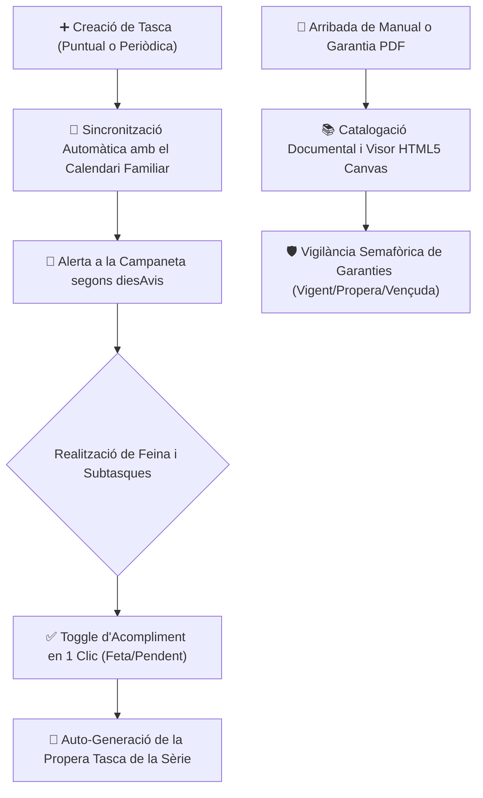

- **Pas 1: Planificació de la Feina**: Es defineix la tasca amb el seu tipus (Manteniment, Reparació, Feina de casa), assignació a un membre o a tothom, dies d'avís i periodicitat (setmanal, mensual, anual, etc.).
- **Pas 2: Sincronització i Avisos**: La tasca s'envia opcionalment al calendari familiar i, quan falten els dies establerts a `diesAvis`, apareix destacada a la campaneta d'alertes.
- **Pas 3: Execució i Subtasques**: Es revisen les subtasques associades (ex: netejar filtre d'aire, greixar engranatges). En completar-les, la tasca principal es marca com a feta amb un sol clic (`acompliment = 'Sí'`).
- **Pas 4: Gestió Documental i Garanties**: Els aparells nous es donen d'alta pujant el seu manual i factura; el sistema calcula automàticament els dies de garantia restants i alerta abans que caduqui la cobertura.

---

#### C. Detall Exhaustiu de les 3 Pestanyes de la Interfície Gràfica

El mòdul s'estructura en 3 pestanyes operatives mitjançant `st.tabs` amb suport per a paràmetres URL (`?tab=...`):

---

##### 5.2.1 Pestanya 1: `🛠️ Registre de Manteniment` (Tasques, Reparacions i Feines de Casa)

La interfície d'execució diària de manteniments de la llar:

1. **Barra d'Accions Superiors i Filtres**:
   - **Botó `➕ Nova Tasca` (`type="primary"`)**: Obre el formulari d'alta d'una nova tasca o manteniment.
   - **Filtre de Membre Familiar**: Desplegable per filtrar les tasques assignades a una persona concreta (ex: Enric, Isabel) o veure les de `Tothom`.
   - **Filtres Temporals i d'Estat**:
     - Selectors d'Any i Mes per segmentar l'històric.
     - Selector d'Estat: `Totes`, `Pendents`, `Fetes`, `Vençudes` (amb data anterior a avui i encara no complertes).

2. **Formulari d'Alta i Edició de Tasques (`edit_task_dialog`)**:
   - **Camp `Data` (`st.date_input`)**: Data prevista d'execució.
   - **Camp `Feina` (`st.text_input`)**: Descripció concisa de l'actuació (ex: *Canviar filtre d'osmosi*, *Revisió caldera gas*, *Pintar barana jardí*).
   - **Selector `Tipus`**: Desplegable amb 4 categories: `Manteniment`, `Reparació`, `Feina casa`, `Altres`.
   - **Selector Multiselecció `Alerta a`**: Permet triar un o diversos membres de la família o l'opció `Tothom`.
   - **Camp Numèric `Dies d'avís`**: Antelació en dies amb què el sistema començarà a avisar a la campaneta superior (`🔔`) abans de la data de venciment.
   - **Selector de Periodicitat**:
     - Opcions: `Puntual`, `Diària`, `Setmanal`, `Quinzenal`, `Mensual`, `Bimestral`, `Trimestral`, `Semestral`, `Anual` o `Personalitzada`.
     - Límit de generació configurable: Per nombre de repeticions o l'opció especial `"Fins a final d'any (31/12)"`.
     - Agrupació per sèrie (`serie_id`): Enllaça totes les concurrències d'una mateixa rutina amb la numeració correlativa `🔁 Periodicitat (X/N)`.
   - **Gestor de Subtasques amb Cadència Pròpia (`subtasques_template`)**:
     - Permet definir subtasques subordinades amb ritmes propis *(Exemple: tasca mare mensual amb una subtasca que només toca fer cada 3 mesos)*.
   - **Casella `Enviar al Calendari`**: Sincronitza la tasca amb l'agenda familiar (`data/events.json`).
   - **Camp `Observacions`**: Notes tècniques, números de telèfon de tècnics o instruccions addicionals.

3. **Targetes Interactives de Tasca (Graella Operativa)**:
   - Cada tasca es mostra en una targeta visual amb codi de color segons el seu estat:
     - 🔴 **Vençuda**: Fons d'alerta vermell si la data ha passat i no s'ha completat.
     - 🟡 **Pendent Pròxima**: Fons groc si s'acosta la data.
     - 🟢 **Completada**: Fons verd suau amb text ratllat.
   - **Botó Toggle d'Acompliment `✅ / ❌`**: Commuta en 1 sol clic l'estat entre feta i pendent (`toggle_manteniment_acompliment`), actualitzant immediatament el comptador d'alertes.
   - **Checklist de Subtasques**: Caselles interactives per marcar subtasques individuals amb indicador de fracció de progrés *(Exemple: `📋 Subtasques (2/3)`)*.
   - **Botó `✏️` (Editar)**: Obre el modal per ajustar dates, periodicitats o membres assignats.
   - **Botó `🗑️` (Eliminar)**: Obre el modal de confirmació per esborrar la tasca puntual o tota la sèrie pendent (`delete_task_dialog`).

4. **Generador de Tasques del Proper Any (`show_generar_any_manteniment_dialog`)**:
   - Accessible des del botó dedicat o el menú superior `Mòduls > Manteniment de la llar > 📅 Generar tasques proper any`.
   - Revisa automàticament els patrons de totes les tasques periòdiques actives i proposa la generació en bloc de tot el calendari de manteniment de l'any següent, evitant omissions i garantint continuïtat en la cura de la llar.

---

##### 5.2.2 Pestanya 2: `📚 Manuals d'Instruccions` (Dipòsit Documental de la Llar)

Arxiu centralitzat de manuals tècnics i llibrets d'instruccions d'aparells, calderes, electrodomèstics i eines de la casa:

1. **Controls d'Alta i Cerca Documental**:
   - **Botó `➕ Afegir Manual` (`type="primary"`)**: Obre el diàleg modal `add_manual_dialog`:
     - Camps: `Títol del document`, `Aparell o model`, `Estança / Ubicació` (Cuina, Safareig, Garatge, Jardí, etc.) i component de càrrega d'arxiu PDF (`st.file_uploader`).
   - **Cercador de Manuals**: Barra de cerca predictiva per localitzar manuals per paraula clau, marca o aparell (ex: *Bosch*, *Caldera Baxi*, *Aire condicionat*).
   - **Filtre per Estança**: Desplegable per visualitzar només els equips d'una habitació concreta.

2. **Targetes Interactives de Manuals**:
   - Cada manual es presenta en una targeta amb miniatura documental, nom de l'equip, estança i recompte de pàgines (`📄 X pàgines`).
   - **Botó `👁️ Veure Manual`**: Obre el visor natiu `view_pdf_dialog` (renderització Canvas HTML5 via PDF.js), que permet llegir el manual còmodament a pantalla completa sense descarregar-lo ni patir bloquejos d'iframes.
   - **Botó `✏️ Editar`**: Modifica metadades (canvi d'estança o títol).
   - **Botó `🗑️ Eliminar`**: Esborra el registre de Supabase i elimina el fitxer físic de `PDF/Manuals/` (`delete_document_dialog`).

---

##### 5.2.3 Pestanya 3: `🛡️ Garanties i Factures de Compra` (Vigilància Semafòrica de Cobertures)

Monitorització de factures de compra, pòlisses d'assegurança i tiquets de garantia per no perdre cap dret de reparació o canvi:

1. **Alta de Garanties i Factures (`add_garantia_dialog`)**:
   - **Botó `➕ Afegir Garantia` (`type="primary"`)**: Obre el modal d'enregistrament:
     - Camps: `Títol / Descripció`, `Aparell o bé cobert`, `Establiment de compra` (ex: MediaMarkt, El Corte Inglés, Amazon), `Data de compra`, `Data de fi de garantia`, `Import de compra (€)` i càrrega del fitxer PDF de la factura o tiquet.

2. **Motor de Càlcul Semafòric de Cobertura (`calculate_warranty_status`)**:
   - L'algoritme avalua en temps real els dies que manquen fins a la data de venciment:
     - 🟢 **Vigent**: Garantia activa amb més de 90 dies de cobertura restant.
     - 🟡 **Venciment Proper**: Menys de 90 dies per a la caducitat (genera un avís groc de revisió preventiva abans que expiri la protecció legal).
     - 🔴 **Vençuda / Caducada**: Cobertura extingida.

3. **Graella de Garanties i Accions**:
   - Targetes visuals amb l'import original, botiga, període de cobertura i dies restants en format destacat.
   - **Botó `👁️ Veure Factura / Garantia`**: Visualitza el tiquet o factura original d'alta resolució al visor PDF.js.
   - **Botó `✏️ Editar`**: Permet corregir dates de compra o imports.
   - **Botó `🗑️ Eliminar`**: Esborra el registre i neteja el PDF associat de `PDF/Garanties/`.

---

#### D. Navegació Dinàmica i Enllaços amb Altres Mòduls
- **Navegació per Paràmetres URL (`st.query_params`)**:
  - `?tab=registre`: Activa directament la graella de tasques de manteniment.
  - `?tab=manuals`: Condueix a la biblioteca de manuals d'instruccions.
  - `?tab=garanties`: Obre el monitor de venciments de garanties.
- **Interconnexions amb la Resta del Sistema**:
  - **[`modules/calendari.py`](file:///e:/Dashboard/modules/calendari.py)**: Les tasques marcades amb `send_to_calendar` es reflecteixen a l'agenda familiar com a esdeveniments amb icona d'eina (`🛠️`).
  - **[`core/alerts.py`](file:///e:/Dashboard/core/alerts.py)**: Les tasques que arriben al seu període d'avís (`diesAvis`) i les garanties amb venciment proper (< 90 dies) s'envien automàticament a la campaneta d'alertes de la barra superior.
  - **Menú Superior `Mòduls > Manteniment de la llar`**: Enllaços ràpids per obrir el generador d'any o consultar la documentació tècnica.

---

### 5.3 Cotxe i Mobilitat (`modules/cotxe.py`)
Mòdul especialitzat en la gestió del vehicle familiar, registre de trajectes i quilometratge per lectura d'odòmetre amb comprovació estricta anti-errors, control de proveïments de combustible i consum real, vigilància mecànica integral col·lapsable (oli, pneumàtics, pressió, líquids i taller) i mètriques analítiques de cost per quilòmetre.

#### A. Arquitectura del Mòdul i Fonts de Dades
El mòdul interactua amb les següents taules a Supabase (PostgreSQL) i fitxers de configuració:
1. **Taules Principals**:
   - `kmCotxe` / `csv/kmCotxe.csv`: Registre cronològic de lectures del comptaquilòmetres i desplaçaments (`idKm`, `data`, `contador`, `km`, `ruta`, `observacions`, `conductor`).
   - `repostatge` / `csv/repostatge.csv`: Històric de càrregues de combustible (`idRepost`, `data`, `litres`, `preu_litre`, `total_import`, `estacio`, `tipus_combustible`, `km_odometre`).
   - `manteniment_cotxe.json` (sincronitzat a Supabase): Registre de canvis d'oli, pneumàtics, inflats de rodes, nivells de líquids i entrades a taller.
2. **Configuració de Rutes Habituals**:
   - `rutes_config` (centralitzat a `categories_conceptes.json`): Catàleg de trajectes freqüents de la llar amb quilometratges predefinits (ex: Arbúcies-Girona, Arbúcies-Vic, etc.) per accelerar l'entrada de dades.
3. **Mecanisme de Validació Estricta d'Odòmetre**:
   - Blindatge en temps real que impedeix desar lectures incoherents on el quilometratge entrat sigui igual o inferior a l'últim valor registrat a la base de dades (`contador_val > last_km`).

---

#### B. Cicle de Vida i Flux Operatiu de Mobilitat

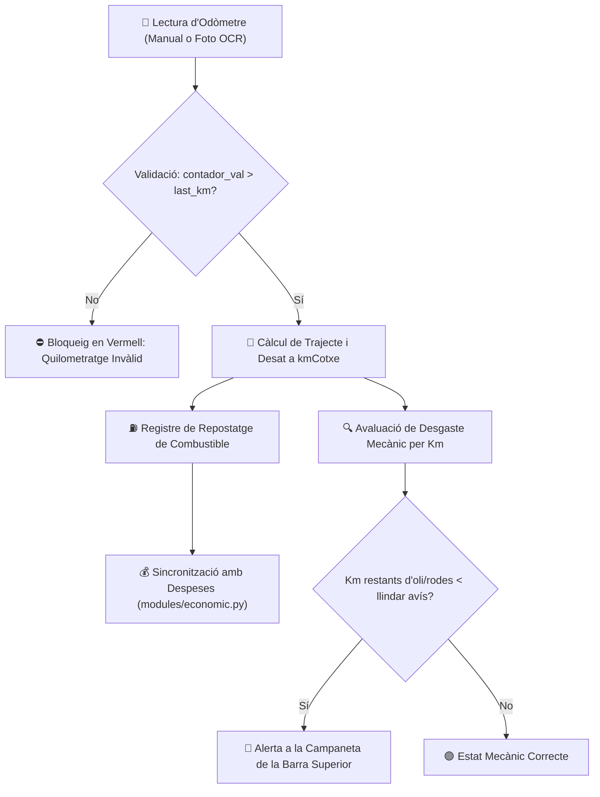

- **Pas 1: Lectura de Quilòmetres**: L'usuari introdueix el valor de l'odòmetre o puja una foto del quadre de comandaments. El sistema verifica que el valor superi l'anterior; si no, bloqueja el botó de desar.
- **Pas 2: Càlcul de Trajecte**: Es computen els quilòmetres nets recorreguts ($\Delta	ext{Km} = 	ext{contador} - 	ext{last\_km}$) i s'associa la ruta escollida.
- **Pas 3: Repostatge i Cost**: En posar benzina o dièsel, s'anoten litres i import, alimentant el càlcul de consum i generant l'apunt a despeses.
- **Pas 4: Monitorització de Desgast**: A cada increment de quilòmetres, el mòdul recalcula la vida útil restant de l'oli i les rodes, avisant quan cal demanar hora al taller.

---

#### C. Detall Exhaustiu de les 4 Pestanyes de la Interfície Gràfica

El mòdul s'estructura en 4 pestanyes operatives mitjançant `st.tabs` amb suport per a commutació dinàmica i paràmetres URL (`?tab=...`):

---

##### 5.3.1 Pestanya 1: `🛣️ Registre Km i Rutes` (Control d'Odòmetre i Desplaçaments)

La interfície d'enregistrament diari de desplaçaments del vehicle:

1. **Mètriques Resum d'Odòmetre (Top Container)**:
   - **`Darrer Odòmetre Registrat`**: Mostra la lectura acumulada oficial en quilòmetres (ex: `184.250 km`).
   - **`Data Darrera Lectura`**: Indica quan es va efectuar l'últim registre per situar temporalment l'usuari.

2. **Formulari de Nova Lectura i Rutes**:
   - **Camp `Data` (`st.date_input`)**: Data del desplaçament.
   - **Camp `Lectura de l'Odòmetre (Km totals)` (`st.number_input`)**: Valor actual del comptador del cotxe.
   - **Mecanisme de Validació Estricta d'Odòmetre**:
     - Si l'usuari escriu un valor igual o inferior a l'últim registrat (`contador_val <= last_km`):
       - Es mostra una **alerta visual vermella** immediata: `⚠️ Els kilòmetres entrats (X km) han de ser estrictament superiors a l'últim odòmetre registrat (Y km).`
       - El camp calculat del trajecte mostra un text d'error: `❌ Trajecte invàlid`.
       - El botó de desat queda completament **deshabilitat**.
     - Si el valor és vàlid (`contador_val > last_km`):
       - Es computa a l'instant el trajecte realitzat: `🚗 Trajecte calculat: +Z km`.
       - El botó verd `💾 Registrar lectura de km` s'habilita per desar a Supabase.
   - **Selector de Plantilles de Rutes Habituals**:
     - Desplegable amb trajectes freqüents preconfigurats (ex: *Arbúcies - Girona*, *Arbúcies - Vic*, *Anar a la feina*).
     - Botó `➕ Afegir nova ruta`: Permet donar d'alta rutes recurrents personalitzades a `categories_conceptes.json`.
   - **Selector de Conductor**: Permet assignar qui conduïa el vehicle (Enric, Isabel, etc.).
   - **Camp `Observacions`**: Detalls puntuals del viatge (ex: *Trànsit dens*, *Pluja*, *Ruta per autopista AP-7*).

3. **Reconeixement OCR per Foto (`📸 Llegir km amb una foto del comptaquilòmetres`)**:
   - **Expander Desplegable**: Permet pujar una fotografia feta amb el mòbil al quadre de comandaments del cotxe (`st.file_uploader`).
   - **Processament per Visió**: Tesseract OCR extreu automàticament els dígits numèrics de la pantalla digital o analògica de l'odòmetre i preomple el camp de quilòmetres sense necessitat d'escriure'l a mà.

4. **Taula Històrica de Rutes (`st.dataframe`)**:
   - Graella completa de viatges ordenats cronològicament.
   - Mostra: Data, Odòmetre, Km fets en el viatge, Ruta, Conductor i Observacions.
   - Botons d'acció per editar o eliminar registres erronis.

---

##### 5.3.2 Pestanya 2: `⛽ Repostatge` (Proveïment i Despesa de Carburant)

Gestió de combustible del vehicle:

1. **Formulari de Càrrega de Carburant**:
   - **Camp `Data`**: Data de la visita a la benzinera.
   - **Selector `Estació de Servei`**: Desplegable amb les gasolineres habituals (ex: *EsclatOil*, *Repsol*, *BonÀrea*, *Cepsa*). Botó per afegir-ne de noves.
   - **Selector `Tipus de Carburant`**: Dièsel, Gasolina 95, Gasolina 98, GLP.
   - **Camps Numèrics Connectats**:
     - `Litres subministrats` (l).
     - `Preu per litre` (€/l).
     - `Import total` (€): Es calcula automàticament com $	ext{Litres} 	imes 	ext{Preu/litre}$ amb possibilitat d'ajust manual per arrodoniments de sortidor.
     - `Quilòmetres actuals de l'odòmetre`: Lectura del comptaquilòmetres en el moment de repostar (clau per al càlcul de consums).
   - **Casella `Enviar a despeses financeres`**: Si està marcada, crea immediatament un apunt de despesa comptable a la taula `despeses` de [`modules/economic.py`](file:///e:/Dashboard/modules/economic.py) sota la categoria de mobilitat.

2. **Taula Històrica de Proveïments**:
   - Registre històric amb filtres per any i estació de servei.
   - Mètriques de resum: Total litres consumits, despesa acumulada en carburant i preu mitjà del litre pagat.

---

##### 5.3.3 Pestanya 3: `🔧 Manteniment i Nivells` (Estructura Col·lapsable d'Expanders)

Monitor mecànic integral organitzat en blocs desplegables independents (`st.expander`) per mantenir una navegació neta i compacta, amb interruptor superior *"Desplegar totes les seccions"* i **badges d'estat en temps real als encapçalaments**:

1. **Interruptor General i Configuració d'Alertes**:
   - **Casella `Desplegar totes les seccions`**: Obre o tanca de cop tots els blocs plegables.
   - **Expander `🔔 Configuració d'avisos`**: Permet definir amb quants quilòmetres d'antelació el sistema comença a avisar a la campaneta de la barra superior (per defecte: `1.000 km abans`).

2. **Expander `🛢️ Canvi d'Oli` (amb badge dinàmic de km restants)**:
   - Mostra: Km de l'últim canvi, interval recomanat pel fabricant (ex: 15.000 km / 1 any), quilòmetres que falten per al proper servei i data estimada segons el ritme d'ús del cotxe.
   - **Barra de Desgast de l'Oli**: Indicador visual percentual de degradació.
   - **Formulari `✏️ Registrar canvi d'oli`**: Permet anotar la data, quilometratge del canvi, marca/viscositat de l'oli utilitzat (ex: *5W30 Sintètic*) i si s'ha canviat també el filtre d'oli.

3. **Expander `🛞 Canvi de Rodes` (Estat dels Pneumàtics)**:
   - Control independent de les cobertes de l'eix davanter i de l'eix posterior.
   - Mostra els quilòmetres acumulats per cada joc de pneumàtics respecte a la seva vida útil estimada (ex: 40.000 km).
   - Formulari de planificació i registre de substitució (Davanteres, Darreres o les 4 rodes alhora).

4. **Expander `💨 Inflat de Rodes (Pressió)`**:
   - Monitorització de la pressió dels pneumàtics en fred en bars (ex: Davant 2.3 bar, Darrere 2.2 bar).
   - **Planificació de Revisions**: Permet programar dates fixes de comprovació o vincular-les abans de viatges llargs de vacances.
   - **Formulari `✏️ Registrar inflat de rodes fet`**: Desa la data, pressions aplicades i estat de la vàlvula.

5. **Expander `🧪 Control de Nivells` (Els 4 Líquids Bàsics)**:
   - Secció especialitzada per a la inspecció regular dels fluids del compartiment del motor:
     1. **Nivell d'Oli de Motor**: Estat entre marques Mínim i Màxim de la varilla.
     2. **Líquid Refrigerant / Anticongelant**: Nivell del vas d'expansió.
     3. **Líquid de Frens**: Estat del dipòsit de la bomba de fre.
     4. **Líquid Eixugaparabrises**: Estat de reserva i addició de sabó netejador.
   - Formulari de planificació d'inspeccions i registre de comprovació amb caselles de farciment si ha calgut afegir líquid.

6. **Expander `🛠️ Taller i Avaries` (Reparacions i ITV)**:
   - Registre d'incidències greus, manteniments extraordinaris o revisions d'ITV.
   - Camps: Data d'entrada, Taller mecànic, Descripció dels treballs, Peces substituïdes, Import de la factura i estat (`En taller`, `Pendent de recanvi`, `Resolt`).

7. **Expander `📋 Històric de Manteniment i Taller`**:
   - Taula cronològica consolidada de totes les actuacions mecàniques sobre el vehicle.
   - Mètrica KPI del cost total acumulat en manteniment mecànic al llarg de la vida útil del cotxe.

---

##### 5.3.4 Pestanya 4: `📊 Consum i Rendiment` (KPIs Analítics i Eficiència)

Panell d'intel·ligència energètica i econòmica del vehicle:

1. **Càlcul Matemàtic del Consum Mitjà ($l/100	ext{ km}$)**:
   - Aplica la fórmula real d'eficiència creuant els litres omplerts amb la distància recorreguda entre proveïments complets:
     $$	ext{Consum} = rac{	ext{Litres}}{\Delta 	ext{Km}} 	imes 100 \quad (l/100	ext{ km})$$
   - Indicador de consum mitjà històric en comparació amb el consum oficial homologat del vehicle.

2. **Càlcul del Cost Global per Quilòmetre (€/km)**:
   - Computa el cost real de moure el vehicle sumant el combustible i el desgast mecànic:
     $$	ext{Cost/km} = rac{\sum 	ext{Carburant (€)} + \sum 	ext{Manteniment i Taller (€)}}{	ext{Km Totals Recorreguts}}$$

3. **Gràfics Interactius de Plotly**:
   - **Evolució del Consum**: Línia temporal de consum mitjà mensual per detectar augments de consum derivats de filtres bruts o pneumàtics desinflats.
   - **Històric del Preu del Carburant**: Gràfic d'evolució del preu pagat per litre (€/l) al llarg dels mesos.
   - **Distribució per Estacions de Servei**: Gràfic de barres que compara quines gasolineres han ofert els preus més competitius.

---

#### D. Navegació Dinàmica i Enllaços amb Altres Mòduls
- **Navegació per Paràmetres URL (`st.query_params`)**:
  - `?tab=km`: Obre directament el registre de quilometratge i rutes.
  - `?tab=repostatge`: Condueix a la càrrega de combustible.
  - `?tab=oli`: Desplega els controls mecànics col·lapsables.
  - `?tab=consum`: Activa el panell d'eficiència i estadístiques.
- **Interconnexions amb el Sistema Global**:
  - **[`modules/economic.py`](file:///e:/Dashboard/modules/economic.py)**: Les càrregues de combustible i les factures de taller mecànic es consoliden automàticament a les despeses generals del pressupost familiar.
  - **[`core/alerts.py`](file:///e:/Dashboard/core/alerts.py)**: Notificacions preventives a la campaneta superior (`🔔`) quan manquen menys de 1.000 km per al canvi d'oli, rodes o venciment d'ITV.
  - **Menú Superior `Editar > 📂 Arxius JSON`**: Accés per consultar i modificar el llistat de rutes habituals.

---

## 6. Mòduls de Prioritat 4: Família, Nutrició i Benestar

### 6.1 Menús i Cuina (`modules/menjar.py`)
Mòdul gastronòmic i nutricional per a la planificació setmanal dels àpats de la llar (dinars i sopars), recomanador intel·ligent d'alimentació basat en IA amb perfils mèdics i personals, gestor d'estoc d'ingredients connectat amb el rebost en temps real, llibre mestre de receptes amb escalat automàtic de comensals i organització de cuina avançada (*mise en place* i *batch cooking*).

#### A. Arquitectura Gastronòmica i Fonts de Dades
El mòdul unifica taules estructurades a Supabase, perfils nutricionals familiars i el repositori de queviures:
1. **Taules a Supabase (PostgreSQL)**:
   - `tb_receptes_pro`: Catàleg mestre de receptes (`idRecepta`, `titol`, `categoria`, `dificultat`, `temps_minuts`, `comensals_base`, `ingredients_raw`, `instruccions`, `eines_necessaries`, `imatge_url`, `calories_racio`, `proteines_g`, `hidrats_g`, `greixos_g`, `valoracio_estrelles`).
   - `tb_historial_menjars`: Registre històric d'àpats consumits amb data i tipus d'àpat per alimentar les regles anti-repetició.
   - `tb_peticions_menjar`: Bústia de propostes i plats desitjats pels diferents membres de la família.
   - `menu_setmanal`: Emmagatzematge del pla setmanal actiu de dilluns a diumenge.
2. **Configuració Nutricional i Familiar (`core/config.json` - Config ID 2)**:
   - **Comensals per defecte**: Xifra de referència de la llar (per defecte: 3 comensals).
   - **Al·lèrgies Mèdiques**: Bloqueig estricte d'ingredients a nivell de salut (ex: celiaquia, fruits secs, lactosa).
   - **Vetos Personals**: Preferències d'aliments que un membre concret no consumeix (ex: bledes, casqueria, ceba crua), associant automàticament un **plat comodí ràpid** (ex: truita, carn a la planxa) per a aquell membre, compartint la mateixa guarnició familiar.
   - **Eines de Cuina Disponibles**: Catàleg d'aparells presents a la llar (Thermomix, Forn elèctric, Airfryer, Olla express, Paella, etc.).
3. **Connexió en Temps Real amb el Rebost**:
   - Revisa l'estoc d'aliments de `compresSuper` i prioritza receptes que aprofitin ingredients peribles propers a la seva data de consum preferent, reduint a zero el malbaratament domèstic.

---

#### B. Cicle de Vida i Flux Operatiu Gastronòmic

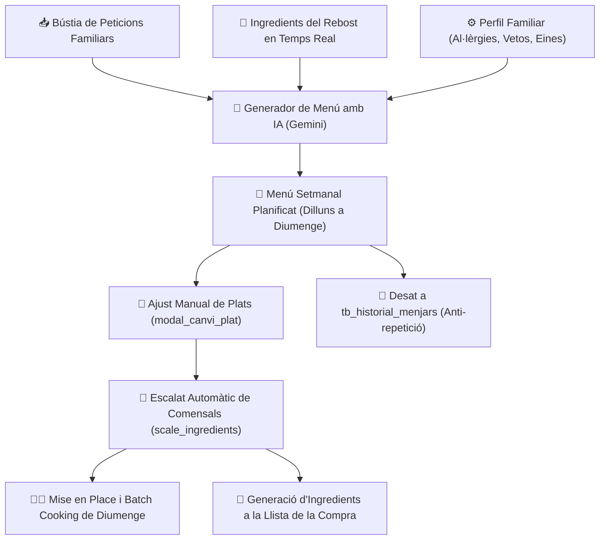

- **Pas 1: Captura de Preferències i Rebost**: La IA consulta els ingredients que cal gastar del rebost, les peticions de la família i les regles dietètiques.
- **Pas 2: Generació de la Proposta Setmanal**: Es construeix la graella de dinars i sopars balancejant carns, peixos, verdures i llegums, evitant hidrats consecutius i respectant els límits calòrics.
- **Pas 3: Personalització i Canvi de Plats**: L'usuari pot substituir qualsevol plat amb el cercador interactiu `modal_canvi_plat`.
- **Pas 4: Escalat i Preparació**: Es defineixen els comensals reals de cada àpat; el sistema recalcula les quantitats d'ingredients i deriva les tasques prèvies de cocció per al diumenge (*batch cooking*).
- **Pas 5: Llista de Compra i Historial**: Els ingredients que no són al rebost s'envien automàticament a la llista de compra de [`modules/compres.py`](file:///e:/Dashboard/modules/compres.py) i el menú es consolida a l'historial.

---

#### C. Detall Exhaustiu de les 6 Pestanyes de la Interfície Gràfica

El mòdul s'estructura en 6 pestanyes operatives mitjançant `st.tabs` amb suport per a paràmetres URL (`?tab=...`):

---

##### 6.1.1 Pestanya 1: `📅 Menú Setmanal` (Planificador Dinar i Sopar)

La interfície d'organització dels àpats de la setmana en curs:

1. **Subpestanyes per Dia (`🗓️ Dilluns` a `🗓️ Diumenge`)**:
   - Cada dia de la setmana es presenta en una pestanya independent per oferir una visió clara i espaiosa dels àpats.
2. **Targetes Interactives de Plat (Dinar i Sopar)**:
   - Cada àpat compta amb seccions per a: **1r Plat**, **2n Plat** i **Postres**.
   - Cada plat es renderitza amb la seva **fotografia oficial 4:3 en primer pla** i etiqueta de temps de cocció i dificultat.
   - **Botó `🔄 Canviar Plat`**: Obre el diàleg modal `modal_canvi_plat` que permet substituir el plat proposat mitjançant cerca difusa o explorant per categoria (Primers, Segons, etc.).
   - **Botó `📖 Veure Recepta`**: Obre la fitxa completa de preparació (`modal_recepta`).
   - **Botó `👨‍🍳 Organització`**: Obre el modal `modal_organitzacio` amb les instruccions de cuina específiques per a aquell dia (descongelar la nit abans, temps d'inici, ordre de fogons).
3. **Selector Dinàmic de Comensals**:
   - Selector numèric que permet ajustar quantes persones dinaran o soparan aquell dia en concret, recalculant automàticament les racions dels ingredients.
4. **Botó `💾 Desar Menú a l'Historial`**:
   - Enregistra els plats efectivament servits a `tb_historial_menjars` per activar el filtre anti-repetició per als propers menús.

---

##### 6.1.2 Pestanya 2: `👨‍🍳 Mise en Place & Batch Cooking` (Preparacions Prèvies)

Panell d'estratègia culinària per estalviar temps entre setmana:

1. **Agrupació de Cocció de Diumenge (*Batch Cooking*)**:
   - Revisa tots els àpats de la setmana i unifica les preparacions base que es poden cuinar de cop:
     - Sofregits de ceba i tomàquet.
     - Caldos i brous de pollastre o verdures.
     - Cocció de llegums o verdures al vapor.
     - Enfornat conjunt de tubercles o proteïnes.
2. **Descompte Automàtic d'Estoc del Rebost**:
   - Si al rebost o congelador ja hi ha caldos o sofregits desats, l'algoritme els descompta automàticament de la càrrega de treball del diumenge:
     $$	ext{Feina de diumenge} = \max(0, 	ext{Necessari per als menús} - 	ext{Estoc al Rebost})$$
3. **Eines de Cuina i Cronograma**:
   - Guia visual amb les eines necessàries (Thermomix, Forn, Airfryer, Olla express) i ordre òptim d'execució per tenir-ho tot envasat en carmanyoles en menys de 2 hores.

---

##### 6.1.3 Pestanya 3: `🤖 Generador de Menús IA` (Nutrició Intel·ligent)

Motor de recomanació nutricional basat en models multimodals avançats (Gemini):

1. **Paràmetres i Filtres de Generació**:
   - **Límit Calòric Independent**: Permet establir un màxim de calories per als dinars (ex: 700 kcal) i per als sopars (ex: 450 kcal).
   - **Selector de Membres a Taula**: Caselles per indicar quins familiars seran a casa cada dia de la setmana.
   - **Regles Dietètiques Integrades**: Màxim 1 cop per setmana carn vermella, mínim 2 cops peix, mínim 2 cops llegum i prohibició d'hidrats pesats consecutius.
   - **Filtre Anti-repetició**: Llindar en dies per impedir que es repeteixin receptes consumides recentment a l'historial.
2. **Núvol d'Etiquetes del Rebost (`render_pantry_tag_cloud`)**:
   - Mostra en etiquetes interactives els aliments que són actualment al rebost de la llar.
   - L'usuari pot fer clic sobre un ingredient (ex: *carbassa*, *llenties*, *xampinyons*) per obligar la IA a incloure'l al menú d'aquesta setmana.
3. **Botó `⚡ Generar Menú amb IA`**:
   - Executa el model de llenguatge amb el prompt estructurat i retorna la graella completa de la setmana amb opció d'aplicar-la o regenerar-la.

---

##### 6.1.4 Pestanya 4: `📖 Llibre de Receptes` (Receptari Familiar)

Enciclopèdia culinària interactiva de la llar:

1. **Expander de Cerca i Filtres Avançats**:
   - **Camp `Cercar per nom...`**: Cerca en temps real per títol o ingredient clau.
   - **Filtres Multiselecció**:
     - `Categoria`: Primer, Segon, Postre, Complement, Guarnició, Salsa.
     - `Dificultat`: Fàcil, Mitjana, Difícil.
     - `Tipus de Dia`: Entre setmana, Cap de setmana, Festiu, Especial.
     - `Àpat`: Esmorzar, Dinar, Sopar.
     - `Origen`: Biblioteca pròpia / Internet.
   - **Slider de Temps Màxim**: Filtra per durada de cocció (de 0 a 240 minuts).
2. **Graella de Receptes Gastronòmiques**:
   - Targetes visuals amb fotografia 4:3, valoració per estrelles (⭐), temps de preparació i etiqueta calòrica.
3. **Fitxa Detallada de Recepta (`modal_recepta`)**:
   - S'obre en clicar sobre qualsevol plat:
     - **Selector d'Escalat Dinàmic de Comensals (1 a 30)**: Executa l'algoritme `scale_ingredients`, recalculant de forma proporcional grams, mil·lilitres, unitats i fraccions d'ingredients.
     - Taula d'ingredients escalats i instruccions numerades pas a pas.
     - Dades nutricionals per ració: Calories (kcal), Proteïnes (g), Hidrats de carboni (g) i Greixos (g).
     - Eines de cuina requerides amb icones d'aparell.
     - **Botó `🛒 Afegir a la Llista de Compra`**: Envia els ingredients que no són al rebost directament a la llista de compra de [`modules/compres.py`](file:///e:/Dashboard/modules/compres.py).

---

##### 6.1.5 Pestanya 5: `➕ Afegir Recepta` (Creació i Edició)

Formulari estructurat per enregistrar nous plats al patrimoni culinari de la llar:

1. **Metadades Bàsiques**: Títol del plat, categoria gastronòmica, temps de preparació en minuts, nivell de dificultat, tipus de dia recomanat i nombre de racions base.
2. **Editor d'Ingredients i Procediment**:
   - Àrea de text estructurada per llistar ingredients (un per línia amb quantitat i unitat).
   - Pas a pas detallat de la tècnica de cocció.
3. **Aparells i Nutrició**:
   - Marcatge d'eines necessàries (Thermomix, Forn, Airfryer, etc.).
   - Estimació de calories i macronutrients per ració.
4. **Càrrega de Fotografia Gastronòmica**:
   - Pujada d'imatge amb recomanació d'angle a 45° en format 4:3 per a una visualització òptima.

---

##### 6.1.6 Pestanya 6: `📥 Bústia de Peticions` (Participació Familiar)

Espai col·laboratiu per als membres de la família:

1. **Registre de Desitjos Gastronòmics**: Formulari ràpid on qualsevol membre pot indicar quin plat li faria il·lusió menjar (ex: *Canelons*, *Paella de marisc*, *Cremós de xocolata*).
2. **Taula de Peticions Pendents**: Llista de propostes amb la data de la sol·licitud i el nom del membre de la família.
3. **Botó d'Aprovació Directa**: En aprovar una petició, el plat s'incorpora com a prioritat màxima a la següent planificació de la IA o es col·loca directament al dia escollit.

---

#### D. Navegació Dinàmica i Enllaços amb Altres Mòduls
- **Navegació per Paràmetres URL (`st.query_params`)**:
  - `?tab=menu`: Obre el menú setmanal.
  - `?tab=mise_en_place`: Condueix al pla de batch cooking.
  - `?tab=generador`: Activa el generador d'intel·ligència artificial.
  - `?tab=receptes`: Desplega el catàleg de receptes.
  - `?tab=bustia`: Obre la bústia familiar de peticions.
- **Interconnexions amb la Resta del Dashboard**:
  - **[`modules/compres.py`](file:///e:/Dashboard/modules/compres.py)**: Connexió bidireccional: el rebost alimenta els ingredients disponibles per a les receptes, i el botó `🛒 Afegir a la llista` envia els queviures que manquen directament a la llista de la compra.
  - **[`modules/calendari.py`](file:///e:/Dashboard/modules/calendari.py)**: Els menús setmanals confirmats es poden sincronitzar com a esdeveniments d'agenda familiar.
  - **Menú Superior `Editar > 📂 Arxius JSON`**: Accés per revisar el perfil nutricional i eines a `core/config.json`.

---

### 6.2 Agenda i Calendari Familiar (`modules/calendari.py`, `core/calendar_manager.py`)
Mòdul central de coordinació temporal, esdeveniments, cites mèdiques, compromisos laborals i rutines familiars de la llar. Integra sincronització bidireccional iCal amb Google Calendar, graella interactiva mensual responsive estil Google Calendar, vista d'agenda cronològica, control d'acompliment en 1 clic (Fet / No Fet), creació ràpida intel·ligent mitjançant processament de llenguatge natural i disseny ultra-compacte d'una sola línia horitzontal adaptat a telèfons mòbils.

#### A. Arquitectura del Calendari i Fonts de Dades
El mòdul articula la informació temporal connectant bases de dades remotes a Supabase, memòries cau locals i feeds de tercers:
1. **Taules a Supabase (PostgreSQL)**:
   - `data/events.json` (Config ID 3): Dipòsit centralitzat d'esdeveniments manuals de la família i estats d'acompliment (`id`, `titol`, `data_inici`, `data_fi`, `hora_inici`, `hora_fi`, `tot_el_dia`, `categoria`, `membre`, `lloc`, `notes`, `status_fet`, `uid_ical`).
   - `data/feeds_cache.json` (Config ID 4): Memòria cau persistent de subscripcions iCal externes (Google Calendar personals d'Enric, Isabel, etc.).
2. **Configuració de Membres i Colors (`core/config.json` - Config ID 2)**:
   - Defineix els membres de la unitat familiar i assigna una paleta de colors única a cadascun per identificar a l'instant qui té cada compromís a la graella.
3. **Mecanisme de Desduplicació i Canonicitat (`core/calendar_manager.py`)**:
   - Algoritme `deduplicate_events` basat en empremta hash i UID iCal que impedeix duplicitats per concurrència de feeds i gestiona de forma canònica les excepcions de recurrències (`RECURRENCE-ID`).
   - **Triple Clau de Persistència**: Garanteix que si un esdeveniment prové d'un feed extern o es crea manualment, el seu estat (Fet / No Fet) queda ancorat permanentment a la base de dades sense perdre's en sincronitzar.

---

#### B. Cicle de Vida i Flux Operatiu d'un Esdeveniment

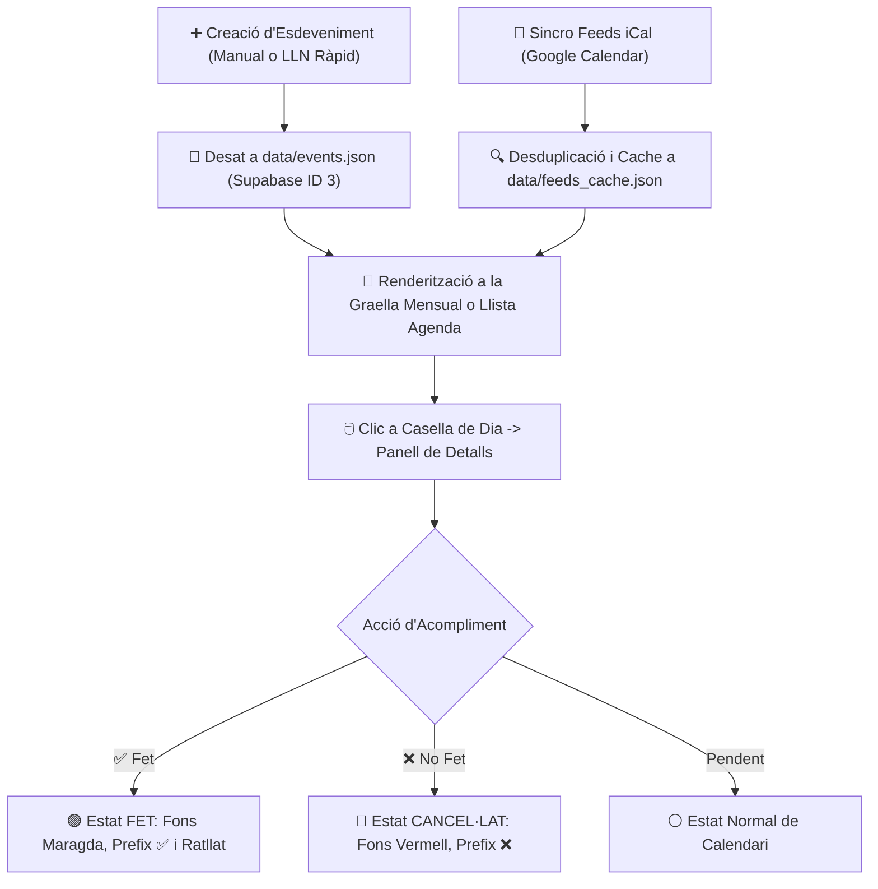

- **Pas 1: Ingesta del Compromís**: L'usuari crea l'esdeveniment emplenant el formulari complet o teclejant una instrucció ràpida en llenguatge natural.
- **Pas 2: Fusió de Feeds**: El motor fusiona els esdeveniments manuals amb els calendaris externs de Google Calendar, netejant duplicats.
- **Pas 3: Visualització Personalitzada**: Es pinta la graella mensual o la llista cronològica aplicant els colors corporatius de cada membre familiar.
- **Pas 4: Consulta del Dia**: En fer clic sobre qualsevol casella de la graella, es despleguen a sota tots els seus esdeveniments en targetes interactives.
- **Pas 5: Resolució en 1 Clic**: L'usuari marca si s'ha fet o no es pot fer mitjançant els botons verds i vermells de resolució immediata.

---

#### C. Detall Exhaustiu de les Vistes i Controls Interactius

El mòdul disposa d'un comandament superior unificat i dues vistes principals commutables mitjançant `st.radio`:

---

##### 6.2.1 Comandament Superior d'Accions i Navegació Temporal

1. **Barra d'Eines Principal**:
   - **Botó `➕ Nou` (`btn_open_new_ev`, `type="primary"`)**: Desplega el panell d'alta per enregistrar un nou esdeveniment o cita.
   - **Botó `🔄 Sincro` (`btn_sync_feeds`)**: Força la descàrrega i sincronització immediata dels feeds iCal de Google Calendar, actualitzant `data/feeds_cache.json`.
   - **Navegació de Mesos**:
     - Botó `◀` (`cal_prev_month`): Retrocedeix al mes anterior.
     - Botó `Avui` (`cal_btn_today`): Retorna immediatament al mes i dia actuals.
     - Botó `▶` (`cal_next_month`): Avança al mes següent.
   - **Títol Dinàmic**: Retola el mes en català i l'any actiu en tipografia destacada *(Exemple: `📅 Octubre 2026`)*.
2. **Selector de Mode de Vista (`st.radio`)**:
   - Ràdio horitzontal compacte per alternar entre **`📅 Calendari` (Vista Graella)** i **`📋 Agenda / Llista` (Vista Cronològica)**, memoritzant la preferència a `st.session_state.cal_view_mode`.

---

##### 6.2.2 Formulari d'Alta d'Esdeveniments (`st.tabs`)

En prémer `➕ Nou`, es desplega un panell organitzat en dues pestanyes de creació:

1. **Pestanya `⚡ Creació ràpida intel·ligent`**:
   - Camp de text lliure preparat per processar llenguatge natural.
   - L'usuari pot escriure frases quotidianes *(Exemple: "Dilluns que ve a les 10h dentista de l'Enric a Girona")*.
   - **Parser Intel·ligent**: Descompon la frase, extreu automàticament la data, l'hora d'inici, el membre familiar assignat i la categoria mèdica.
   - **Botó `⚡ Crear ràpidament` (`type="primary"`)**: Valida l'extracció i desa l'esdeveniment a l'instant.
2. **Pestanya `📝 Formulari complet`**:
   - **Camp `Títol de l'esdeveniment`**: Descripció de l'acte o cita.
   - **Selector `Membre familiar`**: Desplegable per assignar a Enric, Isabel o `Tothom`.
   - **Casella `Tot el dia`**: Deshabilita la selecció d'hores per a festius o esdeveniments de jornada completa.
   - **Selectors de Data i Hora**: `Data d'inici`, `Data de finalització`, `Hora d'inici` i `Hora de finalització`.
   - **Selector `Categoria`**: Desplegable amb codi visual per a: `Metge`, `Feina`, `Oci / Social`, `Llar`, `Aniversari`, `Reunió`, `Esport`, `Altres`.
   - **Camp `Lloc / Ubicació`**: Adreça o centre on té lloc la cita.
   - **Camp `Notes / Descripció`**: Instruccions, documents necessaris o observacions.
   - **Botó `💾 Desar Esdeveniment`**: Insereix el registre a `data/events.json` i actualitza Supabase ID 3.
   - **Botó `❌ Cancel·lar`**: Tanca el panell sense desar canvis.

---

##### 6.2.3 Vista 1: `📅 Calendari` (Graella Mensual Estil Google Calendar)

La vista visual per excel·lència de l'agenda domèstica:

1. **Graella de 7 Columnes (Dilluns a Diumenge)**:
   - Capçaleres amb els dies de la setmana en català (*Dl, Dt, Dc, Dj, Dv, Ds, Dg*).
   - **Caselles de Dia Interactives**:
     - Vores suaus amb efecte hover en passar el cursor.
     - Indicador numèric de dia al cantó superior.
     - **Ressaltat Especial d'Avui**: La casella del dia en curs compta amb una vora blava brillant vibrant (`#38bdf8`) i fons il·luminat per identificar la jornada d'un sol cop d'ull.
   - **Pastilles d'Esdeveniments**:
     - Petites càpsules de color dins de cada casella que mostren l'hora i el títol del compromís.
     - El color de la càpsula identifica el membre familiar associat (segons `core/config.json`).
     - Recompte numèric si un dia té més esdeveniments dels que caben visualment a la casella.
2. **Panell de Gestió del Dia Seleccionat (Sub-graella)**:
   - En fer clic a qualsevol dia de la graella, aquest queda marcat amb una vora daurada i es desplega a sota la secció detallada **`🗓️ Esdeveniments per al dia DD/MM/YYYY`**:
     - Botó **`➕ Nou Esdeveniment per a aquest dia`**: Obre el formulari preomplint automàticament la data seleccionada.
     - **Targetes Detallades d'Esdeveniments**: Targetes àmplies amb l'hora, títol, membre, categoria, ubicació i el conjunt de botons d'acció ràpida.

---

##### 6.2.4 Vista 2: `📋 Agenda / Llista` (Llistat Cronològic Continu)

Ideal per consultar la planificació setmanal o mensual com una agenda contínua:

1. **Agrupació Seqüencial per Dates**:
   - Els esdeveniments es presenten ordenats cronològicament dia a dia de forma descendent.
   - Capçalera per a cada data indicant el dia de la setmana, número i mes.
2. **Targetes d'Agenda**:
   - Franja horària (ex: `09:30 - 10:30` o `Tot el dia`).
   - Insígnia de categoria i identificador de la persona responsable.
   - Accés complet als botons d'acció de resolució, edició i eliminació.

---

##### 6.2.5 Sistema d'Acompliment Fet / No Fet i Disseny Mòbil en 1 Línia

Un dels punts més potents del mòdul és el control d'estat immediat de qualsevol compromís:

1. **Botons d'Acció de Resolució**:
   - **Botó `✅` / `✔️` (Fet / Completat)**:
     - En prémer-lo, l'esdeveniment s'il·lumina en color verd maragda sòlid (`#10b981`).
     - S'afegeix el prefix `✅ ` al títol, es ratlla el text i es mostra la insígnia destacada `FET`.
     - Si es torna a prémer, es desmarca tornant a l'estat pendent original.
   - **Botó `❌` / `✖️` (No fet / Cancel·lat)**:
     - En prémer-lo, l'esdeveniment s'il·lumina en color vermell coral sòlid (`#ef4444`).
     - S'afegeix el prefix `❌ `, es ratlla el text i es mostra la insígnia `NO FET`.
     - Permet documentar cites cancel·lades o tasques no realitzades sense haver d'esborrar el registre de l'historial.
   - **Botó `✏️` (Modificar)**: Obre el formulari per editar el títol, horaris, membre o categoria.
   - **Botó `🗑️` (Esborrar)**: Elimina l'esdeveniment definitivament de la base de dades.
2. **Arquitectura CSS Avançada Mòbil en 1 Sola Línia (`:has(.cal-action-btn)`)**:
   - Per evitar que els 4 botons d'acció (`✅`, `❌`, `✏️`, `🗑️`) s'apilin verticalment a les pantalles estretes dels telèfons intel·ligents, s'ha programat una regla CSS Flexbox específica:
     ```css
     div[data-testid="stHorizontalBlock"]:has(.cal-action-btn) {
         flex-direction: row !important;
         flex-wrap: nowrap !important;
         align-items: center !important;
         gap: 4px !important;
     }
     ```
   - Garanteix que tota la botonera de control romangui sempre neta, compacta i accessible en una sola fila horitzontal des de qualsevol dispositiu mòbil.

---

#### D. Navegació Dinàmica i Enllaços amb Altres Mòduls
- **Navegació per Paràmetres URL (`st.query_params`)**:
  - `?tab=calendari` o `?mode=grid`: Obre la vista de graella mensual.
  - `?mode=agenda`: Condueix directament a la llista cronològica.
- **Interconnexions amb la Resta del Sistema**:
  - **[`modules/manteniment.py`](file:///e:/Dashboard/modules/manteniment.py)**: Les tasques de manteniment domèstic marcades amb `send_to_calendar` es reflecteixen automàticament a l'agenda familiar amb la icona `🛠️`.
  - **[`modules/menjar.py`](file:///e:/Dashboard/modules/menjar.py)**: Els menús setmanals es poden projectar a l'agenda com a referència dels àpats de la llar.
  - **[`modules/medicacio.py`](file:///e:/Dashboard/modules/medicacio.py)**: Els tractaments mèdics i pautes temporals sincronitzen alertes horàries a l'agenda.
  - **Menú Superior `Editar > 📂 Arxius JSON`**: Accés directe per consultar o restaurar `data/events.json` i `data/feeds_cache.json`.

---

### 6.3 Control de Medicació (`modules/medicacio.py`)
Mòdul de vigilància de la salut, supervisió de pautes farmacològiques de familiars i persones tutelades, registre de preses diàries en temps real amb comprovació d'adherència terapèutica i injecció automàtica d'alarmes mèdiques a Google Calendar mitjançant compte de servei o fitxers d'exportació iCal (.ics).

#### A. Arquitectura Farmacèutica i Fonts de Dades
El mòdul combina persistència al núvol a Supabase, integració d'APIs de Google Cloud i el perfil sanitari familiar:
1. **Taules a Supabase (PostgreSQL)**:
   - `data/medication_plans.json` (Config ID 5): Registre centralitzat de plans mèdics actius i històrics (`id`, `patient_name`, `patient_type`, `medication_name`, `dosage`, `instructions`, `frequency_type`, `times`, `start_date`, `duration_days`, `calendar_id`, `gcal_synced`, `events`).
2. **Configuració de Pacients (`core/config.json` - Config ID 2)**:
   - Catàleg de membres de la llar i persones tutelades subjectes a supervisió mèdica (nom, tipus de pacient, correus electrònics associats).
3. **Google Calendar API & Service Account (`core/google_credentials.json`)**:
   - Pont d'integració oficial amb Google Cloud que permet injectar automàticament centenars de preses mèdiques als calendaris dels telèfons intel·ligents dels pacients amb notificacions i alertes sonores sense intervenció manual.
   - **Mode Fallback Universal (.ICS)**: Si no es disposa de compte de servei, el mòdul genera paquets de calendari descarregables en format estàndard RFC 5545 (`.ics`) per importar a qualsevol dispositiu Apple, Android o Windows.

---

#### B. Cicle de Vida i Flux Operatiu de Medicació

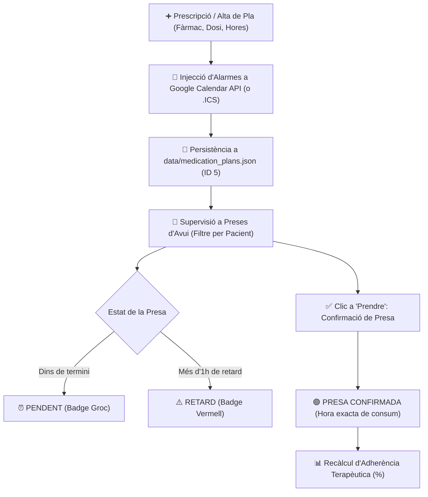

- **Pas 1: Alta del Tractament**: Es defineix el pacient, fàrmac, dosificació, pauta horària (ex: cada 8h, cada 12h, personalitzada) i durada del tractament.
- **Pas 2: Injecció de Calendari**: El sistema calcula totes les preses individuals i les injecta directament al calendari de Google de la persona amb alarmes al seu mòbil.
- **Pas 3: Supervisió en Temps Real**: A la pestanya de preses d'avui es monitoritza cada dosi amb codis de color (pendent, retardada o confirmada).
- **Pas 4: Confirmació en 1 Clic**: El pacient o cuidador prem `✅ Prendre`; el sistema grava l'hora exacta de la presa (`confirmed_at`) i recalcula l'adherència.

---

#### C. Detall Exhaustiu de les 4 Pestanyes de la Interfície Gràfica

El mòdul s'estructura en 4 pestanyes operatives mitjançant `st.tabs` amb suport per a paràmetres URL (`?tab=...`):

---

##### 6.3.1 Pestanya 1: `📅 Preses d'Avui & Supervisió` (Panell Diari de Control)

La pantalla operativa d'administració i comprovació de preses de la jornada:

1. **Capçalera i Filtre per Pacient**:
   - Títol dinàmic amb la data d'avui *(Exemple: `🕒 Pauta de Preses per a Avui (28/10/2026)`)*.
   - **Desplegable `Filtrar per persona`**: Permet veure els medicaments de tota la família alhora (`Tots els pacients`) o centrar-se en un pacient concret (ex: Enric, Persona tutelada).
2. **Targetes Interactives de Presa**:
   - Cada presa del dia es presenta en una targeta visual dividida en 3 blocs:
     - **Caixa Horària (`med-time-box`)**: Caixa estilitzada a l'esquerra que destaca l'hora exacta de la dosi en gran (ex: `08:00`, `14:00`, `21:00`).
     - **Informació del Fàrmac**: Nom del medicament amb dosi *(Ex: `💊 Paracetamol (1g)`)*, pacient destinatari, tipus de pacient i instruccions mèdiques (ex: *Prendre després de dinar amb un got d'aigua*).
     - **Badges Semafòrics d'Estat**:
       - 🟢 **`✅ PRESA CONFIRMADA (a les 14:12)`**: Fons verd amb l'hora exacta en què es va prendre la pastilla.
       - 🔴 **`⚠️ RETARD (>1h)`**: Fons vermell d'alerta si ha passat més d'una hora de l'hora pautada sense confirmació.
       - 🟡 **`⏰ PENDENT`**: Fons groc per a les preses futures del dia.
3. **Accions Ràpides en 1 Clic**:
   - **Botó `✅ Prendre` / `↩️ Desfer`**: Commuta a l'instant l'estat de la dosi (`toggle_intake_manual`). Si es confirma, queda registrat; si s'ha premut per error, el botó permet desfer la confirmació.
   - **Botó `📅 GCal`**: Enllaç directe que obre l'esdeveniment a l'aplicació web o mòbil de Google Calendar.

---

##### 6.3.2 Pestanya 2: `➕ Crear Nou Pla de Medicació` (Programador de Tractaments)

Formulari per donar d'alta una nova pauta mèdica temporal o crònica:

1. **Dades del Destinatari**:
   - **Selector `Pacient / Destinatari del pla *`**: Desplegable amb els familiars i tutelats del sistema.
   - **Camp `Correu de Google Calendar de destí`**: Adreça de Gmail del pacient on s'injectaran les alertes.
2. **Definició del Fàrmac i Posologia**:
   - **Camp `Nom del medicament *`**: Camp de text predictiu (ex: *Sintrom, Omeprazol, Ibuprofèn*).
   - **Camp `Dosi / Format`**: Especificació de càrrega (ex: *500mg, 1 comprimit, 1 sobre, 2 gotes*).
   - **Pauta / Freqüència (`FREQUENCY_PRESETS`)**:
     - Presets preconfigurats amb un sol clic:
       - *Cada 8 hores* (`08:00, 16:00, 00:00`)
       - *Cada 12 hores* (`08:00, 20:00`)
       - *1 cop al dia (Matí)* (`09:00`)
       - *1 cop al dia (Nit)* (`21:00`)
       - *Cada 6 hores* (`06:00, 12:00, 18:00, 00:00`)
       - *Personalitzat*: Habilita un camp per teclejar hores arbitràries separades per comes.
3. **Temporització del Tractament**:
   - **`Data d'inici`**: Selector de calendari.
   - **`Durada del tractament (dies)`**: Selector numèric (de 1 a 365 dies).
   - **`Instruccions / Pauta mèdica`**: Recomanacions de consum (amb menjars, en dejú, protecció gàstrica).
4. **Execució i Exportació**:
   - **Botó `🚀 Crear i Enviar a Google Calendar` (`type="primary"`)**: Genera totes les instàncies de presa i les envia per API directa al calendari de Google de la persona tutelada.
   - **Botó `📥 Descarregar fitxer .ICS del Pla`**: Genera i descarrega a l'ordinador el paquet `.ics` per a dispositius sense connexió a compte de servei.

---

##### 6.3.3 Pestanya 3: `📋 Historial de Plans Actius i Adherència` (Seguiment Clínic)

Supervisió continuada del compliment dels tractaments mèdics de la família:

1. **Acordions per Medicament i Pacient (`st.expander`)**:
   - Cada tractament es presenta en un acordió que retola en temps real el recompte de preses i l'adherència:
     *(Exemple: `💊 Amoxicil·lina · 👤 Isabel (19/21 preses realitzades · 90%)`)*.
2. **Mètriques d'Adherència Terapèutica**:
   - **Barra de Progrés (`st.progress`)**: Proporció visual del compliment del tractament.
   - **Percentatge d'Adherència**: Indicador verd amb la taxa de compliment real de la pauta.
3. **Fitxa de Condicions**:
   - Mostra dosi, freqüència d'hores, període de dates, adreça de Google Calendar i instruccions mèdiques.
4. **Botó `🗑️ Eliminar Pla`**:
   - Permet cancel·lar el tractament mèdic, eliminant el pla actiu i netejant la base de dades.

---

##### 6.3.4 Pestanya 4: `⚙️ Connexió Google Calendar API & Guia` (Configuració del Servei)

Panell d'administració tècnica de la passarel·la amb Google Cloud:

1. **Estat de la Connexió**:
   - 🟢 **Compte de Servei Connectat**: Mostra l'adreça del compte de servei actiu (ex: `service-account@dashboard-familiar.iam.gserviceaccount.com`).
   - 🟡 **Mode Manual / Fallback**: Indica que el compte de servei no està configurat i que s'està utilitzant el mode d'enllaços web directes i fitxers `.ics`.
2. **Guia d'Enllaç de Calendaris per a Persones Tutelades**:
   - Procediment oficial de 5 passos per compartir el calendari de Google d'un familiar amb el compte de servei del Dashboard amb permisos d'edició.
3. **Instruccions de Configuració Inicial de Google Cloud Console**:
   - Explicació pas a pas per descarregar les credencials JSON gratuïtes a `core/google_credentials.json`.

---

#### D. Navegació Dinàmica i Enllaços amb Altres Mòduls
- **Navegació per Paràmetres URL (`st.query_params`)**:
  - `?tab=avui`: Obre la pauta diària de preses.
  - `?tab=nou`: Desplega el programador de nous tractaments.
  - `?tab=plans`: Condueix a l'historial i mètriques d'adherència.
  - `?tab=config`: Mostra l'estat de la Google Calendar API.
- **Interconnexions amb la Resta del Sistema**:
  - **[`modules/calendari.py`](file:///e:/Dashboard/modules/calendari.py)**: Les preses de medicació es poden visualitzar a l'agenda familiar sincronitzada amb la categoria mèdica.
  - **[`core/alerts.py`](file:///e:/Dashboard/core/alerts.py)**: Les dosis amb retard superior a una hora generen notificacions d'urgència a la campaneta de la barra superior (`🔔`).
  - **Menú Superior `Editar > 📂 Arxius JSON`**: Accés per inspeccionar o restaurar `data/medication_plans.json`.

---

### 6.4 Seguretat i Domòtica (`modules/seguretat.py`, `modules/domotica.py`)
Mòduls complementaris de protecció física de la llar, videovigilància, integració amb sistemes domòtics intel·ligents (Home Assistant) i control d'accessos de la casa.

#### A. Arquitectura i Estat Actual d'Implementació
1. **Model Modular de Connexió**:
   - Ambdós mòduls estan desacoblats estructuralment a la carpeta `modules/`, connectats al router principal [`app.py`](file:///e:/Dashboard/app.py) i governats pel selector de visibilitat de mòduls d'administració ([`modules/admin.py`](file:///e:/Dashboard/modules/admin.py)).
   - Actualment actuen com a **mòduls d'enllaç i panell de destí (Landing / Stubs)** amb capçalera corporativa dinàmica (`render_header_with_avatar`), preparats per a la connexió d'APIs locals.
2. **Especificació d'Integració Domòtica (`modules/domotica.py`)**:
   - **Passarel·la Home Assistant (REST API / WebSocket)**: Dissenyat per connectar amb la instància local de Home Assistant de la llar mitjançant token de llarga durada (*Long-Lived Access Token*).
   - **Control de Climatització i Acumuladors**: Connectat lògicament amb [`modules/llum_aigua.py`](file:///e:/Dashboard/modules/llum_aigua.py) per actuar sobre relés intel·ligents (Shelly / Sonoff) i encendre els acumuladors de calor en les hores vall més barates del PVPC.
   - **Monitorització de Sensors Ambientals**: Lectura de termòstats, humitat, sensors de presència i consum elèctric en temps real.
3. **Especificació de Seguretat i Videovigilància (`modules/seguretat.py`)**:
   - **Feeds RTSP / WebRTC**: Receptor per a càmeres IP domèstiques compatibles amb ONVIF / RTSP (vigilància d'accessos exteriors, jardí i garatge).
   - **Estat d'Alarma i Sensors d'Obertura**: Supervisió de l'estat d'armat de l'alarma de la llar i comprovació d'obertura de portes i finestres abans de sortir de casa.

#### B. Administració i Visibilitat des de la Barra Superior
- Des de **`⚙️ Administració > Visibilitat de Mòduls`**, l'usuari pot activar o ocultar aquestes icones de la pàgina principal d'inici amb un sol clic, mantenint el Dashboard adaptat a les necessitats reals de la família en cada moment.

---

## 7. Mòduls de Prioritat 5: Administració, Nucli i Serveis Transversals

---

### 7.1 Administració i Configuració Global (`modules/admin.py`, `core/config_manager.py`)

#### A. Ajustos, Fonts de Dades, Taules i Configuració
1. **Fitxer Central de Configuració (`core/config.json`)**:
   - Tota la parametrització de l'aplicació es governa a través de [`core/config_manager.py`](file:///e:/Dashboard/core/config_manager.py), que carrega i desa de manera atòmica el fitxer JSON [`core/config.json`](file:///e:/Dashboard/core/config.json).
   - Estructura clau de dades:
     - `admin`: Nom, correu electrònic, telèfon, avatar (emoji o URL) i hash/PIN de seguretat d'accés mestre.
     - `titol_casa`: Text del rètol superior (ex: *"XIQUIHOUSE"*), subtítol, color hexadecimal de la capçalera (`#f39c12`), tipografia i mides.
     - `familia`: Array d'objectes amb el perfil complet de cada membre: `{id, nom, data_naixement, rol, color, telefon, alergies, vetos, plats_favorits, present}`.
     - `menjar`: Paràmetres dietètics globals, ràtios calòriques per àpat, catàleg d'eines actives i estris disponibles (`cataleg_eines`).
     - `periferics`: Paràmetres del maquinari de la llar, incloent impressora tèrmica de tiquets (`nom_controlador`, `metode_impressio`, `salts_linia_tall`, `tall_automatic`) i paràmetres de l'escàner USB (motor WinRT / WIA, resolució DPI).
     - `icones_actives`: Mapa booleà que habilita o oculta cadascuna de les targetes interactives del tauler d'inici (`landing`).
     - `tutelats`: Llistat de persones o familiars sota tutela legal o gestió delegada amb comptes associats.
     - `bancs`: Catàleg d'entitats bancàries de la llar amb colors corporatius i identificadors per a filtratge ràpid.
     - `tema`: Selector de paleta visual (*Fosc* / *Clar*).
     - `idioma`: Idioma predeterminat de la interfície (*ca* / *es*).
2. **Neteja d'Estat i Resolució d'Inconsistències de Sessió**:
   - Per evitar que els widgets de Streamlit mantinguin claus obsoletes en memòria cau després de desar o navegar entre seccions, [`modules/admin.py`](file:///e:/Dashboard/modules/admin.py) incorpora `_clear_all_admin_widget_keys()` i `_clear_section_session_keys(prefix)`, encarregades d'eliminar de `st.session_state` totes les claus temporals de formularis (`f_` per a família, `t_` per a tutelats, `b_` per a bancs).
   - Cada desat sincronitza el disc i invoca immediatament `st.cache_data.clear()` per refrescar la informació en tots els mòduls dependents.

---

#### B. Flux de Treball del Mòdul d'Administració

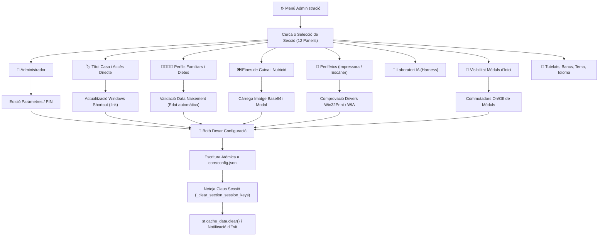

---

#### C. Detall Exhaustiu de les 12 Seccions de Configuració

##### 1. Secció 👤 Administrador
- **Capçalera Dinàmica i Avatar**: Targeta corporativa d'estil Chrome Settings que reflecteix el nom complet de l'administrador, rol del sistema (`admin`), correu electrònic i avatar circular amb fons degradat.
- **Formulari de Dades Personals**:
  - `Nom de l'Administrador`: Camp de text editable vinculat a la sessió activa.
  - `Correu Electrònic`: Text d'avís per a notificacions administratives.
  - `Telèfon de Contacte`: Per a integracions de missatgeria o avisos d'urgència.
  - `Selector d'Avatar`: Tria d'emojis o càrrega d'imatge local.
- **PIN Mestre de Seguretat**:
  - Camp de contrasenya/PIN numèric per desbloquejar accions de màxima sensibilitat (esborrat massiu de registres, accés al gestor de bases de dades des d'usuaris convidats o configuració de passarel·les bancàries).

##### 2. Secció 🏷️ Títol de la casa
- **Personalització Visual de la Marca de la Llar**:
  - `Text del Títol Principal`: Camp de text (per defecte *"XIQUIHOUSE"*).
  - `Subtítol o Lema`: Text secundari (ex: *"Gestió Integral de la Llar"*).
  - `Color Principal del Rètol`: Color picker interactiu per definir el to hexadecimal (per defecte `#f39c12`) que tenyeix les capçaleres de tots els mòduls.
  - `Mida i Estil de Tipografia`: Selector de grandària (normal, gran, extra gran).
  - `Caixa de Vista Prèvia en Temps Real`: Panell delimitat amb vores discontínues que renderitza immediatament el text i el color escollits tal com es visualitzaran a la pantalla d'inici.
- **Actualitzador de l'Accés Directe d'Escriptori de Windows (`_update_desktop_shortcut`)**:
  - Quan es modifica el títol de la casa, l'aplicació executa un script en segon pla que reanomena i reconfigura automàticament l'accés directe `.lnk` ubicat a l'escriptori de Windows de l'ordinador amfitrió per mantenir la coherència de marca del sistema.

##### 3. Secció 👨‍👩‍👧‍👦 Família
- **Llistat de Membres Familiars**:
  - Cada membre es presenta en una targeta independent plegable (`st.expander`) o llista estructurada.
  - `Nom i Cognoms`: Identificador del familiar.
  - `Data de Naixement`: Format europeu estricte (`DD/MM/AAAA`).
  - `Càlcul Dinàmic d'Edat (`calcular_edat`)`: Funció algorísmica que processa dates en formats string o objecte datetime i calcula exactament els anys complerts tenint en compte mes i dia actuals.
  - `Rol Familiar`: Selector (Pare, Mare, Fill/a, Avi/àvia, Convidat).
  - `Color Identificador`: Color picker per al calendari d'agenda, torns de medicació i tasques de manteniment.
  - `Telèfon Mòbil`: Per a vinculació d'alertes personals.
  - `Al·lèrgies i Intol·leràncies Mèdiques`: Camp de text lliure (separat per comes) estrictament connectat amb el planificador de menús IA i el banc de proves Harness (tolerància 0%).
  - `Vetos Alimentaris Personals`: Aliments que el familiar no vol menjar (encara que no siguin al·lèrgies).
  - `Plats Comodí / Favorits`: Plats segurs d'emergència per substituir automàticament qualsevol àpat que contingui un veto.
  - `Commutador de Presència (`🟢 Present` vs `⚪ Fora`)`: Permet desactivar temporalment un membre quan està de viatge, de vacances o fora de casa perquè la generació de menús i compres no calculi racions innecessàries.
- **Accions i Modals de Família**:
  - `➕ Afegir Membre Familiar`: Formulari emergent per registrar nous integrants.
  - `🗑️ Esborrar Membre Familiar (`show_delete_family_member_dialog`)`: Modal de seguretat de Streamlit (`@st.dialog`) que sol·licita confirmació explícita abans d'eliminar el registre per evitar pèrdues accidentals.
  - `💾 Desar Canvis de Família`: Invoca `_on_save_family_members()`, purga les claus `f_` de la sessió i reescriu el fitxer de configuració.

##### 4. Secció 🍽️ Menús i Nutrició / 🍳 Eines de Cuina
- **Catàleg Visual d'Eines i Aparells de Cuina (`DEFAULT_CATALEG_EINES`)**:
  - Catàleg complet d'electrodomèstics i estris: Forn elèctric, Microones, Fregidora d'aire (*Airfryer*), Robot de cuina (Thermomix), Batedora de vas, Paella gran, Olla a pressió, Graella elèctrica, Vaporera, etc.
  - `Miniatures i Resolució d'Imatges (`_get_eina_foto_src`)`: Cerca intel·ligent a les carpetes locals del projecte (`imatges/Eines/`, `imatges/Productes/`, etc.) o fonts web remotes, convertint fitxers locals a fluxos segurs en Base64 (`data:image/png;base64,...`).
  - `Visor Modal d'Eines (`_render_eina_thumb_html`)`: Modal CSS pur amb etiquetes `<label>` i caixes ocultes que permet fer clic a la miniatura de 56x56 px per obrir un visor ampliat d'alta resolució amb descripció tècnica sense fer recàrrega de pàgina.
  - `Interruptors d'Activació (`_on_eina_change`)`: Permet marcar quins aparells estan realment disponibles a la cuina de la casa. El planificador de menús IA no proposarà mai receptes que requereixin eines apagades.
  - `Pujada d'Eines Personalitzades`: Formulari amb doble pestanya (`📁 Pujar fitxer PC/Mòbil` o `🔗 Enllaç URL`) per incorporar nous estris amb foto, nom i descripció.

##### 5. Secció 🔔 Alertes Globals
- **Configuració de Llindars de Notificació**:
  - `Avisos de Loteria i Sorteigs`: Dies d'antelació per a la caducitat de dècims.
  - `Marge d'Avisos de Manteniment`: Dies de preavís abans del venciment de tasques domèstiques recurrents.
  - `Avisos de Caducitat de Garanties`: Llindar d'avís en dies per a aparells i electrodomèstics de la llar.
  - `Visibilitat a la Campaneta`: Selectors per activar o silenciar categories d'alertes específiques al panell superior.

##### 6. Secció 🔌 Perifèrics (Impressora i Escàner)
- **Impressora Tèrmica de Tiquets (ESC/POS)**:
  - `Llistat de Controladors Detectats`: Detecció automàtica d'impressores locals de Windows mitjançant `win32print`.
  - `Controlador Seleccionat`: Selector del dispositiu (per defecte `BIXOLON_SRP275`).
  - `Mètode d'Impressió Preferit`: Radio button entre *RAW ESC/POS (Windows natiu local)* i *Impressió Web (HTML5/window.print())*.
  - `Salts de Línia de Marge`: Quantitat de salts buits (per defecte 6) abans de tallar perquè el text no quedi atrapat sota la guillotina.
  - `Tall de Paper Automàtic`: Interruptor per enviar la comanda ESC/POS `\x1dV\x00` en finalitzar.
  - `Botó d'Impressió de Prova`: Envia un tiquet curt de diagnòstic per verificar alimentació de paper i impressió de capçalera.
- **Escàner USB de Documents i Tiquets**:
  - `Motor d'Escaneig`: Selector entre el motor d'última generació WinRT natiu ([`scan_winrt.ps1`](file:///e:/Dashboard/scan_winrt.ps1)) o l'API clàssica WIA.
  - `Resolució d'Escaneig (DPI)`: 150 DPI (ràpid per a OCR) o 300 DPI (alta definició).
  - `Ruta de Destí`: Carpeta local predeterminada (`tickets/`).

##### 7. Secció 🧪 Laboratori IA (Harness)
- Accés directe als controls del banc de proves heurístic i informes d'avaluació de models (vegeu subapartat 7.2).

##### 8. Secció 🤝 Tutelats
- Gestió de registres de familiars sota tutela legal o gestió delegada, assignant comptes bancaris, límits de despesa i alertes administratives específiques.

##### 9. Secció 🏦 Bancs
- Gestió del catàleg d'entitats financeres de la llar (CaixaBank, BBVA, Santander, Revolut, etc.), codis de color identificatius i associació amb els comptes de [`modules/economic.py`](file:///e:/Dashboard/modules/economic.py).

##### 10. Secció 🎨 Aspecte i Tema
- Selector d'estil visual de l'aplicació entre tema **Fosc** (paleta fosca d'alt contrast amb fons `#0f172a` i targetes `#1e293b`) i tema **Clar** (estil corporatiu net amb fons blanc i vores suaus `#dadce0`).

##### 11. Secció 🔘 Icones pantalla d'inici (Visibilitat)
- Matriu d'interruptors (*toggles*) per activar o ocultar qualsevol de les targetes del menú principal (*Landing*):
  - `Compres i Rebost`, `Econòmic`, `Llum i Aigua`, `Cotxe`, `Manteniment`, `Menús i Cuina`, `Agenda`, `Medicació`, `Seguretat`, `Domòtica`, `Jocs / Oci`.
  - Desa instantàniament a `icones_actives` i reordena la graella del tauler.

##### 12. Secció 🌐 Idiomes
- Selector d'idioma de l'aplicació (*Català* / *Castellà*) amb diccionari de cadenes transversals a [`core/config_manager.py`](file:///e:/Dashboard/core/config_manager.py).

---

#### D. Interfície Gràfica, Elements Interactius i Enllaços Intermòdul
1. **Disseny d'Interfície Chrome Settings**:
   - Estructura a dues columnes (`col_menu: 3`, `col_body: 7`): barra lateral d'accés ràpid amb cercador en viu de seccions a l'esquerra, i àrea de formulari amb targetes arrodonides a la dreta.
2. **Sistema de Missatges Flash (`_render_flash_message`)**:
   - En desar dades satisfactòriament, es genera un banner verd temporal a la part superior del formulari (`st.session_state["flash_success"]`) que confirma l'operació i s'esvaeix al següent cicle.
3. **Connexions Intermòdul**:
   - **Compres (`modules/compres.py`)**: Rep els paràmetres de l'escàner i la impressora de tiquets.
   - **Menús (`modules/menjar.py`)**: Llegeix els membres presents, al·lèrgies, vetos, plats favorits i el catàleg d'eines actives.
   - **Agenda (`modules/calendari.py`) i Medicació (`modules/medicacio.py`)**: Utilitzen els membres familiars i els seus colors assignats per a filtres i avatars.
   - **Landing (`modules/dashboard.py`)**: Governa la renderització dels botons segons el mapa `icones_actives`.

---

### 7.2 Laboratori IA - Harness (`core/harness.py`)

#### A. Arquitectura d'Avaluació Determinista i Dades de Prova
1. **Propòsit del Mòdul**:
   - El banc de proves **Harness** ([`core/harness.py`](file:///e:/Dashboard/core/harness.py)) és un entorn de proves automàtiques dissenyat per avaluar rigorosament la qualitat, fidelitat i seguretat dels models d'intel·ligència artificial (Gemini 2.5 Flash, Gemini 3.8 Flash, DeepSeek, etc.) abans de desplegar-los per a la generació de menús familiars.
2. **Bateria de Casos de Prova (`data/harness_menu_cases.json`)**:
   - Conté escenaris extrems de prova dissenyats expressament per estressar el model:
     - Casos amb múltiples membres amb al·lèrgies severes creuades (celiaquia, intolerància a la lactosa, al·lèrgia als fruits secs).
     - Escenaris amb múltiples vetos alimentaris personals i exigència de plats comodí específics.
     - Restriccions d'eines (ex: cuines sense forn ni fregidora d'aire).
     - Rebosts amb estoc limitat que cal consumir amb caràcter prioritari.
3. **Cas en Viu de la Família (`get_live_family_test_case`)**:
   - A més dels casos sintètics, el banc de proves extreu automàticament la configuració real vigent de la família i el catàleg d'eines des de [`core/config.json`](file:///e:/Dashboard/core/config.json) per avaluar com es comportaria el model amb la situació domèstica d'avui mateix.

---

#### B. Flux de Treball del Banc de Proves Harness

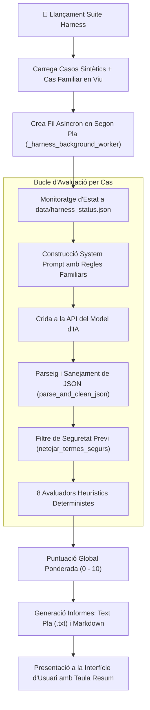

---

#### C. Detall dels 8 Avaluadors Heurístics i Mètriques de Rendiment

1. **Seguretat d'Al·lèrgies Mèdiques (`grade_alergies`)**:
   - **Tolerància 0%**: Qualsevol presència d'un al·lergen prohibit en un àpat destinat al familiar afectat atorga immediatament un 0 en la prova.
   - **Filtre de Termes Segurs (`netejar_termes_segurs`)**: L'algorisme neteja prèviament qualificatius segurs com *"sense gluten"*, *"sense lactosa"*, *"apte per a celíacs"* o *"llet vegetal"* per evitar falsos positius en avaluar paraules clau com *"gluten"* o *"llet"*.
2. **Vetos Personals i Desdoblament (`grade_vetos_i_desdoblament`)**:
   - Verifica que cap membre rebi un aliment vetat. Si un aliment vetat apareix al menú general, avalua si el model ha desdoblat correctament l'àpat oferint l'alternativa del plat comodí registrat a la fitxa del familiar.
3. **Regles Dietètiques de la Llar (`grade_regles_llar`)**:
   - Verifica l'equilibri nutricional setmanal: presència de verdura diària, freqüència mínima de peix (almenys 2-3 cops per setmana), racions de llegums i limitació de carns vermelles o fregits.
4. **Anti-repetició d'Hidrats Consecutius (`grade_repeticions_hidrats`)**:
   - Penalitza la coincidència d'hidrats pesants en el mateix dia (ex: paella o pasta per dinar combinat amb pizza o arròs per sopar).
5. **Alineació amb Puntuacions d'Estrelles (`grade_puntuacions_estrelles`)**:
   - Comprova si el model prioritza les receptes amb 4 o 5 estrelles del catàleg històric de la casa enfront de plats amb valoracions baixes.
6. **Eines de Cuina i Forn (`grade_eines_i_forn`)**:
   - Avalua si les receptes proposades respecten el catàleg d'estris actius i penalitza si es programa un ús simultani o incompatible d'aparells (ex: demanar forn simultàniament a diferents temperatures).
7. **Aprofitament d'Estoc del Rebost (`grade_aprofitament_estoc`)**:
   - Premia les propostes que incorporen ingredients marcats com a *"consum preferent"* o amb sobreestoc al rebost i congelador de [`modules/compres.py`](file:///e:/Dashboard/modules/compres.py).
8. **Control Dietètic i Calòric (`grade_control_dietetic`)**:
   - Supervisa que l'aportació energètica s'ajusti als objectius de manteniment o pèrdua de pes definits per als membres de la casa.

---

#### D. Execució en Segon Pla, Monitorització i Generació d'Informes
- **Motor Asíncron (`_harness_background_worker`, `start_harness_suite_background`)**:
  - Les proves d'IA poden trigar entre 30 segons i 3 minuts segons la quantitat de casos. El motor llança un fil de segon pla (*threading*) que escriu el progrés en percentatge, el cas actiu i els registres a [`data/harness_status.json`](file:///e:/Dashboard/data/harness_status.json).
  - La interfície mostra una barra de progrés viva que es refresca sense bloquejar la navegació de l'usuari per altres mòduls.
- **Generador d'Informes en Text Pla (`generate_harness_txt_report`)**:
  - Produeix un fitxer de text estructurat descarregable amb diagnòstic pas a pas, temps de resposta de la API, tokens consumits, violacions detectades i recomanacions de millora del prompt.
- **Informe Markdown (`generate_harness_markdown_report`)**:
  - Renderitza una taula visual amb codi de colors (verd per a notes superiors a 8, groc entre 5 i 8, vermell per sota de 5) i resum gràfic de compliment per categoria.

---

### 7.3 Gestió de Bases de Dades i Sincronització Offline (`modules/bases_dades.py`, `modules/sincronitzacio.py`)

#### A. Gestor de Bases de Dades Supabase en Temps Real (`modules/bases_dades.py`)
1. **Accés i Permisos d'Accés**:
   - Accessible des del menú superior d'escriptori (*Eines > 🗄️ Bases de Dades*) o mitjançant el paràmetre URL `?db=nom_taula`.
   - Protegit per rol: només els usuaris amb rol `admin` o convidats amb PIN mestre poden visualitzar o modificar taules.
2. **Explorador Multitaula**:
   - Desplegable amb totes les taules relacionals de Supabase: `despeses`, `ingressos`, `compresSuper`, `carteraSuper`, `gasolina`, `kmCotxe`, `revisionsCotxe`, `hipoteca`, `limitsDespeses`, `pagadors`, `documentsLlar`, `mantenimentLlar`, `medicacio`, etc.
   - Detecta automàticament la clau primària (*Primary Key*) segons la matriu `PK_MAP` (`idPago`, `idIngres`, `IdCompra`, `idGasolina`, `idRuta`, `idTRCartera`, `id`).
3. **Editor de Dades Integrat (`st.data_editor`)**:
   - Permet afegir noves files al final de la graella, modificar qualsevol cel·la fent doble clic i seleccionar files per a la seva eliminació física a Supabase.
   - Commutador de seguretat `Ordenar pel més recent primer` per auditar immediatament les darreres transaccions registrades.
4. **Panell Desplegable de Filtres Ràpids (`🔍 Filtres`)**:
   - Detecta intel·ligentment el tipus de columnes del DataFrame actiu i genera filtres visuals adaptats:
     - Selectors de columna única: Banc, Forma de Pagament, Mes, Any, Categoria, Estat de Tiquet Pendent (`ticketPendent`).
     - Cerca per text lliure a Concepte o Article.
     - Filtratge per rang d'import monetari (`apply_import_filter`).
     - Botó `Netejar Filtres` per restaurar la vista completa de la taula amb un sol clic.

---

#### B. Sincronització Offline i Consolidació de Dades (`modules/sincronitzacio.py`)
1. **Arquitectura d'Operació Desconnectada**:
   - Si la connexió a Internet cau mentre s'introdueix una despesa, una ruta de cotxe o una compra, l'aplicació entra automàticament en mode desconnectat (*is_offline*).
   - Totes les peticions de mutació s'encapsulen com a objectes JSON atòmics i s'emmagatzemen a la cua local [`sync_queue.json`](file:///e:/Dashboard/sync_queue.json):
     - `INSERT`: Nova fila amb dades completes.
     - `INSERT_BULK`: Línies massives (ex: línies d'un tiquet de supermercat).
     - `UPDATE`: Nom de taula, clau primària, identificador i mapa de canvis.
     - `DELETE`: Identificador de la fila per eliminar.
2. **Panell de Gestió de la Cua**:
   - Si la cua conté operacions pendents, es mostra una taula informativa amb la data/hora de la modificació local, la taula afectada i el detall del canvi.
3. **Botons d'Acció**:
   - `🗑️ Netejar Cua (Descartar canvis locals)`: Esborra el fitxer `sync_queue.json` descartant les modificacions fetes fora de línia.
   - `🚀 Pujar Canvis a Supabase i Consolidar`: Itera sobre la cua executant cadascuna de les operacions mitjançant la instància de Supabase, informant del nombre d'accions completades amb èxit, gestionant possibles col·lisions i restaurant l'estat en línia.

---

#### C. Flux de Treball de Sincronització Offline

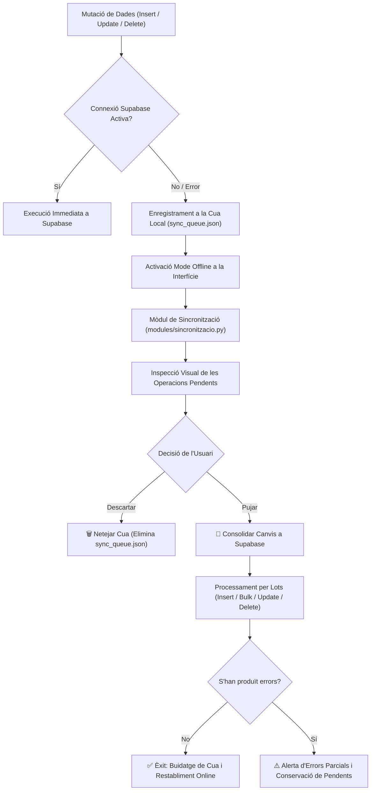

---

### 7.4 Sistema Global d'Alertes (`core/alerts.py`)

#### A. Arquitectura Transversal i Agregació d'Alertes Multimòdul
1. **Campaneta de Notificacions Persistent (`🔔`)**:
   - La campaneta d'alertes està present de forma unificada a la barra superior de navegació de l'aplicació i al tauler d'inici (*Landing*).
   - Mostra un distintiu numèric en temps real (*badge*) amb la suma d'avisos pendents que requereixen atenció.
2. **Optimització de Memòria i Rendiment**:
   - Per evitar consultes redundants a la base de dades, [`core/alerts.py`](file:///e:/Dashboard/core/alerts.py) aprofita directament els DataFrames actius ja presents a la memòria de sessió (`df_desp`, `df_km`, `df_limits`). Només si la sessió és verge invoca `load_dashboard_data`.
   - [`app.py`](file:///e:/Dashboard/app.py) manté una memòria cau de 60 segons sobre el recompte per mantenir la navegació fluida i sense latència.

---

#### B. Catàleg de Regles de Notificació i Semàfor de Severitat

| Tipus / Mòdul | Icona | Condició d'Activació | Nivell d'Alerta | Missatge Emetut |
|:---|:---:|:---|:---:|:---|
| **Cotxe (Oli)** | 🔧 | Kms restants per canvi d'oli $\le 0$ km | **Error (Vermell)** | *"Cal fer el canvi d'oli (previst als X km). Superat per Y km."* |
| **Cotxe (Oli)** | 🔧 | Kms restants per canvi d'oli $\le$ llindar d'avís | **Warning (Groc)** | *"Queden X km per al canvi d'oli (als Y km)."* |
| **Cotxe (Pneumàtics)** | 🛞 | Kms restants per canvi de rodes $\le$ llindar | **Warning / Error** | *"Revisar/canviar rodes: previst als X km (Y km restants)."* |
| **Cotxe (Inflat)** | 🛞 | Data d'inflat superada o dins del marge | **Warning / Error** | *"Inflat de rodes pendent des del DD/MM/AAAA o proper."* |
| **Cotxe (Nivells)** | 💧 | Data de revisió de líquids vençuda o pròxima | **Warning / Error** | *"Revisió de nivells de líquids (refrigerant/oli/frens) pendent."* |
| **Cotxe (ITV)** | 📋 | Caducitat de la ITV en menys de 30 dies | **Warning / Error** | *"Inspecció Tècnica de Vehicles (ITV) pendent de renovar."* |
| **Compres** | 🛒 | `ticketPendent == True` | **Warning (Groc)** | *"Hi ha tiquets de compra escanejats pendents de desglossar."* |
| **Manteniment** | 🏠 | Tasca domèstica amb data límit vençuda | **Error (Vermell)** | *"Tasca de manteniment vençuda assignada a [Familiar]."* |
| **Manteniment** | 🏠 | Dies restants per a tasca $\le diesAvis$ | **Warning (Groc)** | *"Tasca de manteniment propera en els propers X dies."* |
| **Garanties** | 🛡️ | Venciment de garantia d'aparell domèstic $\le 60$ dies | **Info (Blau)** | *"La garantia del producte [Nom] caduca el DD/MM/AAAA."* |
| **Medicació** | 💊 | Presa planificada no marcada amb retard $> 1$ h | **Warning (Groc)** | *"Presa de medicació de [Familiar] pendent d'administració."* |

---

### 7.5 Controlador d'Impressió de Tiquets (`modules/impressora.py`)

#### A. Protocol Dual: RAW ESC/POS Local vs Web Print HTML5
1. **Objectiu del Mòdul**:
   - Permet imprimir físicament en paper tèrmic de rotllo continu (76 mm o 80 mm) les llistes de la compra generades a [`modules/compres.py`](file:///e:/Dashboard/modules/compres.py), facilitant la compra al supermercat sense dependre de la pantalla del mòbil.
2. **Arquitectura Dual d'Impressió**:
   - **Mode Local Windows (RAW ESC/POS)**: Utilitza el mòdul `win32print` per comunicar-se directament amb el controlador de Windows de la impressora tèrmica (ex: *BIXOLON SRP-275*, *Epson TM-T20*, etc.). Envia fluxos de bytes binaris no interpretats amb comandaments nadius del capçal matricial.
   - **Mode Web Universal (HTML5 / window.print())**: Si l'aplicació s'executa en un dispositiu mòbil, tauleta o a través de Streamlit Cloud, genera una finestra emergent neta en HTML5 amb CSS calibrat a amplada fixa (80 mm) i llança el diàleg natiu d'impressió del navegador.

---

#### B. Normalització Matricial de Text i Seqüències de Control de Tall
1. **Funció de Sanejament Matricial (`normalitzar_per_a_matriu`)**:
   - Les impressores matricials d'agulles i tèrmiques tradicionals sovint presenten taules de caràcters reduïdes (*CodePage 437/850*). Per evitar que accents catalans o caràcters especials es converteixin en símbols inintel·ligibles, la funció substitueix automàticament accents, dièresis i la ela geminada (`à->a`, `é->e`, `í->i`, `ç->c`, `·->.`, etc.).
2. **Formatador d'Amplada Fixa (32 Caràcters per Línia)**:
   - Modela cada línia exactament a 32 columnes:
     - Checkbox buit per marcar a mà durant la compra (`[ ]`).
     - Quantitat necessària (`2x`).
     - Nom de l'article truncat a 16 caràcters per evitar salts de línia antiestètics.
     - Preu estimat aliniat a la dreta amb indicador monetari.
3. **Seqüències de Comandament ESC/POS**:
   - `\x1b@`: Inicialització i restabliment de paràmetres del maquinari.
   - `\x1ba\x01` i `\x1ba\x00`: Centrat de títols i alineació a l'esquerra del cos.
   - `\x1bE\x01` i `\x1bE\x00`: Activació i desactivació de text en negreta.
   - Salts de línia de seguretat (configurables, per defecte 6) per desplaçar el text imprès més enllà del corró d'arrossegament.
   - `\x1dV\x00` (*GS V 0*): Comanda de tall de paper complet o parcial (*Auto Cut*).

---

#### C. Flux d'Impressió i Formatació de Llistes de la Compra

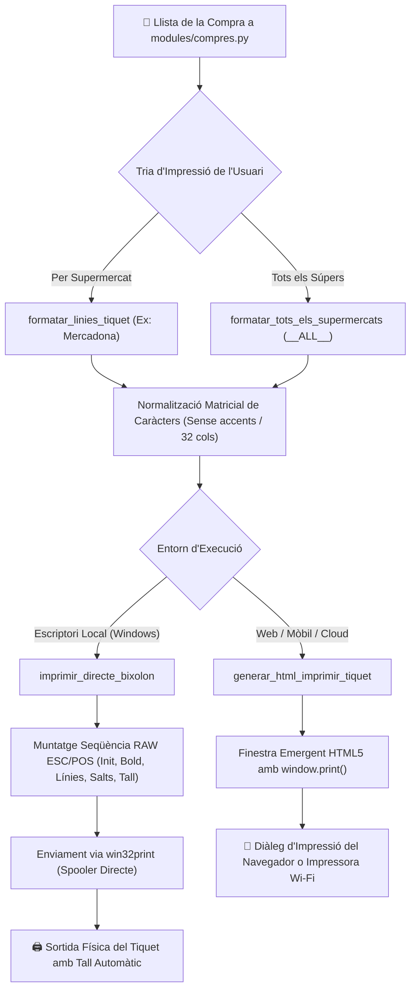

---

## 8. Annex: Historial de Canvis Recents Consolidat

| Data | Mòdul Afectat | Descripció del Canvi Consolidat |
|:---|:---|:---|
| **29/10/2026** | **Econòmic / Dashboard** | **Control de Data de l'Apunt al Modal de Confirmació**: Integrat selector de data (`st.date_input`) amb format `dd/mm/aaaa` per a cadascun dels pagaments i ingressos seleccionats al diàleg `dialog_confirmar_operacions`. S'ha incorporat un control estricte que limita la data obligatòriament a l'interval del mes corresponent (`min_value` i `max_value` entre el dia 1 i l'últim dia de mes), amb validació de bloqueig al servidor i actualització coordinada a `despeses`, `tr_cartera` i taules de previsió. |
| **28/10/2026** | **Llum / Factures** | **Normalització de Dates a `dd/mm/aaaa` i Parser Resilient**: Conversió dels 44 registres històrics de `data/consum_llum.json`, `csv/consum_llum.csv` i Supabase ID=9 de format ISO a `dd/mm/aaaa` (`dataFactura`, `periodeInici`, `periodeFi`). Implementada la funció de suport `_parse_dmy_or_iso()` a `modules/llum_aigua.py` per garantir una lectura i edició 100% resilient dels períodes de facturació. |
| **28/10/2026** | **Nucli / Editor JSON** | **Neteja d'Arxius Temporals Obsolets**: Eliminats els fitxers temporals obsolets d'antigues importacions de receptes (`pending_13.json`, `pending_13_real.json`, `missing_recipes.json`), netejant el menú superior desplegable `Editar > 📂 Arxius JSON` per mostrar exclusivament els fitxers de dades actius de l'aplicació. |
| **28/10/2026** | **Documentació Global** | **Auditoria i Documentació Exhaustiva de la Secció 7**: Desglossament complet d'Administració (12 seccions estil Chrome Settings), Laboratori IA Harness (8 avaluadors deterministes i execució en segon pla), Gestor de Bases de Dades en temps real, Sincronització Offline i Controlador d'Impressora ESC/POS. |
| **27/10/2026** | **Cotxe / Km i Rutes** | **Control Estricte d'Odòmetre**: Bloqueig i validació perquè els kilòmetres entrats a una nova ruta mai puguin ser iguals o inferiors a l'última lectura registrada de l'odòmetre (`contador_val > last_km`), amb avís dinàmic en vermell, indicador de trajecte invàlid i protecció tant a l'entrada manual com a l'escaneig per foto OCR. |
| **26/10/2026** | **Llum i Aigua / Preus** | **Registre Persistent de Preus Horaris PVPC i Auditoria Factura**: Creat el registre diari `data/preus_llum_diaris.json` (accessible des del menú superior *Editar > 📂 Arxius JSON* sense afegir noves pestanyes), gravació automàtica continuada de les 24h de cada dia, funció de contrast de consums i auditoria completa de la factura 10-2026 (66,59 €, 449,572 kWh amb 25h de preus negatius). |
| **28/10/2026** | **Compres / Escàner** | **Integració 1-Clic d'Escaneig a Compres**: Afegits botons `🖨️ Obrir Escàner` i `📥 Carregar últim tiquet` a `modules/compres.py`, encapsulament `LocalFileWrapper` i fallback automàtic de supermercat i data des del nom de fitxer (`tickets/ticket_<super>_<date>.jpg`). |
| **28/10/2026** | **Cotxe / Odòmetre** | **Validació Estricta de Km**: Bloqueig d'entrades de quilòmetres inferiors o iguals al darrer registre a `modules/cotxe.py` amb alerta visual vermella en temps real. |
| **28/10/2026** | **Llum / PVPC** | **Registre Diari de Preus PVPC**: Implementació de registre horari persistent a `data/preus_llum_diaris.json` i funcions de contrast de consum a `core/llum_manager.py`. |
| **25/10/2026** | **Escaneig Tiquets** | **Restauració escaneig directe 1-clic**: Nou motor natiu WinRT ([`scan_winrt.ps1`](file:///e:/Dashboard/scan_winrt.ps1)), superant l'antiga fallada de bloqueig temporal WIA (`ERROR_SHARING_VIOLATION` / `0x80030070`). Eliminats botons secundaris a [`auto_scan_ui.py`](file:///e:/Dashboard/auto_scan_ui.py) deixant només `🖨️ Escanejar Tiquet`. |
| **25/10/2026** | **Cotxe / Manteniment** | **Seccions Col·lapsables**: Totes les seccions de la pestanya *Manteniment* transformades en blocs plegables independents (`st.expander`) amb badges informatius en temps real als encapçalaments i control de desplegament global. |
| **24/10/2026** | **Rendiment Core** | **Pla d'optimització de 30 dies**: Finestra activa de 30 dies a Supabase + arxiu històric en CSV amb memòria cau de 24h per a taules massives. Eliminats els buidats massius de cau, passant de bloquejos de 20s a càrregues en menys d'1s. |
| **24/10/2026** | **Compres Super** | **Model Matemàtic de Preu Final Fix ($PF = B \times (1 - d)$)**: Enginyeria inversa de promocions a la càrrega manual de línies, mantenint el Total Línia invariable i fidel al tiquet de caixa. |
| **24/10/2026** | **Llum i Aigua** | **Estudi Solar PVGIS i Acumuladors**: Integrat simulador fotovoltaic amb dades oficials de radiació solar, desdoblament d'acumuladors tèrmics amb persistència a `data/acumuladors_config.json`, i ingesta històrica de factures elèctriques en PDF. |
| **23/10/2026** | **Llum i Aigua** | **Creació del Mòdul '💡 Llum i Aigua'**: Preus PVPC horaris en directe, gestió de factures elèctriques i d'aigua amb visor natiu PDF.js i sincronització a Supabase IDs 9 i 10. |
| **22/10/2026** | **Cotxe** | **Control de Nivells**: Secció independent per a la revisió de líquids del vehicle (oli, refrigerant, frens, eixugaparabrises) amb planificacions i alertes per km i temps. |
| **22/10/2026** | **Agenda** | **Control Fet/No Fet i Mòbil 1 Línia**: Botons interactius `✅`/`❌` amb colors sòlids vibrants i regles CSS `:has(.cal-action-btn)` per mantenir les 5 accions en una sola fila horitzontal a telèfons mòbils. |
| **21/10/2026** | **Manteniment Llar** | **Tasques Periòdiques i Subtasques**: Generació en sèrie de tasques recurrents, subtasques amb cadència pròpia i generador interactiu de tasques per al proper any al menú superior. |
| **19/10/2026** | **Manteniment Llar** | **Gestió Documental (Manuals i Garanties)**: Dipòsit de documents PDF amb visor interactiu HTML5 Canvas (PDF.js) i semàfor de venciment de garanties. |
| **18/10/2026** | **Econòmic / Compres** | **Navegació Nativa per Pestanyes**: Ús del paràmetre natiu `default` a `st.tabs`, creació de botons túnel bidireccionals i quantitat editable a destí per a traspassos de comptes. |
| **17/10/2026** | **Compres Super** | **Blindatge de Dates i Suport PDF**: Sanejament de dates contra errors matricials d'OCR, bloqueig de dates futures, extracció nativa de PDFs de supermercat amb `pypdf` i nous models Gemini. |
| **16/10/2026** | **Econòmic** | **Pagues Extres i Nou Any Comptable**: Incorporació de pagues extres i selector d'anys a 3 bandes ([any-1, any, any+1]) amb projeccions visuals. |
| **16/10/2026** | **Impressora** | **Impressora de Tiquets**: Integració d'impressió RAW ESC/POS de llistes de compra amb tall de paper i vista d'impressió web. |
| **18/09/2026** | **Nucli / BBDD** | **Arquitectura Offline**: Mode desconnectat amb cua local `sync_queue.json` i mòdul de consolidació de dades. |
| **13/09/2026** | **BBDD / Interfície** | **Gestor de Bases de Dades**: Creació de `modules/bases_dades.py` i barra de navegació superior d'escriptori amb 4 menús clàssics. |
